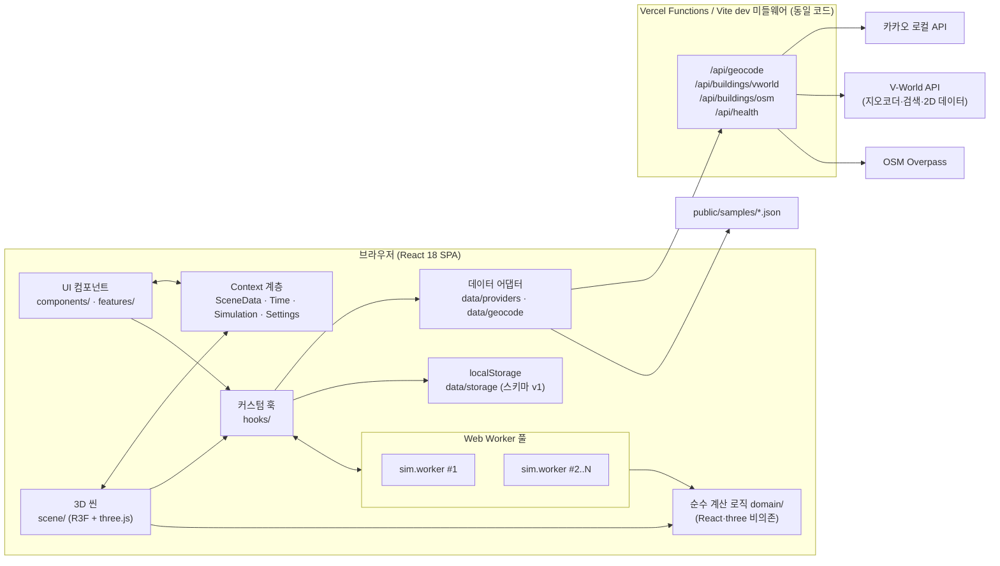
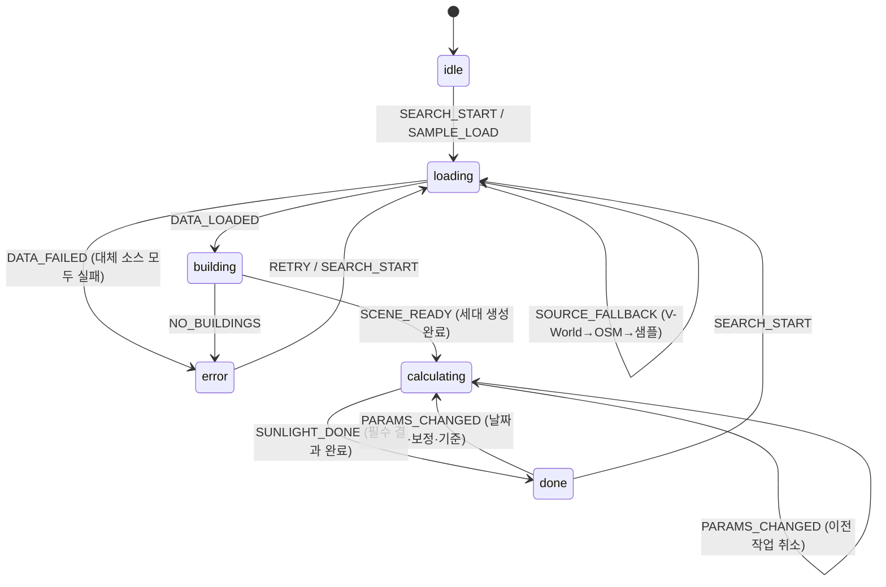

# PLAN.md — 전국 단위 3D 아파트 단지 일조량 시뮬레이터

> 문서 상태: **초안 v1 (검토 요청)** · 작성일 2026-11-04
> 승인 전에는 구현을 시작하지 않는다.

## 0. 확정된 결정 사항과 검토가 필요한 제안

### 0.1 확정 (질문 답변 반영)

| 항목 | 결정 |
|---|---|
| 지오코딩 | **카카오 로컬 API 우선**, 실패·키 없음일 때 **V-World 지오코더/검색 API**로 대체 |
| 스타일 | **CSS Modules** + CSS 변수(디자인 토큰) + 미디어 쿼리 |
| 배포 | **Vercel** (정적 빌드 + `/api` 서버리스 함수 프록시) |
| API 키 | 아직 없음 → 1일차에 발급·실측 검증 |
| 샘플 지역 | 아래 6.4절에서 제안 (서울·부산·세종 3곳) |

### 0.2 요구사항 원문과 다르게 제안하는 점 (승인 필요)

1. **API 키에 `VITE_` 접두사를 붙이지 않는다.**
   Vite는 `VITE_`로 시작하는 환경변수를 클라이언트 번들에 그대로 넣는다. 카카오 REST 키나 V-World 키에 이 접두사를 붙이면 배포본 JS에서 키가 그대로 보인다.
   → 비밀 키(`KAKAO_REST_API_KEY`, `VWORLD_API_KEY`, `VWORLD_DOMAIN`)는 **서버(프록시)에서만** 읽는다. 클라이언트용 비밀이 아닌 값(`VITE_FORCE_SAMPLE_MODE` 등)만 `VITE_` 접두사를 쓴다.
2. **개발 서버 프록시는 `server.proxy` 대신 Vite 플러그인 미들웨어로 구현한다.**
   Vercel 함수와 **같은 핸들러 코드**를 dev 서버에 연결해, 로컬과 배포 환경의 동작을 똑같이 맞춘다.
3. **React 18 고정에 따른 버전 고정**: `@react-three/fiber` v9는 React 19가 필요하다. 그래서 **fiber 8.x와 drei 9.x**로 고정한다. 정확한 버전은 1일차 `npm view`로 확인한 뒤 `package.json`에 고정한다.
4. **샘플 데이터는 OSM 기반으로 만든다.** V-World 지오코더 문서에는 결과를 실시간으로만 쓰고 저장하지 말라는 조항이 있다. 2D 데이터 API의 저장·재배포 조건은 **확인 필요** 상태다. 그래서 저장소에 커밋하는 샘플 JSON은 **OSM(ODbL, 출처 표기)** 데이터로 만들고, 층수가 비어 있으면 보정값(추정 표시)을 쓴다.
5. **(선택, 결정 요청) 키 없는 실시간 모드**: Nominatim(OSM 지오코더)과 Overpass를 쓰면 API 키가 없어도 전국 검색을 체험할 수 있다. 원 요구사항에는 없는 항목이다. Nominatim 사용 정책은 초당 1건, 자동완성 금지, 식별 가능한 UA 필요다. 채택하면 "키 없음 → 샘플 모드" 대신 "키 없음 → 샘플 모드 + OSM 실시간 검색(실험적)"이 된다. **승인하면 계획에 넣고, 승인하지 않으면 제외한다.**

---

## 1. 과제 필수 요구사항 충족 매핑표

> README.md에도 이 표를 그대로 넣는다. 각 파일 상단에 `// [요구사항: 상태관리]` 같은 한국어 주석 태그를 달아, 채점자가 `grep "[요구사항:"` 한 번으로 위치를 찾을 수 있게 한다.

| # | 항목 | 충족 파일 | 컴포넌트 / 훅 | 구체적 사용 예 |
|---|---|---|---|---|
| 1 | 개발 프레임워크: React | `src/main.tsx`, `src/App.tsx`, `vite.config.ts` | `App`, `AppProviders` | Vite + React 18 `createRoot`, StrictMode |
| 2 | 개발 언어: TypeScript | `tsconfig.json`(`strict: true`, `noUncheckedIndexedAccess`), 전체 `*.ts(x)` | 도메인 타입 `src/domain/types.ts` | `Building`, `Unit`, `SunPosition` 등 모든 도메인 모델과 Worker 메시지를 판별 유니온 타입으로 정의 |
| 3 | 컴포넌트: 기능별 분리 | `src/components/**`, `src/scene/**`, `src/features/**` | `SearchBar`, `SceneCanvas`, `Buildings`, `SunLight`, `SunPathDome`, `UnitHeatmap`, `TimeControls`, `UnitDetailPanel`, `FloorCompareChart`, `Legend`, `FavoritesPanel`, `OnboardingTour`, `AppLayout` 등 약 40개 | 4장 컴포넌트 트리 참조 |
| 4 | 상태관리: useState | 모든 UI 컴포넌트, `src/contexts/*` | `SearchBar`(`query`, `isOpen`), `DongHoSearch`(`input`, `error`), `TimeControls`, `HeightCorrectionForm`(`floorsInput`), `MobileLayout`(`activeTab`), `SettingsProvider`(`useState`), `SimulationProvider`(`useReducer`) | **zustand·redux 등 외부 상태 라이브러리 사용 0개.** 지역 상태는 `useState`, 상태 전이는 `useReducer`, 공유 상태는 Context(Provider 내부도 useState/useReducer) |
| 5 | 이벤트 처리 | `SearchBar.tsx`, `TimeSlider.tsx`, `PlaybackButton.tsx`, `BuildingMesh.tsx`, `UnitHeatmap.tsx`, `HeightCorrectionForm.tsx`, `FavoritesPanel.tsx`, `useKeyboardShortcuts.ts`, `useBreakpoint.ts` | — | `onChange`/`onSubmit`(검색, 동호수), `onChange`(날짜, 슬라이더), `onClick`(재생/정지, 즐겨찾기), R3F `onClick`/`onPointerOver`/`onPointerOut`(건물·세대), `keydown`(단축키), `resize`/`matchMedia change`(반응형) — 8장 이벤트 목록 참조 |
| 6 | Hooks | `src/hooks/*`, `src/features/*/use*.ts` | 기본: `useEffect`, `useMemo`, `useCallback`, `useRef`, `useContext`, `useReducer`, `useId`, `useSyncExternalStore`(미디어 쿼리) / **커스텀 훅 15개 이상** | `useGeocode`(AbortController cleanup), `useSunlightWorker`(Worker 생성·terminate), `useTimePlayback`(rAF cleanup), `useLocalStorage`(storage 이벤트 동기화) — 7장 참조 |
| 7 | 데이터 처리: 외부 API + 로컬 | `server/handlers/*`, `src/data/**`, `public/samples/*.json`, `src/data/storage/*` | `useGeocode`, `useBuildings`, `useLocalStorage` | **외부 API**: 카카오 로컬, V-World 지오코더·검색·2D 데이터(LT_C_BLDGINFO), OSM Overpass / **로컬**: 샘플 JSON 3종, localStorage(즐겨찾기·최근 검색·층수 보정·동 번호·설정·온보딩) |
| 8 | UI: 반응형 | `src/components/layout/*`, `src/styles/tokens.css`, `*.module.css`, `src/hooks/useBreakpoint.ts`, `src/config/quality.ts` | `AppLayout` → `DesktopLayout` / `TabletLayout` / `MobileLayout`, `BottomSheet` | 3단계 브레이크포인트(<768 / 768~1199 / ≥1200), 하단 시트·탭, 터치 회전·핀치 줌, 캔버스 자동 리사이즈, 기기 성능에 따라 그림자·샘플 밀도 자동 조정 |

---

## 2. 전체 아키텍처



**데이터 흐름 요약**

1. 검색어를 입력하면 `useGeocode`가 `/api/geocode`를 호출한다(카카오 → V-World 순서로 대체).
2. 받은 좌표로 `useBuildings`가 V-World 건물을 요청하고, 실패하면 OSM, 그것도 실패하면 샘플을 쓴다. 응답은 정규화한 뒤 localStorage의 보정값과 병합한다.
3. 건물을 로컬 좌표(m)로 변환하고 정리·돌출한다. 세대 샘플 지점 생성과 3D 렌더링은 메인 스레드가 맡는다.
4. 세대 목록과 건물 프리즘을 Worker에 전달해 일조 계산을 시작한다. 진행률이 표시되고, 결과는 `SimulationContext`에 저장된다.
5. 히트맵 색상, 기준 충족 여부, 통계는 `useMemo`로 파생해 화면에 표시한다.

---

## 3. 폴더 구조

```
React과제/
├─ api/
│  └─ index.ts                  # Vercel 단일 함수 진입점. pathname으로 라우팅 (vercel.json rewrites)
├─ server/                      # 서버 측 코드 (클라이언트 번들에 포함되지 않음)
│  ├─ router.ts                 # /api/* 라우팅 (Vercel·dev 공용)
│  ├─ handlers/
│  │  ├─ health.ts              # 키 존재 여부 → 샘플 모드 판단용
│  │  ├─ geocode.ts             # 카카오 → V-World 대체, 결과 정규화
│  │  ├─ vworldBuildings.ts     # LT_C_BLDGINFO 페이지 순회
│  │  └─ overpassBuildings.ts   # Overpass 미러 대체
│  ├─ http.ts                   # 타임아웃, 재시도, 에러 코드 표준화
│  └─ devApiPlugin.ts           # Vite configureServer 미들웨어로 router 연결
├─ public/
│  └─ samples/
│     ├─ index.json             # 샘플 목록 (이름, 좌표, 파일명, 출처)
│     ├─ seoul-jamsil.json
│     ├─ busan-marine-city.json
│     └─ sejong-hansol.json
├─ scripts/
│  └─ build-sample.ts           # Overpass로 샘플 JSON 생성 (+ 동 번호 수동 매핑 파일 병합)
├─ src/
│  ├─ main.tsx · App.tsx
│  ├─ config/
│  │  ├─ features.ts            # 기능 플래그 (B·C·D 기능 on/off)
│  │  ├─ constants.ts           # 기본 층고, 샘플 간격, 기준값
│  │  └─ quality.ts             # 기기 등급별 품질 프리셋 (그림자 맵, 샘플 수)
│  ├─ domain/                   # ★ 순수 TS: React·three 비의존, Worker·테스트 재사용
│  │  ├─ types.ts
│  │  ├─ time/kst.ts            # KST ↔ UTC, 율리우스일 (실행 PC 시간대와 무관하게 계산)
│  │  ├─ solar/solarPosition.ts · sunEvents.ts · sunPath.ts
│  │  ├─ geo/localProjection.ts
│  │  ├─ geometry/polygon.ts · prism.ts
│  │  ├─ spatial/uniformGrid.ts · rayCast.ts
│  │  ├─ units/generateUnits.ts · hoNumber.ts · parseDongHo.ts
│  │  ├─ analysis/visibility.ts · sunlight.ts · criteria.ts · skyView.ts
│  │  │           irradiance.ts · groundShadow.ts · season.ts
│  │  ├─ color/colorScale.ts
│  │  └─ hash.ts                # 건물 ID 해시(FNV-1a), 캐시 키
│  ├─ data/
│  │  ├─ providers/BuildingProvider.ts · vworldProvider.ts · osmProvider.ts · sampleProvider.ts
│  │  ├─ geocode/geocodeClient.ts · sampleGeocoder.ts
│  │  ├─ normalize/vworld.ts · osm.ts · validate.ts   # 응답 검증 → 도메인 모델
│  │  └─ storage/schema.ts · migrate.ts                # localStorage 스키마·마이그레이션
│  ├─ workers/
│  │  ├─ sim.worker.ts          # 메시지 수신 → domain 함수 호출
│  │  ├─ protocol.ts            # 메시지 타입 (판별 유니온)
│  │  ├─ workerPool.ts          # N개 Worker 관리
│  │  └─ jobQueue.ts            # 우선순위 큐 + 취소 정책
│  ├─ contexts/
│  │  ├─ SceneDataContext.tsx   # 위치·건물·보정·동 번호
│  │  ├─ TimeContext.tsx        # 날짜·시각·재생
│  │  ├─ SimulationContext.tsx  # 계산 상태(useReducer)·결과
│  │  ├─ SettingsContext.tsx    # 레이어·기준값·층고·테마
│  │  └─ AppProviders.tsx
│  ├─ reducers/simulationReducer.ts · playbackReducer.ts
│  ├─ hooks/                    # 범용 커스텀 훅 (7장)
│  ├─ components/               # 범용 UI
│  │  ├─ layout/ (AppLayout, DesktopLayout, TabletLayout, MobileLayout, BottomSheet, Panel)
│  │  ├─ search/ (SearchBar, SearchResultList, DataSourceBadge)
│  │  ├─ controls/ (DateControls, TimeSlider, PlaybackButton, LayerSelector)
│  │  ├─ detail/ (UnitDetailPanel, SunTimelineChart, CriteriaBadge, BuildingInfo)
│  │  ├─ legend/Legend.tsx
│  │  └─ common/ (ErrorBoundary, StatusBanner, ProgressBar, HelpTooltip, Modal,
│  │              LimitationsDialog, SettingsDialog, EmptyState)
│  ├─ scene/                    # R3F 컴포넌트
│  │  ├─ SceneCanvas.tsx · Buildings.tsx · BuildingMesh.tsx · Ground.tsx
│  │  ├─ SunLight.tsx · UnitHeatmap.tsx · SelectionHighlight.tsx
│  │  ├─ CameraRig.tsx · CompassRose.tsx · SceneErrorFallback.tsx
│  ├─ features/                 # 단계 B·C 기능 모듈 (플래그로 마운트 여부 결정)
│  │  ├─ dongHo/ (DongHoSearch, DongAssignDialog, useUnitLookup)
│  │  ├─ floorCompare/ (FloorCompareChart, useFloorStats)
│  │  ├─ sunPath/ (SunPathDome, SunInfoCard)
│  │  ├─ heightCorrection/ (HeightCorrectionForm)
│  │  ├─ favorites/ (FavoritesPanel, RecentSearches)
│  │  ├─ onboarding/ (OnboardingTour, useOnboarding, steps.ts)
│  │  ├─ windowView/ (WindowViewCamera, WindowViewControls)
│  │  ├─ groundShadow/ (GroundShadowLayer, GroundCellTooltip)
│  │  ├─ skyView/ (skyView 레이어 연결)
│  │  ├─ irradiance/ (IrradiancePanel, SolarPotentialCard)
│  │  └─ seasonTimelapse/ (SeasonTimelapseControls, MonthlySummaryChart, useSeasonTimelapse)
│  ├─ styles/tokens.css · global.css
│  └─ test/fixtures/            # NOAA 기준값, 샘플 건물
├─ .env.example · vercel.json · vite.config.ts · vitest.config.ts · tsconfig.json
├─ PLAN.md · README.md
```

**폴더 의존 규칙** (ESLint `no-restricted-imports`로 강제)

- `domain/`은 `react`, `three`, `@react-three/*`, `src/` 내부 다른 폴더를 import할 수 없다.
- `workers/`는 `domain/`만 import한다.
- `features/*`끼리는 서로 import하지 않는다. 공용 코드는 `hooks/`, `components/`로 올린다.

---

## 4. 컴포넌트 설계

### 4.1 컴포넌트 트리

```
<App>
 └ <ErrorBoundary scope="app">
   └ <AppProviders>   (Settings → SceneData → Time → Simulation 순서로 중첩)
     └ <AppLayout>    (useBreakpoint로 아래 셋 중 하나를 렌더)
       ├ <DesktopLayout>
       │  ├ <ControlPanel> (좌)
       │  │  ├ <SearchBar> → <SearchResultList>
       │  │  ├ <DataSourceBadge>          (V-World / OSM / 샘플 표시)
       │  │  ├ <DongHoSearch>             [B1]
       │  │  ├ <DateControls>             (프리셋: 동지·춘분·하지·추분, date input)
       │  │  ├ <TimeSlider> + <PlaybackButton>
       │  │  ├ <LayerSelector>            (일조 / 천공률[C9] / 일사량[C10] / 지면 그림자[C8])
       │  │  ├ <SeasonTimelapseControls>  [C11]
       │  │  └ <FavoritesPanel> + <RecentSearches>  [B5]
       │  ├ <SceneArea> (중앙)
       │  │  ├ <ErrorBoundary scope="scene" fallback={<SceneErrorFallback>}>
       │  │  │  └ <SceneCanvas>
       │  │  │     ├ <CameraRig> | <WindowViewCamera> [C7]
       │  │  │     ├ <SunLight>
       │  │  │     ├ <Ground> + <GroundShadowLayer> [C8]
       │  │  │     ├ <Buildings> → <BuildingMesh>×N
       │  │  │     ├ <UnitHeatmap>        (InstancedMesh)
       │  │  │     ├ <SelectionHighlight>
       │  │  │     ├ <SunPathDome>        [B3]
       │  │  │     └ <CompassRose>
       │  │  ├ <StatusBanner>  (샘플 모드·에러·계산 진행률)
       │  │  ├ <Legend>
       │  │  └ <SceneToolbar> (카메라 리셋, 창문 시점[C7], 도움말, 한계 안내, 설정)
       │  └ <DetailPanel> (우)
       │     ├ <BuildingInfo> + <HeightCorrectionForm>[B4] + <DongAssignDialog>[B1]
       │     ├ <UnitDetailPanel> → <SunTimelineChart>, <CriteriaBadge>, SVF·일사량 수치
       │     ├ <FloorCompareChart>        [B2]
       │     ├ <SunInfoCard>              [B3]
       │     ├ <SolarPotentialCard>       [C10]
       │     └ <MonthlySummaryChart>      [C11]
       ├ <TabletLayout>  (상단 바 = 검색·날짜·시각, 접이식 우측 시트 = DetailPanel)
       └ <MobileLayout>  (전체 화면 Canvas + <BottomSheet> 탭: 컨트롤 / 세대 정보 / 분석)
     ├ <OnboardingTour> [B6]  (포털)
     ├ <LimitationsDialog> · <SettingsDialog>  (포털)
```

> 레이아웃 셋은 **같은 하위 컴포넌트를 배치만 다르게** 재사용한다. 브레이크포인트가 바뀌어도 `SceneCanvas`가 다시 마운트되지 않도록, 캔버스는 `AppLayout`에서 한 번만 만들고 레이아웃별 슬롯에 CSS grid area로 배치한다.

### 4.2 컴포넌트별 명세 (주요 컴포넌트)

| 컴포넌트 | props | 책임 | 사용 Hooks | 처리 이벤트 |
|---|---|---|---|---|
| `AppLayout` | — | 브레이크포인트별 레이아웃 선택, 캔버스 단일 인스턴스 유지 | `useBreakpoint`, `useState`(패널 접힘) | resize(훅 내부) |
| `SearchBar` | `onSelectPlace(place)` | 검색어 입력, 후보 목록 열기·닫기, 최근 검색 저장 | `useState`(query, isOpen, activeIndex), `useGeocode`, `useLocalStorage`(recent), `useRef`(input), `useId` | `onChange`, `onSubmit`, `onKeyDown`(↑↓ Enter Esc), `onBlur` |
| `SearchResultList` | `results`, `activeIndex`, `onPick` | 후보 표시(주소/장소 구분 아이콘) | — | `onClick`, `onMouseEnter` |
| `DataSourceBadge` | — | 현재 데이터 출처·추정값 비율 표시, 샘플 모드 안내 | `useSceneData` | `onClick`(출처 설명 툴팁) |
| `DateControls` | — | 날짜 선택, 절기 프리셋 버튼 | `useTime`, `useMemo`(올해 절기 날짜) | `onChange`(date), `onClick`(프리셋) |
| `TimeSlider` | — | 일출~일몰 범위 슬라이더(분 단위), 현재 시각·고도 표시 | `useTime`, `useSunPosition`, `useState`(드래그 중 임시값) | `onChange`, `onPointerDown/Up` |
| `PlaybackButton` | — | 하루 재생/정지, 속도 선택 | `useTimePlayback` | `onClick` |
| `LayerSelector` | — | 히트맵 레이어 전환(활성 플래그 레이어만 노출) | `useSettings` | `onChange`(radio) |
| `SceneCanvas` | `quality` | R3F Canvas, dpr 상한, 그림자 설정, 포인터 미스 시 선택 해제 | `useQuality`, `useSceneData` | `onPointerMissed` |
| `Buildings` / `BuildingMesh` | `building`, `selected`, `corrected` | 돌출 지오메트리 생성(`useMemo`), 보정 건물 외곽선 강조 | `useMemo`, `useState`(hover), `useCursor`(drei) | `onClick`, `onPointerOver`, `onPointerOut` |
| `UnitHeatmap` | `units`, `values`, `colorScale` | InstancedMesh 창문 패치, `instanceColor` 갱신, 선택·호버 | `useRef`(InstancedMesh), `useEffect`(색상 갱신), `useMemo`(행렬) | `onClick`(instanceId → unit), `onPointerMove`, `onPointerOut` |
| `SunLight` | — | 태양 방향 DirectionalLight, 그림자 카메라 범위를 장면 반경에 맞춤 | `useSunPosition`, `useRef`, `useFrame`, `useMemo` | — |
| `CameraRig` | — | OrbitControls(터치 회전·핀치), fly-to | `useCameraFlyTo`, `useThree`, `useRef` | 컨트롤 `onStart`(fly-to 중단) |
| `UnitDetailPanel` | `unitId` | 건물·층·방향·호수, 총/연속 일조, 기준 충족, SVF, 일사량 | `useSimulation`, `useMemo`(통계), `useState`(탭) | `onClick`(창문 시점, 층별 비교 열기) |
| `SunTimelineChart` | `timeline`, `stepMin`, `window` | 하루 일조 여부 막대(recharts BarChart), 기준 구간 음영, 현재 시각 표시선 | `useMemo` | `onClick`(막대 → 해당 시각으로 이동) |
| `Legend` | `layer` | 색상 스케일, 단위, 최소/최대 | `useSettings`, `useMemo` | — |
| `StatusBanner` | — | idle/loading/building/calculating/done/error 상태, 진행률, 재시도 | `useSimulation` | `onClick`(재시도, 샘플 모드 전환, 닫기) |
| `ErrorBoundary` | `scope`, `fallback` | 하위 렌더 오류 포착, 재시도 키 리셋 | 클래스 컴포넌트(에러 바운더리는 Hooks로 구현 불가, README에 이유 명시) | `onClick`(다시 시도) |
| `BottomSheet` | `snapPoints`, `children` | 모바일 하단 시트(접힘·중간·전체), 드래그 핸들 | `useState`(snap), `useRef`(드래그 시작 Y) | `onPointerDown/Move/Up`, `onKeyDown` |

(B·C 기능 컴포넌트 명세는 12장의 기능별 명세에 함께 적는다.)

---

## 5. 상태 설계

### 5.1 배치 원칙

| 구분 | 위치 | 상태 |
|---|---|---|
| **지역 useState** | 각 컴포넌트 | 검색어 `query`, 후보 드롭다운 `isOpen`·`activeIndex`, 동호수 입력 `dongHoInput`·`dongHoError`, 호버 세대 `hoveredUnitId`, 호버 건물, 패널 접힘 `isDetailOpen`, 모바일 탭 `activeTab`, 하단 시트 `snap`, 층수 보정 폼 `floorsInput`·`formError`, 즐겨찾기 이름 편집 `editingId`·`draftName`, 온보딩 단계 `stepIndex`(useOnboarding 내부), 슬라이더 드래그 임시값 |
| **useReducer** | `SimulationContext`, `useTimePlayback`, `useSeasonTimelapse` | 시뮬레이션 상태 머신, 계산 종류별 진행률, 재생 상태 |
| **Context (useState 기반)** | `SceneDataContext`, `TimeContext`, `SettingsContext` | 위치, 건물, 보정값, 동 번호, 선택 건물·세대, 카메라 모드, 날짜·시각, 레이어, 기준값, 층고, 품질 |
| **useRef + useFrame** | 3D 컴포넌트 | 카메라 보간 진행값, 재생 중 프레임 누적 시간, 태양 광원 위치 보간 |
| **useMemo 파생값 (상태로 저장하지 않음)** | 사용처 | 히트맵 색상 배열, 기준 충족 여부, 층별 통계, 단지 순위, 범례 범위, 로컬 좌표 변환 건물, 세대 목록, 태양 경로 점 |

### 5.2 Context 분리 (리렌더링 최소화)

각 Context는 **state Context와 actions Context를 분리**한다. actions는 `useCallback`/`useMemo`로 참조를 안정적으로 유지해, 버튼처럼 동작만 쓰는 컴포넌트가 상태 변화 때문에 다시 렌더링되지 않게 한다.

| Context | 상태 (Provider 내부 구현) | 변경 빈도 | 주요 소비자 |
|---|---|---|---|
| `SettingsContext` | `useState`: `layer`, `criteria{winStart,winEnd,contMin,totalStart,totalEnd,totalMin}`, `floorHeight`, `stepMinutes`, `qualityOverride`, `theme` (localStorage 동기화) | 낮음 | LayerSelector, Legend, 계산 훅 |
| `SceneDataContext` | `useState`: `place{name,lat,lng}`, `rawBuildings`, `source`, `selectedBuildingId`, `selectedUnitId`, `cameraMode` / `useLocalStorage`: `corrections`, `dongAssignments` / `useMemo`: `buildings`(보정 병합 + 로컬 좌표), `units`, `sceneHash` | 중간 | 씬, 패널, 동호수 검색 |
| `TimeContext` | `useState`: `date`(YYYY-MM-DD, KST), `minuteOfDay`, `isPlaying` | **높음**(재생 중 초당 수십 회) | TimeSlider, SunLight, SunPathDome 마커, 타임라인 표시선 |
| `SimulationContext` | `useReducer(simulationReducer)`: `phase`, `progress{sunlight,skyView,irradiance,ground,season}`, `error`, `results{sunlight?, skyView?, irradiance?, ground?, season?}` | 중간 | 히트맵, 패널, 차트, 배너 |

> 재생 중 `minuteOfDay`가 자주 바뀌어도 **히트맵 색상은 하루 누적 결과라서 바뀌지 않는다.** 따라서 TimeContext를 구독하는 곳은 시각 표시 관련 컴포넌트 몇 개뿐이다. `SunLight`는 TimeContext 값을 `useRef`에 옮겨 두고 `useFrame`에서 부드럽게 보간한다.

### 5.3 시뮬레이션 상태 머신 (`simulationReducer`)



액션 타입(판별 유니온):
`SEARCH_START | SOURCE_FALLBACK | DATA_LOADED | DATA_FAILED | NO_BUILDINGS | SCENE_READY | JOB_STARTED{kind,jobId} | PROGRESS{kind,done,total} | RESULT{kind,payload} | JOB_CANCELLED{kind} | JOB_FAILED{kind,error} | PARAMS_CHANGED{invalidate:Kind[]} | RETRY | RESET`

- `phase`는 **필수 결과(일조)** 기준으로 정한다. 천공률·일사량 같은 부가 계산은 `progress[kind]`로만 표시하고, 실패해도 `phase`를 error로 바꾸지 않는다(부분 실패 허용).
- reducer는 순수 함수라서 vitest로 상태 전이 테스트를 쓴다.

### 5.4 상태 흐름 예시: 날짜 변경

`DateControls onChange` → `TimeContext.setDate` → `useSunlightWorker`의 `useEffect([date, sceneHash, criteriaKey])` 실행 → 진행 중인 일조·일사·지면 작업 `cancel`(천공률은 날짜와 무관하므로 유지) → 캐시 조회, 없으면 `JOB_STARTED` → `PROGRESS`… → `RESULT` → `UnitHeatmap`의 `useMemo(colors)` 재계산 → `instanceColor.needsUpdate`

---

## 6. 데이터 소스

### 6.1 API 명세

> 범례: ✅ 공식 문서로 확인함 / ⚠️ 확인 필요 (1일차 실측으로 확정)

#### (1) 카카오 로컬 — 주소 검색 ✅

- `GET https://dapi.kakao.com/v2/local/search/address.json`
- 헤더: `Authorization: KakaoAK {REST_API_KEY}`
- 파라미터: `query`(필수), `analyze_type`(`similar`|`exact`, 기본 similar), `page`(1~45), `size`(1~30, 기본 10)
- 응답: `meta{total_count, pageable_count, is_end}`, `documents[]{address_name, address_type, x(경도, 문자열), y(위도, 문자열), address{…}, road_address{address_name, building_name, …}}`
- 쿼터: 일 100,000건(카카오맵 REST API 기준), 월 무료 3,000,000건(전체 합산) ✅
- ⚠️ 카카오 개발자 콘솔에서 앱별로 "카카오맵" 사용 설정을 켜야 하는지 1일차에 확인한다(쿼터 문서에 "처음 활성화한 앱에만 무료 쿼터" 언급이 있음).
- ⚠️ 브라우저 직접 호출 시 CORS 허용 여부는 공식 문서에 나와 있지 않다. 어차피 키를 숨기려고 프록시를 쓰므로 영향이 없다.

#### (2) 카카오 로컬 — 키워드 장소 검색 ✅ (단지명 검색의 주 경로)

- `GET https://dapi.kakao.com/v2/local/search/keyword.json`, 같은 헤더
- 파라미터: `query`(필수), `category_group_code`(선택), `x`,`y`,`radius`(0~20000m), `rect`, `page`(1~45), `size`(1~15, 기본 15), `sort`(`accuracy`|`distance`)
- 응답: `documents[]{id, place_name, category_name, category_group_code, address_name, road_address_name, x, y, distance?}`, `meta{total_count, pageable_count, is_end, same_name}`
- 프록시 전략: 주소 검색과 키워드 검색을 **병렬 호출**한 뒤 병합한다. 주소 결과를 먼저, 장소 결과 중 `category_name`에 "아파트"가 들어간 항목을 그다음에 놓고, 같은 좌표(10m 이내)는 중복 제거한다. 최대 10건을 반환한다.

#### (3) V-World 지오코더 2.0 ✅ (대체 1)

- `GET https://api.vworld.kr/req/address?service=address&request=GetCoord&version=2.0&crs=EPSG:4326&type={ROAD|PARCEL}&address={주소}&format=json&refine=true&simple=false&key={KEY}`
- 응답: `response.status`(`OK`|`NOT_FOUND`|`ERROR`), `response.result.point.x`(경도), `response.result.point.y`(위도), `response.refined.text`
- 오류 코드: `INVALID_KEY`, `INCORRECT_KEY`(도메인 불일치), `UNAVAILABLE_KEY`, `OVER_REQUEST_LIMIT`
- 제한: 일 40,000건. **결과는 실시간으로만 써야 하고 저장 장치·DB에 저장할 수 없다**는 조항이 있다(→ 6.5 즐겨찾기 정책).
- 전략: `ROAD`로 먼저 요청하고, `NOT_FOUND`이면 `PARCEL`로 다시 요청한다.

#### (4) V-World 검색 API 2.0 ✅ (대체 2: 단지명)

- `GET https://api.vworld.kr/req/search?service=search&request=search&version=2.0&type=PLACE&query={단지명}&size=10&page=1&crs=EPSG:4326&format=json&key={KEY}`
- `type`: `PLACE`|`ADDRESS`(이때 `category`=`ROAD`|`PARCEL` 필수)|`DISTRICT`|`ROAD`
- 응답: `status`, `result.items.item[]{title, point{x,y}, address{road, parcel}}`
- ⚠️ 응답 최상위에 `response` 래퍼가 있는지 문서 표만으로는 불분명하다. 1일차 실측으로 확정한다.

#### (5) V-World 2D 데이터 API 2.0 — 건축물정보 `LT_C_BLDGINFO` ✅ (건물 메인)

- `GET https://api.vworld.kr/req/data`
- 파라미터: `service=data`, `version=2.0`, `request=GetFeature`, `data=LT_C_BLDGINFO`, `key`, `domain`(키 발급 시 등록한 URL), `geomFilter`, `attrFilter`(선택), `columns`(선택), `geometry=true`, `attribute=true`, `buffer`(m, 기본 0), `crs=EPSG:4326`, `size`(1~1000, 기본 10), `page`(기본 1), `format=json`
- `geomFilter` 형식: `POINT(x y)`, `LINESTRING(...)`, `POLYGON((...))`, `MULTIPOLYGON(...)`, `BOX(minx,miny,maxx,maxy)`
- 요청 예: `geomFilter=BOX(127.0790,37.5080,127.0910,37.5170)&size=1000&page=1` → `page.total`까지 순회
  (대안: `geomFilter=POINT(lng lat)&buffer=400`. buffer가 EPSG:4326에서도 미터 단위로 동작하는지 ⚠️ 확인 필요)
- 속성(✅ 문서 확인): `bld_nm`(건물명), `dong_nm`(**건물 동 명칭 → 동 번호 자동 지정에 사용**), `usability`(용도), `strct_cd`, `grnd_flr`(**지상층수**), `ugrnd_flr`, `archarea`, `height`(**건물높이**), `vl_rat`, `bc_rat`, `totalarea`, `platarea`, `useapr_day`, `ag_geom`(지오메트리)
- 응답 공통: `response.status`, `response.record{total,current}`, `response.page{total,current,size}`, `response.result`(json이면 GeoJSON)
- ⚠️ 확인 필요: (a) GeoJSON 경로가 `response.result.featureCollection.features`인지, (b) 지오메트리 타입이 Polygon인지 MultiPolygon인지, (c) 피처 고유 ID 필드(`id`/`pnu` 등) 유무, (d) BOX 최대 면적 제한, (e) `height`가 0이나 빈 값으로 오는 비율, (f) `domain`을 서버 측 요청에서 쓸 때 localhost를 등록할 수 있는지
- 참고: 공개 프로젝트 사례에 따르면 이 레이어 응답에는 CORS 헤더가 없다고 한다 → 프록시 필수.
- 높이 결정 순서: `height > 0`이면 실측 높이를 쓴다(`heightSource: 'measured'`). 없으면 `grnd_flr × 층고`(`'floors'`). 둘 다 없으면 외곽선 면적 < 50m²는 1층, 그 이상은 5층 × 층고(`'default'`, **추정값** 표시).
- 1일차 실측 결과(`docs/api-verification.md`): GeoJSON 경로 `response.result.featureCollection.features`, 전부 MultiPolygon, ID `LT_C_BLDGINFO.<숫자>`, 숫자 속성도 문자열, 층수 누락 19~50%(대부분 소형 부속 건물), 공동주택 평균 층고 2.90m(잠실).

#### (6) OSM Overpass API ✅ (건물 대체)

- `POST https://overpass-api.de/api/interpreter`, body `data=<쿼리>`(x-www-form-urlencoded)
- 미러(대체): `https://overpass.private.coffee/api/interpreter`, `https://maps.mail.ru/osm/tools/overpass/api/interpreter`
- 쿼리:
  ```
  [out:json][timeout:25];
  ( way["building"](around:{R},{lat},{lng});
    relation["building"]["type"="multipolygon"](around:{R},{lat},{lng}); );
  out tags geom;
  ```
- 사용 태그: `building`, `building:levels`, `height`(m, "45 m" 같은 단위 포함 문자열을 파싱), `name`, `addr:housenumber`(아파트 동 번호가 들어 있는 경우가 있음), `building:part`는 무시
- 정책: 일 10,000쿼리·1GB 이하는 일회성 사용으로 허용, 정기 사용은 그 1/100 수준. 식별 가능한 `User-Agent`를 보내고, 병렬 요청을 금지하며, 429/406이면 30초 뒤 재시도. 서버가 과부하 상태라 신뢰성이 보장되지 않는다고 명시되어 있음 → 응답을 메모리·sessionStorage에 캐싱하고 미러로 대체한다.
- ⚠️ CORS: 공식 위키에 언급이 없다 → 프록시를 통해 호출한다.
- 출처 표기: "© OpenStreetMap contributors (ODbL)"를 화면 하단과 README에 표시한다.

### 6.2 프록시 전략

| 환경 | 구성 |
|---|---|
| 로컬 dev | `server/devApiPlugin.ts`가 Vite `configureServer`로 `/api/*`에 `server/router.ts`를 연결한다. 키는 `loadEnv(mode, cwd, '')`로 `.env.local`에서 읽는다(접두사 없음 → 클라이언트 번들 미포함) |
| Vercel | `api/index.ts`가 `export default { fetch(request) }`(Web 표준 핸들러)에서 `server/router.ts`를 호출한다. `vercel.json` rewrites로 `/api/(.*)` → `/api`. 환경변수는 Vercel 대시보드에서 설정 |
| 정적 호스팅·함수 없음 | `/api/health` 실패 → 자동 샘플 모드 |

프록시 공통 처리: 요청 타임아웃 8초(Overpass 25초), 1회 재시도, 업스트림 오류를 `{ok:false, code:'NO_KEY'|'UPSTREAM'|'TIMEOUT'|'NOT_FOUND'|'QUOTA', message}`로 표준화, 같은 요청에 대한 짧은 응답 캐시(`Cache-Control: s-maxage=3600`), 입력 검증(좌표 범위가 한국 bbox 안인지, 반경 ≤ 500).

내부 API(클라이언트 ↔ 프록시):

| 경로 | 요청 | 응답 |
|---|---|---|
| `GET /api/health` | — | `{kakao:boolean, vworld:boolean, time}` |
| `GET /api/geocode?q=` | 검색어 | `{ok:true, provider:'kakao'|'vworld', results: GeoResult[]}` |
| `GET /api/buildings/vworld?lat&lng&r` | 중심·반경 | `{ok:true, features: RawVworldFeature[], truncated:boolean}` |
| `GET /api/buildings/osm?lat&lng&r` | 중심·반경 | `{ok:true, elements: OverpassElement[]}` |

정규화(`src/data/normalize/*`)는 클라이언트에서 한다. 원시 응답 → `validate.ts`(타입 가드, 좌표·층수 범위 확인, 잘못된 피처 제외 후 개수 보고) → `Building`.

### 6.3 데이터 소스 추상화

```ts
interface BuildingProvider {
  readonly id: 'vworld' | 'osm' | 'sample';
  fetch(center: LatLng, radiusM: number, signal: AbortSignal): Promise<Building[]>;
}
// useBuildings: [vworld, osm] 순서로 시도 → 둘 다 실패하거나 0건이면 → 가장 가까운 샘플 제안
```

건물 ID: `source:원본ID`(V-World ID 필드가 없으면 ⚠️), 원본 ID가 없으면 `source:hash(정규화 외곽선 좌표를 소수 6자리로 반올림)`(FNV-1a 32bit, 16진수). 같은 건물을 다시 불러와도 같은 ID가 나오므로 localStorage 보정값이 다시 연결된다.

### 6.4 샘플 데이터

**제안 지역** (OSM 커버리지가 좋다고 예상되는 곳. ⚠️ 1일차에 Overpass로 확인하고 부족하면 교체)

| 파일 | 지역 | 선정 이유 |
|---|---|---|
| `seoul-jamsil.json` | 서울 송파구 잠실동 일대 대단지 (위도 약 37.51°) | 판상형·탑상형 혼합, 동 수가 많아 동·호수 검색과 층별 비교 시연에 적합 |
| `busan-marine-city.json` | 부산 해운대구 마린시티 (약 35.16°) | 초고층 주거 타워 → 긴 그림자, 천공률 차이가 큼 |
| `sejong-hansol.json` | 세종시 한솔동 일대 (약 36.48°) | 계획 신도시의 남향 판상형 → 기준 충족 층 분석이 명확 |

**스키마** (`schemaVersion` 포함)

```jsonc
{
  "schemaVersion": 1,
  "id": "seoul-jamsil",
  "name": "서울 잠실 (샘플)",
  "center": { "lat": 37.5123, "lng": 127.0850 },
  "radiusM": 400,
  "source": { "provider": "osm", "license": "ODbL 1.0", "attribution": "© OpenStreetMap contributors", "fetchedAt": "2026-11-05" },
  "buildings": [
    {
      "id": "osm:way/123456",
      "footprint": [[127.08401, 37.51234], [127.08455, 37.51230], "..."],  // [lng, lat], 닫힘 정점 없음
      "floors": 25,
      "heightM": null,
      "heightSource": "floors",           // measured | floors | default
      "dongNumber": "101",                 // 샘플은 전부 지정
      "name": "OO아파트 101동",
      "usage": "apartments"
    }
  ],
  "searchAliases": ["잠실", "송파 잠실동"]  // 샘플 모드 검색어 매칭
}
```

`public/samples/index.json`: `[{id, name, center, file, aliases}]`. 샘플 모드에서는 `sampleGeocoder`가 aliases를 부분 문자열로 매칭한다. 샘플 모드에서 검색창에 "샘플 지역 선택" 버튼 3개를 바로 보여 준다.

생성: `scripts/build-sample.ts`(Node, `tsx`로 실행) → Overpass 조회 → 정규화 → `scripts/dong-map/*.json`(수동 동 번호 매핑, 지도에서 확인해 작성)을 병합 → `public/samples/*.json` 저장. 데이터 정확성보다 **기능 시연 가능성**이 우선이며, README에 "샘플 층수·동 번호 일부는 시연용 보정값"이라고 명시한다.

### 6.5 localStorage 스키마

키 접두사 `sunsim:`, 각 값은 `{ v: number, data: T }` 형태로 감싸고, `migrate.ts`에서 버전별 변환 함수를 둔다. 파싱 실패나 알 수 없는 버전이면 기본값으로 초기화하고 콘솔이 아닌 화면 토스트로 알린다.

| 키 | 타입 (`data`) | 제한 |
|---|---|---|
| `sunsim:favorites` | `Favorite[]` = `{id, name, lat, lng, address, createdAt}` | 최대 50 |
| `sunsim:recentSearches` | `{query, label, lat, lng, provider, at}[]` | 최대 10, 중복 제거 후 맨 앞에 추가 |
| `sunsim:corrections` | `Record<buildingId, {floors:number, updatedAt}>` | — |
| `sunsim:dongAssignments` | `Record<buildingId, {dong:string, updatedAt}>` | — |
| `sunsim:settings` | `{theme, floorHeight, stepMinutes, criteria, qualityOverride, panelEfficiency}` | — |
| `sunsim:onboarding` | `{completed:boolean, completedAt?}` | — |

> V-World 지오코더 결과는 저장할 수 없다는 조항 때문에, `provider==='vworld'`인 검색 결과는 최근 검색에 **검색어만 저장**하고 좌표는 클릭할 때 다시 지오코딩한다. 카카오 결과 좌표 저장에 관한 약관은 ⚠️ 확인 필요(즐겨찾기는 사용자가 직접 저장하는 개인 데이터로 취급).

### 6.6 환경변수 (`.env.example`)

```
# 서버(프록시) 전용 — VITE_ 접두사 금지 (클라이언트 번들 노출 방지)
KAKAO_REST_API_KEY=
VWORLD_API_KEY=
VWORLD_DOMAIN=http://localhost:5173
# 클라이언트 플래그 (비밀 아님)
VITE_FORCE_SAMPLE_MODE=false
```

---

## 7. 커스텀 훅 명세

| 훅 | 입력 | 반환 | 내부 Hooks | cleanup / 비고 |
|---|---|---|---|---|
| `useGeocode()` | — (`search(q)` 호출 방식) | `{results, status:'idle'|'loading'|'success'|'empty'|'error', error, provider, search, reset}` | `useState`, `useRef`(AbortController), `useCallback`, `useEffect`(언마운트 시 abort) | 새 검색이 들어오면 이전 요청 abort. 샘플 모드면 `sampleGeocoder` 사용 |
| `useApiHealth()` | — | `{mode:'live'|'sample', reason, keys}` | `useState`, `useEffect`(마운트 시 1회 fetch) | abort, 3초 타임아웃 |
| `useBuildings(center, radius)` | `LatLng | null`, m | `{buildings, source, status, error, estimatedRatio, retry}` | `useState`, `useEffect([center, radius])`, `useRef`(abort, 메모리 캐시 Map) | 소스 대체 체인. 보정·동 번호 병합은 `SceneDataContext`의 `useMemo`에서 수행(관심사 분리) |
| `useSunPosition(lat, lng, date, minute)` | 숫자·문자열 | `{altitudeDeg, azimuthDeg, direction:[x,y,z], isUp}` | `useMemo` | 순수 함수 `solarPosition` 호출 |
| `useSunPath(lat, lng, date, stepMin=10)` | — | `{points:Vec3[], sunrise, sunset, solarNoon, noonAltitude}` | `useMemo` | 동지·하지 비교용으로 별도 날짜를 넘겨 여러 번 호출 |
| `useSunlightWorker()` | Context에서 sceneHash·units·date·settings 구독 | `{run(kind, params), cancel(kind), progress, results}` | `useEffect`(풀 생성 / 언마운트 시 `terminate`), `useRef`(pool, queue, cache), `useCallback`, `useContext`(SimulationContext dispatch) | 파라미터 변경 시 해당 kind 취소 → 재요청. 10장 참조 |
| `useTimePlayback()` | — | `{isPlaying, speed, toggle, setSpeed}` | `useReducer(playbackReducer)`, `useEffect`(rAF 루프 시작·정지, `cancelAnimationFrame`), `useRef`(마지막 타임스탬프) | 일몰에 도달하면 자동 정지. 탭이 숨겨지면(`visibilitychange`) 일시정지 |
| `useSeasonTimelapse()` | — | `{isPlaying, monthIndex, speed, play, pause, seek}` | `useReducer`, `useEffect`(interval), `useRef` | 아직 계산되지 않은 달이면 대기 상태 표시 |
| `useLocalStorage<T>(key, initial, opts)` | 키, 초기값, `{version, migrate}` | `[value, setValue, remove]` | `useState`(lazy init으로 읽기), `useEffect`(값 변경 시 쓰기), `useEffect`(`storage` 이벤트로 다른 탭과 동기화 / 리스너 해제) | 쓰기 실패(용량 초과·사생활 모드) 시 메모리 상태만 유지하고 경고 토스트 |
| `useUnitLookup()` | — | `{lookup(input) → {ok:true, unitId, buildingId} | {ok:false, reason:'FORMAT'|'NO_DONG'|'NO_FLOOR'|'NO_LINE'}}` | `useContext`(SceneData), `useMemo`(동 → 건물 인덱스, 호 → 세대 인덱스) | 파서는 `domain/units/parseDongHo.ts` |
| `useCameraFlyTo()` | — | `flyTo(target:{position, lookAt}, durationMs)` | `useThree`, `useRef`(시작·끝·진행), `useFrame`(easeInOutCubic 보간) | 사용자가 조작을 시작하면 보간 중단 |
| `useOnboarding()` | — | `{active, stepIndex, step, next, prev, skip, restart}` | `useState`(stepIndex, active), `useLocalStorage`(completed), `useEffect`(첫 방문 자동 시작, 앵커 요소가 보이도록 scrollIntoView) | 대상 요소는 `data-tour="search"` 속성으로 찾음 |
| `useMediaQuery(query)` | 미디어 쿼리 문자열 | `boolean` | `useSyncExternalStore`(matchMedia `change` 구독·해제) | SSR 고려 불필요, 초기값 동기 계산 |
| `useBreakpoint()` | — | `'mobile'|'tablet'|'desktop'` | `useMediaQuery` ×2 | — |
| `useQuality()` | — | `QualityPreset` | `useBreakpoint`, `useMemo`, `navigator.hardwareConcurrency`, 설정의 수동 오버라이드 | 3단계 프리셋 (9장) |
| `useKeyboardShortcuts(map)` | `Record<string, handler>` | — | `useEffect`(window `keydown` 등록·해제), `useRef`(최신 map 유지) | input·textarea 포커스 중에는 무시 |
| `useElementSize(ref)` | ref | `{width, height}` | `useState`, `useEffect`(ResizeObserver 연결·disconnect) | 차트 반응형 크기 |
| `useFloorStats(buildingId, line)` | — | `{floors:[{floor, unitId, minutes, meets}], firstMeetingFloor}` | `useMemo`, `useContext` | B2 |

---

## 8. 이벤트 처리 목록

| # | 이벤트 | 위치 | 핸들러 | 상태 변화 |
|---|---|---|---|---|
| 1 | 검색어 입력 `onChange` | `SearchBar` | `handleQueryChange` | `query` (useState) |
| 2 | 검색 제출 `onSubmit` | `SearchBar` | `handleSubmit`(preventDefault) | `useGeocode.search` → `results`, `isOpen=true` |
| 3 | 후보 키보드 이동 `onKeyDown` ↑↓/Enter/Esc | `SearchBar` | `handleKeyDown` | `activeIndex`, 선택 또는 닫기 |
| 4 | 후보 클릭 `onClick` | `SearchResultList` | `onPick` | `SceneData.place`, 최근 검색 추가, `SEARCH_START` |
| 5 | 동호수 입력 `onChange`/`onSubmit` | `DongHoSearch` | `handleChange`, `handleSubmit` | `input`, `error` / 성공 시 `selectedUnitId` + `flyTo` |
| 6 | 날짜 선택 `onChange` | `DateControls` | `handleDateChange` | `Time.date` → 재계산 |
| 7 | 절기 프리셋 `onClick` | `DateControls` | `handlePreset(kind)` | `Time.date` |
| 8 | 시각 슬라이더 `onChange` | `TimeSlider` | `handleMinuteChange` | `Time.minuteOfDay` (재생 중이면 정지) |
| 9 | 재생/정지 `onClick` | `PlaybackButton` | `toggle` | playback reducer `TOGGLE` |
| 10 | 건물 클릭 `onClick` (R3F) | `BuildingMesh` | `handleClick(e)` (`e.stopPropagation()`) | `selectedBuildingId`, 우측 패널 / 모바일 탭 전환 |
| 11 | 건물 호버 `onPointerOver/Out` | `BuildingMesh` | `setHovered` | 지역 `hovered`, 커서 pointer |
| 12 | 세대 클릭 `onClick` (instanceId) | `UnitHeatmap` | `handleUnitClick` | `selectedUnitId`, `selectedBuildingId` |
| 13 | 세대 호버 `onPointerMove/Out` | `UnitHeatmap` | `handleHover` | `hoveredUnitId` → 툴팁 (requestAnimationFrame으로 스로틀) |
| 14 | 빈 곳 클릭 `onPointerMissed` | `SceneCanvas` | `clearSelection` | 선택 해제 |
| 15 | 층수 보정 제출 `onSubmit`, 되돌리기 `onClick` | `HeightCorrectionForm` | `handleSubmit`, `handleReset` | `corrections`(localStorage) → buildings 재생성 → 재계산 |
| 16 | 동 번호 지정 `onSubmit` | `DongAssignDialog` | `handleAssign` | `dongAssignments`(localStorage) |
| 17 | 즐겨찾기 추가·이름 변경·삭제 `onClick`/`onSubmit` | `FavoritesPanel` | `add`, `rename`, `remove` | `favorites`(localStorage), `editingId` |
| 18 | 최근 검색 클릭·전체 삭제 | `RecentSearches` | `handlePick`, `clearAll` | 위치 이동 / 목록 비움 |
| 19 | 레이어 전환 `onChange` | `LayerSelector` | `setLayer` | `Settings.layer` → 필요 시 해당 계산 요청 |
| 20 | 층별 비교 막대 클릭 | `FloorCompareChart` | `handleBarClick` | `selectedUnitId` + flyTo |
| 21 | 타임라인 막대 클릭 | `SunTimelineChart` | `handleBarClick` | `Time.minuteOfDay` |
| 22 | 창문 시점 진입·복귀 `onClick`, 시야각 `onChange` | `WindowViewControls` | `enter`, `exit`, `setFov` | `cameraMode` |
| 23 | 키보드 단축키 `keydown` | `useKeyboardShortcuts`(App) | 아래 표 | 각 상태 |
| 24 | 창 크기·방향 변경 `resize`, `matchMedia change` | `useBreakpoint`, R3F 내부 | — | 레이아웃 전환, 캔버스 크기 |
| 25 | 하단 시트 드래그 `onPointerDown/Move/Up` | `BottomSheet` | `handleDrag*` | `snap` |
| 26 | 온보딩 다음·이전·건너뛰기 | `OnboardingTour` | `next`, `prev`, `skip` | `stepIndex`, `completed` |
| 27 | 탭 숨김 `visibilitychange` | `useTimePlayback` | — | 재생 일시정지 |
| 28 | 다른 탭에서 storage 변경 `storage` | `useLocalStorage` | — | 즐겨찾기 등 동기화 |

**키보드 단축키**: `Space` 재생/정지, `←`/`→` 10분 이동, `Shift+←/→` 1시간 이동, `1`~`4` 레이어 전환, `F` 선택 대상으로 카메라 이동, `Esc` 선택 해제·창문 시점 종료, `/` 검색창 포커스, `?` 단축키 도움말

---

## 9. 핵심 알고리즘

> 모든 함수는 `src/domain/`의 순수 함수다. 각 항목에 **수식 / 의사코드 / 복잡도 / 검증**을 적는다.
> 공통 기호: φ 위도, λ 경도(동경 +), δ 태양 적위, H 시간각, h 고도각, A 방위각(북=0°, 시계 방향).

### 9.1 태양 위치 (NOAA Solar Calculator 방식)

**시간 처리**: 입력은 KST 날짜와 그날 0시부터의 분(`minuteOfDay`)이다. 실행하는 PC의 시간대와 무관하도록 `Date`의 로컬 메서드를 쓰지 않고 `Date.UTC(y, m-1, d, 0, minuteOfDay - 540)`으로 UTC 밀리초를 계산한다(KST = UTC+9, 서머타임 없음).

율리우스일 `JD = ms / 86400000 + 2440587.5`, 율리우스 세기 `T = (JD − 2451545.0) / 36525`

```
L0 = (280.46646 + T(36000.76983 + 0.0003032 T)) mod 360        # 평균 황경
M  = 357.52911 + T(35999.05029 − 0.0001537 T)                   # 평균 근점이각
e  = 0.016708634 − T(0.000042037 + 0.0000001267 T)              # 궤도 이심률
C  = sin M (1.914602 − T(0.004817 + 0.000014 T))
   + sin 2M (0.019993 − 0.000101 T) + 0.000289 sin 3M           # 중심차
Θ  = L0 + C                                                      # 진황경
Ω  = 125.04 − 1934.136 T
λ☉ = Θ − 0.00569 − 0.00478 sin Ω                                 # 겉보기 황경
ε0 = 23 + (26 + (21.448 − T(46.815 + T(0.00059 − 0.001813 T)))/60)/60
ε  = ε0 + 0.00256 cos Ω                                          # 보정 황도경사
δ  = asin(sin ε · sin λ☉)                                        # 적위
y  = tan²(ε/2)
EoT = 4·deg( y sin2L0 − 2e sinM + 4e·y sinM cos2L0 − ½y² sin4L0 − 5/4 e² sin2M )   # 균시차 [분]
TST = minuteOfDay + EoT + 4λ − 60·tz        (tz = 9)             # 진태양시 [분]
H   = TST/4 − 180                                                # 시간각 [°]
cos θz = sin φ sin δ + cos φ cos δ cos H ;  h = 90° − θz
A   = (deg(atan2(sin H, cos H sin φ − tan δ cos φ)) + 180) mod 360
```

- **일출·일몰**: `cos H0 = cos 90.833° / (cos φ cos δ) − tan φ tan δ` (90.833° = 대기 굴절 34′ + 태양 반지름 16′). 남중(분) `= 720 − 4λ − EoT + 60·tz`, 일출 = 남중 − 4·H0, 일몰 = 남중 + 4·H0. δ와 EoT는 남중 시각으로 1회 반복 보정한다.
- **대기 굴절**: 일조 판정용 고도각은 **기하학적 고도(굴절 미적용)** 를 기본으로 한다(보수적, 한계 안내에 명시). 일출·일몰 시각만 NOAA 관례대로 90.833°를 쓴다. 설정에서 굴절 보정(Bennett 식)을 켤 수 있다.
- **로컬 방향 벡터** (9.2의 축 규칙): `d = (cos h sin A,  sin h,  −cos h cos A)`
- **복잡도**: O(1). 하루 10분 간격이면 144회. 날짜별로 미리 계산해 Worker에 배열로 넘긴다.
- **검증**:
  1. `suncalc`(devDependency, 테스트 전용)와 비교: 서울·부산·제주 × 동지·춘분·하지 × 06~18시 정각 → |Δh|, |ΔA| < 0.2° (suncalc는 저정밀 식이므로 허용 오차를 넉넉히 잡음)
  2. NASA/JPL Horizons(DE441, AIRLESS) 기준값(`src/test/fixtures/sun-reference.json`, 1일차 수집 — `docs/api-verification.md`) → |Δ| < 0.05°, 일출·일몰 ±1분
  3. 성질 테스트: 남중 시 A ≈ 180°, 하지 남중 고도 ≈ 90 − φ + 23.44°, 동지 ≈ 90 − φ − 23.44°
  4. 실행 시간대 독립성: `TZ=America/New_York vitest`로도 같은 결과(package.json 스크립트 `test:tz`)

### 9.2 좌표 변환 (지역 접평면, ENU 근사)

**축 규칙 (three.js 오른손 좌표계와 일치)**: 원점 = 검색 중심, **+x = 동**, **+y = 위**, **+z = 남**(즉 북 = −z), 단위 m

WGS84 (a = 6378137, e² = 0.00669437999014)에서 원점 위도 φ0의 곡률 반경을 쓴다.

```
M(φ0) = a(1 − e²) / (1 − e² sin²φ0)^{3/2}     # 자오선 곡률 반경
N(φ0) = a / (1 − e² sin²φ0)^{1/2}             # 묘유선 곡률 반경
x =  N cos φ0 · (λ − λ0)
z = −M · (φ − φ0)
```

- **오차 분석**: 이 근사는 원점에서 거리 d에 대해 2차 항까지 무시한다. 주요 항은 cos φ의 위도 변화로 인한 x 오차 `Δx ≈ x · tan φ0 · Δφ`다. φ0 = 37.5°, d = 500m이면 Δφ ≈ 7.8e-5 rad → Δx ≈ 500 × 0.767 × 7.8e-5 ≈ **0.03 m**. 지구 곡률로 인한 높이 처짐 `d²/2R ≈ 0.02 m`. 건물 크기(수십 m)와 데이터 자체 오차(외곽선 오차 수십 cm~수 m)에 비해 무시할 수 있다.
- 자오선 수렴각(진북과 격자 북의 차이)은 원점 접평면을 쓰므로 0이다. 태양 방위각과 같은 기준(진북)이다.
- **역변환** 제공(지면 셀 툴팁 등). **복잡도** 정점당 O(1).
- **검증**: Vincenty 역해 공식으로 계산한 측지 거리와 비교(테스트 내 참조 구현) → 500m 이내 상대 오차 < 1e-4. 왕복 변환 오차 < 1e-6 m.

### 9.3 건물 생성 (외곽선 정리 + 돌출)

```
cleanFootprint(ring):
  1. 닫힘 정점 제거(첫 점 == 끝 점)
  2. 연속 중복 정점 제거 (거리 < 0.05 m)
  3. 공선 정점 제거: |cross(b−a, c−b)| / (|b−a||c−b|) < sin(0.5°)
  4. 정점 < 3 또는 |면적| < 10 m² → 폐기 (보고 카운트)
  5. 방향 통일: 위에서 내려다본 (x, −z) 평면에서 신발끈 공식 부호 → CCW로 정렬
  6. 자기교차 검사: 모든 비인접 변 쌍 선분 교차 O(n²) (n은 보통 < 50)
     → 교차하면 볼록 껍질(Andrew monotone chain)로 대체하고 `geometryRepaired=true`
  7. 구멍(inner ring)은 무시 (아파트에서는 드묾, 한계에 명시)
  MultiPolygon → 각 다각형을 별도 Prism으로 만들되 buildingId 공유
```

- **Prism**: `{buildingId, ring: Float64Array(x,z...), height, bbox}`. 지면 y = 0(평지 가정).
- **렌더링**: `THREE.Shape(ring의 (x, −z))` → `ExtrudeGeometry({depth: height, bevelEnabled:false})` → X축 −90° 회전. `useMemo([ring, height])`로 캐싱. 건물 300개 이하는 개별 Mesh로 그려 클릭을 단순하게 처리하고, 그 이상이면 `mergeGeometries` + face→buildingId 테이블로 전환한다(13장 성능).
- **복잡도**: 정리 O(n²)(자기교차), 돌출 O(n).
- **검증**: 단위 테스트 — 시계 방향 입력이 CCW로 바뀌는지, 중복·공선 정점 제거, 나비 넥타이(bow-tie) 다각형이 볼록 껍질로 처리되는지, 면적 보존.

### 9.4 세대 샘플 지점 생성과 호수 규칙

```
generateUnits(prism, floors, floorHeight, opts{unitWidth=6m(설정 가능), minEdge=4m, sillOffset=1.2m, normalOffset=0.05m}):
  for each edge i (a→b) of CCW ring:
    L = |b − a|; if L < minEdge: continue
    n_out = 외향 법선 = 변 방향을 시계 방향 90° 회전 (CCW 다각형이므로 오른쪽이 바깥)
    k = max(1, floor(L / unitWidth))
    for j in 0..k−1:
      t = (j + 0.5)/k ;  p_xz = a + t(b − a) + n_out · normalOffset
      for f in 1..floors:
        y = (f − 1)·floorHeight + sillOffset
        → Unit{ id:`${bid}:${i}:${j}:${f}`, floor:f, faceIndex:i, lineIndex:j,
                position:(p.x, y, p.z), normal:(n.x, 0, n.z) }
```

- **주향(主向) 면 결정**: 길이 ≥ minEdge인 변 중 **법선의 남쪽 성분(+z)이 가장 큰 긴 변**(길이 상위 2개 후보 중)을 주향 면으로 정한다. 판상형 아파트의 거실·발코니 면에 해당한다.
- **호수 부여**: 주향 면의 라인에만 호수를 붙인다. 바깥에서 그 면을 바라볼 때 **왼쪽(서쪽)부터 1, 2, 3…** 라인 번호를 주고 `호수 = 층 × 100 + 라인`(예: 12층 3라인 → 1203호). 라인 수가 100 이상이면 `층 × 1000 + 라인`. 다른 면의 샘플은 `측면 샘플`로 분석에 쓰지만 호수 검색 대상은 아니다. 탑상형처럼 주향 면이 애매하면 남측 2개 면을 합쳐 연속 번호를 준다. (실제 호수 체계는 단지마다 달라 "추정 호수"로 표시한다.)
- **복잡도**: O(Σ 라인 × 층). 100개 동 × 평균 4개 면 × 4라인 × 20층 ≈ 32,000 샘플.
- **검증**: 법선이 바깥을 향하는지(p + n·1m가 다각형 밖인지 point-in-polygon), 1층 y = 1.2m, 호수 생성·역매핑 왕복 테스트.

### 9.5 일조 판정 (광선–프리즘 교차, 직접 구현)

세대 지점 **p**, 태양 방향 **d** (|d| = 1, d_y = sin h)에 대해

1. `h > h_min`(기본 0°)
2. `n · d > 0`(창이 태양 쪽을 향함)
3. 반직선 `r(t) = p + t·d (t > ε)`가 어떤 프리즘에도 막히지 않음

**광선–돌출다각형 교차 (핵심 관찰)**: d_y > 0이면 광선은 위로만 올라간다. 시작점이 높이 H인 프리즘의 지붕보다 아래(p_y < H)에 있으면, 광선은 **옆면(벽)을 통해서만** 프리즘에 들어갈 수 있다(지붕은 아래에서 위로 나가는 면). 따라서

```
hitsPrism(p, d, prism):
  if p.y ≥ prism.height: return false
  tMax = (prism.height − p.y) / d.y               # 지붕 높이에 도달하는 t
  # xz 평면 2D 반직선 o=(p.x,p.z), u=(d.x,d.z) 와 각 변 [a,b]의 교차
  for each edge (a, b):
    e = b − a ;  denom = cross2(u, e)
    if |denom| < 1e-12: continue                  # 평행
    w = a − o
    t = cross2(w, e) / denom                      # 광선 매개변수 (3D와 같은 t: u는 d의 xz 성분)
    s = cross2(w, u) / denom                      # 변 매개변수
    if ε < t ≤ tMax and 0 ≤ s ≤ 1: return true    # 벽 높이 안에서 교차
  return false
```

- `u = (d_x, d_z)`를 정규화하지 않으므로 2D t와 3D t가 같다. 따라서 높이 판정 `p_y + t·d_y ≤ H` ⇔ `t ≤ tMax`.
- 태양이 거의 천정에 있으면(|u| → 0) 옆면과 교차하지 않는다 → 막히지 않음(물리적으로 맞음).
- **자기 건물 차폐**: ㄱ자·ㄷ자 동은 자기 날개에 가려질 수 있으므로 자기 건물도 검사한다. 시작점을 법선 방향으로 0.05m 띄우고 `t > ε(=1e-3)`로 자기 면 교차를 배제한다.

**가속 구조**

1. **최대 탐색 거리**: 장면 최고 높이 H_max에서 `t_max_global = (H_max − p_y)/d_y`, 수평 탐색 거리 `L = t_max_global · |u|`. 저고도(h = 5°)에서도 H_max = 150m이면 L ≈ 1.7km지만 장면 반경(≤ 500m)으로 자른다.
2. **균일 그리드(xz)**: 셀 크기 기본 20m. 각 프리즘을 bbox가 겹치는 셀에 등록한다. 광선은 **2D DDA(Amanatides–Woo)** 로 셀을 따라가며, 각 셀의 프리즘을 검사한다(같은 광선에서 이미 검사한 프리즘은 `mailbox` 배열의 rayId로 건너뜀). 진입 지점의 t가 해당 셀 최대 높이 도달 t보다 크면 그 셀은 건너뛴다(셀별 `maxHeight` 저장).
3. **bbox 사전 검사**: 2D 슬랩 테스트로 광선이 프리즘 bbox를 통과하지 않으면 변 검사를 생략한다.
4. **조기 종료**: 첫 교차에서 즉시 반환(가시성만 필요하므로 최근접 교차는 불필요).

- **복잡도**: 광선당 O(k_cells + Σ 후보 프리즘 변 수). 그리드가 없으면 O(B·n̄)(B = 건물 수).
- **검증**:
  - 해석해 테스트: 높이 30m 정육면체 남쪽 20m 지점, 남쪽 정면 태양 고도 h → `tan h < 30/20`이면 차단, 아니면 통과(경계 ±0.01° 양쪽)
  - 평행·꼭짓점 통과·변 위 접촉 같은 퇴화 케이스
  - 그리드 결과 == 전수 검사 결과 (랜덤 장면 1,000개 광선 속성 테스트)
  - 시각 검증: 같은 태양 벡터의 three.js 그림자와 계산 결과를 같은 시각에 비교(수동 시나리오)

### 9.6 일조 시간 집계

- **샘플링 규칙**: 일출~일몰 구간을 Δ분(기본 10분) 간격 칸으로 나누고 **각 칸의 중점 시각**에서 판정한다. 일조로 판정되면 그 칸 전체(Δ분)를 일조로 친다(중점 규칙, 오차 ±Δ/2 per 경계).
- **가시성 마스크**: 세대 u, 단계 k에 대해 `vis[u·K + k] ∈ {0, 1}` (`Uint8Array`, K ≤ 96). 모든 분석(일조, 기준, 일사량)이 이 마스크 하나를 재사용한다.
- **통계**
  ```
  sunMinutes(window)   = Δ · Σ_{k ∈ window} vis[k]
  maxContinuous(window)= Δ · (window 안에서 연속된 1의 최대 길이)
  ```
  window는 기준 구간(예: 08:00~16:00, 09:00~15:00)과 칸 경계를 맞춘다(칸 중점이 구간 안에 있는 칸만 포함). 전체 하루 값도 함께 제공한다.
- **복잡도**: O(U·K).
- **검증**: 수작업 마스크 → 총·연속 시간 테스트, 구간 경계 처리, Δ = 5/10/15분 결과 비교로 샘플링 오차가 ±Δ 안에 있는지 확인.

### 9.7 참고 기준 판정

- 기본값: **동지일 기준 09:00~15:00 연속 2시간 이상** **또는** **08:00~16:00 총 4시간 이상** → 충족
- `meetsCriteria = maxContinuous(09–15) ≥ 120 || sunMinutes(08–16) ≥ 240`. 두 조건 각각의 충족 여부와 부족한 시간(분)을 따로 표시한다.
- 기준 시각·시간은 설정에서 바꿀 수 있다. 선택한 날짜가 동지가 아니면 "기준은 동지일 기준이며 현재 날짜 값은 참고용"이라는 안내 배지를 붙인다.
- 화면과 README에 **"판례 등에서 자주 언급되는 기준을 참고로 표시하며, 법적 판단이 아닙니다"** 문구를 고정한다.
- 검증: 경계값(119/120분, 239/240분) 테스트.

### 9.8 태양 경로 (Sun Path)

- 반구 반지름 `R = 0.85 × 장면 반경`, 중심 = 원점 지면. 일출~일몰을 5분 간격으로 샘플링해 `P_k = R · d(t_k)` → `drei <Line>` 곡선. 일출·일몰 지점에 지평선 교차 마커, 정시마다 작은 점과 시각 라벨(데스크톱만).
- 동지·하지·춘분 궤적은 토글로 겹쳐 본다(색상 구분, 범례). 현재 태양 위치는 발광 구 마커로 표시한다.
- 카드 정보: 일출·남중·일몰 시각, 남중 고도, 낮 길이(9.1의 공식).
- **복잡도**: O(K). **검증**: 남중점이 정남(x ≈ 0, z > 0)에 있는지, 춘분 일출 방위 ≈ 90°(±1°).

### 9.9 천공률 (Sky View Factor)

**정의**: 창문 면(법선 n)에서 보이는 반구에 대해, **코사인 가중(투영 입체각)** 기준으로 하늘이 보이는 비율

```
SVF = (1/π) ∫_{Ω_n} V(ω) · cos θ dω ,   V(ω) = 1 (하늘) / 0 (건물 또는 지면)
```

- **샘플링**: 피보나치 원판 점을 반구로 올리는 코사인 가중 매핑(Malley 방법)
  ```
  for i in 0..N−1:
    r = sqrt((i + 0.5)/N) ;  ψ = i · π(3 − √5)        # 황금각
    local = (r cos ψ, r sin ψ, sqrt(1 − r²))          # z_local = n 방향
    ω = TBN · local
  SVF ≈ (1/N) Σ V(ω_i)                                  # 코사인 가중이 샘플 분포에 포함됨
  ```
  `V(ω) = 0` 조건: `ω_y ≤ 0`(지면) 또는 9.5의 광선이 프리즘에 막힘. ω_y < 0이면 지면에 닿는 광선이라 건물 검사가 불필요하다.
  (9.5의 "지붕 아래에서는 옆면으로만 진입" 관찰은 ω_y > 0일 때 그대로 성립한다.)
- **수치 의미**: 가림이 전혀 없는 **수직 벽은 SVF = 0.5**(반구 절반은 지면). 그래서 화면에는 원값과 함께 **"하늘 개방도 = SVF / 0.5 (0~100%)"** 를 표시해 직관적으로 읽게 한다.
- **샘플 수와 오차**: 독립 몬테카를로 추정의 표준오차는 `σ = sqrt(p(1−p)/N)`(p = SVF). N = 256, p = 0.3이면 σ ≈ 0.029. 피보나치 준몬테카를로 점은 보통 O(N⁻¹ log N)에 가깝게 수렴해 실제 오차가 더 작다. 테스트에서 N = 64/128/256/1024의 결과를 N = 16,384 기준값과 비교한 **수렴 표**를 만들어 README에 싣는다. 기본값: 데스크톱 256, 태블릿 192, 모바일 128.
- **날짜와 무관**하므로 장면이 바뀔 때만 다시 계산하고 날짜를 바꿔도 캐시를 유지한다.
- **복잡도**: O(U·N·광선 비용). 32,000 × 256 ≈ 820만 광선.
- **검증**: (a) 무장애 수직 벽 → 0.5 ± 0.01, (b) 무장애 수평 지붕 → 1.0, (c) 폭 W·높이 H의 무한 협곡 바닥 중앙 해석해 `SVF = cos(atan(2H/W))`(수평면 기준, 긴 직육면체 두 개로 근사) ± 0.02.

### 9.10 일사량 추정 (청천 모델)

각 시각 t의 면 일사량 [W/m²]:

```
G_t = vis_t · DNI · max(0, cos θ_i)                        # 직달 (그림자 반영)
    + DHI · F_sky                                            # 천공 산란
    + ρ_g · GHI · (1 − cos β)/2                              # 지면 반사 (등방)
cos θ_i = n · d ,  β = 면 경사각 (벽 90°, 지붕 0°)
```

- **대기권 밖 일사**: `I0 = 1361 · (1 + 0.033 cos(2π·n_day/365))` W/m² (태양 상수 1361 W/m², Kopp & Lean 2011)
- **대기 질량**: Kasten & Young (1989) `AM = 1 / (cos θz + 0.50572 (96.07995 − θz)^−1.6364)` (θz는 도 단위)
- **직달 법선 일사(DNI)**: Meinel & Meinel (1976) 청천 모델을 고도·I0 보정해 사용
  `DNI = I0 · 0.7^(AM^0.678)` (해수면, 맑은 대기 기준 경험식)
- **수평 산란(DHI)**: 청천 산란 비율의 단순 근사 `DHI = 0.1 · DNI` (같은 계열의 교재 근사. 실제 맑은 날 산란 비율 10~20% 범위의 하한 쪽 값을 쓰며 설정에서 바꿀 수 있음)
- **수평 전일사**: `GHI = DNI · cos θz + DHI`
- **천공 산란 형태계수 F_sky**: 등방 천공 모델(Liu & Jordan 1960)은 `(1 + cos β)/2`(벽 0.5). **천공률(9.9)이 계산되어 있으면 F_sky = SVF로 대체**해 주변 건물이 가리는 산란광까지 반영한다(같은 코사인 가중 정의라서 일관됨). 9.9 기능이 꺼져 있으면 등방값으로 대체한다.
- **지면 반사율** ρ_g = 0.2 (도시 지면 일반값, 설정 가능)
- **적분**: 일출~일몰 Δ분 간격 중점 합산 `E_day = Σ G_t · Δ/60 / 1000` [kWh/m²·day]. 시간별 배열 `hourly[24]`도 함께 저장한다.
- **옥상 태양광 잠재량**: 지붕면(β = 0, 프리즘 상단 중심점에서 9.5로 가림 판정 — 더 높은 인접 건물만 가림)
  `P_day = E_day · A_roof · k_usable(0.6) · η(0.20) · PR(0.8)` [kWh/day]. 효율·활용률·성능비는 UI에서 조정한다.
- **출처**: Meinel & Meinel, *Applied Solar Energy* (1976) / Kasten & Young, *Applied Optics* 28(22) (1989) / Liu & Jordan, *Solar Energy* 4(3) (1960) / Duffie & Beckman, *Solar Engineering of Thermal Processes* (교재, 모델 정리). 실제 기상(구름·미세먼지) 미반영, **청천 상한 추정치**임을 패널과 README에 명시한다.
- **복잡도**: 가시성 마스크(9.6)를 재사용하므로 추가 비용은 O(U·K) 산술뿐이다(광선 추가 없음). 지붕은 별도로 O(B·K) 광선.
- **검증**: 서울 춘분 남중 수평면 GHI가 청천 문헌값 범위(약 800±100 W/m²) 안에 있는지, 남향 벽 동지 일적산 > 북향 벽, 가림 마스크 전부 0 → 산란·반사 성분만 남는지, 단위 테스트에 pvlib 계산값(⚠️ 오프라인에서 계산해 픽스처로 저장할지 1~3일차에 결정) 비교.

### 9.11 지면 그림자 누적 맵

- 격자: 장면 bbox를 셀 크기 c(기본 데스크톱 4m, 태블릿 5m, 모바일 8m)로 나누어 `cols × rows`. 반경 400m, c = 4m → 200 × 200 = 40,000셀.
- 셀 중심 (x, 0.1, z)에서 각 시각 단계 k마다 9.5 판정(법선 조건 없음, 지면은 하늘 전체를 봄). **건물 외곽선 안의 셀은 마스크**(NaN → 투명)한다.
- `shadowMinutes[cell] = Δ · Σ_k (1 − vis_k)` (구간: 기본 08~16시, 설정 가능)
- **최적화**: 같은 시각 k의 모든 셀은 같은 d를 쓰므로 그리드 DDA 시작 셀이 규칙적이다. 셀 순서를 광선 방향 순으로 정렬해 캐시 효율을 높인다(선택). 계산은 행 단위로 쪼개 진행률을 보낸다.
- **렌더링**: `Float32Array` → 0~1 정규화 → `DataTexture(RGBA8, cols × rows)`(색상 스케일 LUT 적용), `NearestFilter`, 지면 평면에 UV 매핑. 셀 호버 시 레이캐스트 UV → 셀 인덱스 → 툴팁 "그림자 3시간 20분".
- **복잡도**: O(cells · K · 광선 비용) = 40,000 × 48 ≈ 190만 광선.
- **검증**: 단일 정육면체 장면에서 정오 그림자 길이 `H / tan h`와 셀 결과 비교, 건물 내부 셀이 마스크되는지, 셀 크기를 바꿔도 총 그림자 면적·시간이 수렴하는지.

### 9.12 계절 타임랩스·연간 요약

- 대표일: **매월 21일**(3·6·9·12월 21일은 춘분·하지·추분·동지에 가까움) 12개.
- 각 대표일마다 9.6 가시성 → 세대별 일조 시간 `Uint16Array(U)`와 일사량 `Float32Array(U)`만 저장한다(마스크는 버려 메모리 절약: 12 × 32,000 × 6 B ≈ 2.3 MB).
- 재생: `useSeasonTimelapse`가 월 인덱스를 0.5~3초 간격(속도 조절)으로 넘긴다. 히트맵은 해당 월 배열로 색을 바꾸고, `SunPathDome`은 해당 월 궤적을 그린다. 아직 계산되지 않은 달은 "계산 중" 표시.
- 월별 요약 차트(recharts LineChart): 선택 세대의 월별 일조 시간·일사량, 단지 평균·하위 10% 선.
- 계산 순서: 현재 선택 날짜와 가까운 달부터(사용자가 먼저 볼 가능성이 큼) → 동지(12월) 우선.
- **복잡도**: 12 × 9.6. **검증**: 12월 값 = 동지 근처 단일 계산 값과 일치하는지(캐시 일관성), 월별 남향 세대 일조가 여름에 짧아지는(고도가 높아 남향 벽 입사가 줄어드는) 경향 확인.

### 9.13 캐싱

키: `hash(round(lat,5), round(lng,5), date, sceneHash, kind, paramsHash)`. `sceneHash` = 정렬된 (buildingId, height, ring 해시)의 FNV-1a. 메모리 LRU(최대 24개 결과, 약 100MB 상한 추정 시 오래된 것부터 제거). 층수 보정이 바뀌면 sceneHash가 바뀌어 자동으로 무효화된다.

---

## 10. Worker 메시지 프로토콜과 작업 큐

### 10.1 메시지 타입 (`src/workers/protocol.ts`)

```ts
// 메인 → Worker
type ToWorker =
  | { type: 'INIT_SCENE'; sceneHash: string; prisms: PrismDTO[]; gridCellSize: number }  // 장면 1회 전송, Worker 내부에 그리드 구축
  | { type: 'RUN'; jobId: number; sceneHash: string; kind: JobKind; params: JobParams; unitRange: [number, number] }
  | { type: 'CANCEL'; jobId: number }
  | { type: 'DISPOSE_SCENE'; sceneHash: string };

type JobKind = 'sunlight' | 'skyView' | 'irradiance' | 'roof' | 'ground' | 'season';

// Worker → 메인
type FromWorker =
  | { type: 'READY'; sceneHash: string }
  | { type: 'PROGRESS'; jobId: number; done: number; total: number }
  | { type: 'RESULT'; jobId: number; kind: JobKind; payload: ResultDTO }   // TypedArray는 transfer
  | { type: 'CANCELLED'; jobId: number }
  | { type: 'ERROR'; jobId: number | null; message: string };
```

- 세대 위치·법선은 `Float32Array`(U × 6)로 묶어 **transferable**로 보낸다(복사 비용 제거). 결과 마스크·통계도 transfer한다.
- **취소 구현**: Worker는 세대를 512개 단위 청크로 처리하고, 청크 사이에 `await yieldToEventLoop()`(MessageChannel 기반 매크로태스크)로 메시지를 받는다. `CANCEL`을 받으면 `cancelledJobs`에 등록하고, 다음 청크 경계에서 확인해 `CANCELLED`로 끝낸다. 진행률은 청크마다(최대 10Hz로 스로틀) 보낸다.

### 10.2 Worker 풀

- 개수: `clamp(navigator.hardwareConcurrency − 1, 1, 4)`, 모바일 프리셋은 최대 2.
- 큰 작업(일조, 천공률, 지면)은 `unitRange`(지면은 행 범위)로 **분할해 여러 Worker에 병렬로 맡기고**, 메인에서 결과를 이어 붙인다. 분할된 하위 작업은 같은 부모 jobId를 공유해 한 번에 취소된다.
- 모든 Worker가 같은 `INIT_SCENE`을 받는다(프리즘 데이터는 수백 KB 수준이라 복제 비용이 작음).
- `useSunlightWorker`의 `useEffect` cleanup에서 `pool.terminateAll()`.

### 10.3 우선순위와 취소 정책 (`jobQueue.ts`)

| 우선순위 | 작업 | 날짜에 의존 | 취소 조건 |
|---|---|---|---|
| P0 | `sunlight`(현재 날짜, 가시성 마스크) | O | 날짜·장면·간격 변경 |
| P1 | 현재 레이어에 필요한 작업 (`skyView` / `irradiance` / `ground`) | skyView X / 나머지 O | 해당 입력 변경, 레이어가 바뀌면 P3으로 강등(취소하지 않음) |
| P2 | `roof`(옥상 일사) | O | 날짜·장면 변경 |
| P3 | 나머지 레이어 사전 계산(유휴 시) | — | 장면 변경 |
| P4 | `season`(12개월) | — | 장면 변경, 타임랩스 패널을 닫으면 일시 보류 |

- 규칙: (1) 장면이 바뀌면 전부 취소하고 `DISPOSE_SCENE`, (2) 같은 kind의 새 요청이 오면 이전 요청을 취소(최신만 유지), (3) 높은 우선순위 작업이 오면 실행 중인 낮은 우선순위 작업은 **현재 청크까지만 하고 양보**(선점 대신 협조적 양보)한 뒤 다시 큐에 넣는다, (4) 실행 전에 캐시를 조회해 있으면 즉시 `RESULT`.
- `irradiance`는 `sunlight` 마스크와(가능하면) `skyView`에 의존한다. 큐가 의존성을 확인하고, 선행 결과가 없으면 선행 작업을 먼저 넣는다.

### 10.4 성능 목표 (데스크톱 기준: 4코어 노트북, Chrome. 모바일은 ×3 이내)

| 계산 | 규모 가정 | 목표 |
|---|---|---|
| 하루 일조 (sunlight) | 건물 100, 세대 샘플 10,000, Δ = 10분(약 50단계 유효) | **≤ 2초** (세대 30,000에서 ≤ 5초) |
| 천공률 | 세대 10,000 × 256광선 | ≤ 4초 |
| 일사량 | 마스크 재사용 | ≤ 0.3초 (+옥상 ≤ 0.5초) |
| 지면 누적 | 40,000셀 × 48단계 | ≤ 4초 |
| 계절 12개월 | 일조 × 12 | ≤ 25초, 첫 달은 ≤ 2초에 표시(점진적) |
| 3D 조작 | 계산 중 | 50fps 이상 유지(메인 스레드 계산 금지) |

1~6일차에 `bench/raycast.ts`(`npm run bench`, tsx 실행 — vitest 5에서 `bench` API가 빠져 일반 스크립트로 측정)로 광선당 비용을 측정하고, 목표를 넘으면 기본 샘플 밀도(unitWidth, Δ)를 조정한다.

> **5일차 실측** (Node 26, 단일 스레드, 동지 하루·벽면 점·n·d > 0 광선만): 잠실(건물 625) 0.16µs, 마린시티 0.25µs, 한솔동 0.22µs/광선 → 광선 50만 개 약 0.08~0.13초. 전수 검사 대비 2~30배. 목표(2초) 대비 여유가 커서 기본 샘플 밀도는 그대로 둔다.

---

## 11. 기능 플래그

`src/config/features.ts`

```ts
export const FEATURES = {
  dongHoSearch: true,      // B1
  floorCompare: true,      // B2
  sunPath: true,           // B3
  heightCorrection: true,  // B4
  favorites: true,         // B5 (축소 대상 아님)
  onboarding: true,        // B6 (축소 대상 아님)
  windowView: true,        // C7
  groundShadow: true,      // C8
  skyView: true,           // C9
  irradiance: true,        // C10
  seasonTimelapse: true,   // C11
} as const;
```

- 각 기능의 진입점(패널 섹션, 툴바 버튼, 레이어 옵션, 씬 컴포넌트, 단축키, 온보딩 단계)은 `FEATURES.x &&`로 감싼다. **미완성 기능은 플래그를 false로 두고 제출**하므로 UI에 노출되지 않는다.
- 기능 모듈은 `React.lazy`로 지연 로딩해 초기 번들을 줄이고, 플래그가 꺼져 있으면 번들에서 빠진다(상수 플래그 → 트리 셰이킹).
- 기능별 `ErrorBoundary`로 감싸 한 기능의 오류가 다른 기능에 퍼지지 않게 한다.

---

## 12. 기능 단계별 상세 명세와 완료 기준

### 단계 A. 필수 (MVP)

| 기능 | 명세 | 완료 기준 |
|---|---|---|
| A1 검색 → 3D 생성 | 검색 → 후보 목록 → 선택 → 건물 로드(소스 대체) → 로컬 변환·정리·돌출 → 카메라를 장면 전체에 맞춤 | 실제 주소 3곳 + 샘플 3곳 모두 3D 생성, 반경 400m, 건물 정보 없는 경우 "추정값" 배지 |
| A2 날짜·시각 | date input + 절기 프리셋 4개(해당 연도 날짜를 식으로 계산하지 않고 고정 근사: 3/20, 6/21, 9/23, 12/22 + 설명), 일출~일몰 슬라이더(5분 단위), 재생 속도 ×1(1시간/2초)·×2·×4 | 슬라이더와 태양 위치가 동기화, 재생 중 슬라이더 조작 시 정지 |
| A3 실시간 그림자 | DirectionalLight(shadow-mapSize 프리셋), 그림자 카메라 범위 = 장면 bbox, `shadow-bias`·`normalBias` 조정, 태양이 지평선 아래면 광원 끔 + 하늘색 어둡게 | 그림자 계단 현상·shadow acne 없음(육안), 일몰 처리 |
| A4 세대 일조 계산 | Worker 풀, 진행률 바, 재계산 시 취소 | 10.4 목표 충족, 날짜를 연타해도 최종 날짜 결과만 표시 |
| A5 히트맵·범례 | InstancedMesh 창문 패치(폭 = 라인 폭 × 0.8, 높이 = 층고 × 0.6), 색상 = 순차 팔레트(0~8시간+), 색각 이상 고려(viridis 계열), 범례에 단위·기준선 | 세대 3만 개에서 60fps 근처, 범례와 색이 일치 |
| A6 세대 상세 패널 | 동·층·추정 호수·방위(8방위 + 각도), 총/연속 일조(하루, 기준 구간), 타임라인 차트, 기준 충족 배지, 부족 시간 | 세대 클릭부터 패널 표시까지 < 100ms |
| A7 예외 처리 | 로딩 스켈레톤, 에러 배너(재시도·샘플 전환), 건물 0개 안내, 키 없음 → 자동 샘플 모드 배너, 3D ErrorBoundary | 네트워크 차단(DevTools offline)에서도 샘플 모드로 정상 동작, 콘솔 에러 0 |

### 단계 B. 1차 추가 기능

**B1 동·호수로 세대 찾기**

- 파서(`parseDongHo`): 정규식 `^\s*(\d{1,4})\s*동?\s*[- ]?\s*(\d{3,5})\s*호?\s*$` → "101동 1203호", "101-1203", "101 1203" 허용. 호수에서 뒤 2자리 = 라인, 나머지 = 층.
- 결과: 성공 → 세대 선택 + `flyTo` + 하이라이트 펄스 / 실패 이유별 메시지("형식 예: 101동 1203호", "101동이 지정된 건물이 없습니다 — 건물을 클릭해 동 번호를 지정하세요", "101동은 25층까지입니다", "3라인이 없습니다(1~4라인)").
- 동 번호 지정: 건물 상세에서 "동 번호 지정" → `DongAssignDialog`(입력 검증: 1~4자리 숫자, 중복이면 경고) → localStorage. V-World `dong_nm`이나 OSM `addr:housenumber`/`name`에서 "101동"을 정규식으로 추출해 자동 지정(사용자 지정이 우선).
- 완료 기준: 샘플 3곳에서 모든 동 검색 가능, 오류 메시지 4종 확인.

**B2 층별 비교 그래프**

- 선택한 세대의 (건물, 면, 라인)에 대해 1층~최상층 일조 시간 막대(recharts BarChart, 가로 막대가 층 순서를 직관적으로 보여 줌), 기준선(ReferenceLine 120분 연속 / 240분 총, 기준 종류 토글), 기준 미충족 막대는 회색 계열, **"N층부터 기준 충족"** 라벨과 해당 막대 강조, 막대 클릭 → 세대 선택.
- 완료 기준: 막대 클릭이 3D 선택과 양방향으로 동기화.

**B3 태양 경로 3D**

- 9.8 구현. 토글: 오늘 / 동지 / 하지 / 춘분 궤적, 현재 위치 마커, `SunInfoCard`.
- 완료 기준: 시각 슬라이더를 움직이면 마커가 궤적 위를 이동하고, 그림자 방향과 일치.

**B4 건물 높이 수동 보정**

- 건물 선택 → `HeightCorrectionForm`(지상층수 1~120 정수, 현재값·원본값·출처 표시) → 제출 → `corrections` 저장 → 해당 건물 지오메트리·세대 재생성 → 재계산. 보정된 건물은 외곽선 색상과 "보정됨" 배지, "원래 값으로" 버튼.
- 완료 기준: 새로 고침 후에도 보정 유지, 되돌리면 원래 결과와 같은 캐시 키로 즉시 복원.

**B5 즐겨찾기·최근 검색**

- 현재 위치 ★ 추가(이름 기본값 = 장소명), 인라인 이름 변경(Enter 저장, Esc 취소), 삭제(실행 취소 토스트 5초), 최근 검색 10개(검색 성공 시 자동 추가, 개별·전체 삭제), 클릭 → 이동.
- 완료 기준: `useLocalStorage` 사용, 다른 탭과 동기화, 저장 실패 시 경고.

**B6 온보딩 가이드**

- 4단계: ① 검색(또는 샘플 지역 버튼) ② 날짜·시각·재생 ③ 세대 클릭 → 상세 패널 ④ 분석 레이어·층별 비교·태양 경로. 각 단계는 대상 요소 하이라이트(반투명 오버레이 + 구멍) + 말풍선 + 이전/다음/건너뛰기 + 진행 점. 모바일은 하단 시트 탭을 자동 전환. 툴바 "?"로 다시 보기.
- 완료 기준: 첫 방문 자동 시작, 완료 후 재방문 시 표시 안 함, 3개 브레이크포인트에서 위치가 깨지지 않음.

### 단계 C. 2차 추가 기능

| 기능 | 명세 | 완료 기준 |
|---|---|---|
| C7 창문 시점 | 세대 패널 "창문에서 보기" → `cameraMode='window'`, 카메라 = 세대 위치 + 법선 × 0.3m, 바라보는 방향 = 법선, 드래그로 좌우 ±80°·상하 −30~+70° 둘러보기, FOV 슬라이더 40~100°, 태양 경로 표시 유지, 시각 슬라이더 연동, "궤도 보기로 돌아가기"(Esc) | 태양이 건물 뒤로 넘어가는 순간과 타임라인의 일조 끝 시각이 일치 |
| C8 지면 그림자 누적 | 9.11, 레이어 토글, 셀 크기 선택(2·4·8m, 모바일은 4m 이상만), 구간 선택, 호버 툴팁 | 데스크톱 기본 설정 ≤ 4초, 그림자 방향이 현실적(북쪽으로 길게) |
| C9 천공률 | 9.9, 레이어로 히트맵 전환, 패널에 SVF·개방도(%) | 해석해 테스트 통과, 저층일수록 낮은 경향 |
| C10 일사량·태양광 | 9.10, 외벽 레이어(kWh/m²·day), 옥상 색상(지붕면 상단 오버레이), `SolarPotentialCard`(효율·활용률 슬라이더, 하루·연간 추정 kWh — 연간은 C11 결과가 있으면 월별 합산, 없으면 "계절 계산 필요"), 청천 가정 경고 | 수평면 GHI 검증 통과 |
| C11 계절 타임랩스 | 9.12, 재생/일시정지/속도(0.5·1·2초/월), 월 슬라이더, 월별 요약 차트 연동 | 12개월 점진 계산, 재생 중 3D 조작 가능 |

### 단계 D. 기타 확장 (시간이 남을 때 순서)

1. 결과 CSV 내보내기(세대별 동·호·층·방위·일조·SVF·일사량, UTF-8 BOM으로 엑셀 한글 대응)
2. URL 상태 저장(`?lat&lng&date&t&unit`) — 공유 링크
3. 결과 이미지 저장(`gl.domElement.toDataURL`, `preserveDrawingBuffer` 대신 저장 시점에 한 번 렌더 후 캡처)
4. 단지 내 일조 순위 TOP 10(useMemo 파생)
5. 다크 모드(CSS 변수 토큰 전환, 기본은 시스템 설정 따름)
6. 가상 신축 건물 배치 → 전후 비교(차이 히트맵)
7. 두 지역 비교 모드

### 범위 축소 규칙 적용 방법

- 매일 저녁 일정표와 비교해 **반나절 이상 지연**되면 축소 순서(D → C11 → C10 → C9 → C8 → C7 → B4 → B3 → B2 → B1, B5·B6 유지)에 따라 다음 대상의 플래그를 false로 바꾸고 일정을 다시 짠다. 결정 내용은 일일 보고에 적는다.
- 의존성 주의: C10은 C9가 꺼지면 등방 산란 모델로 대체되므로 독립적으로 동작한다. C11은 C10이 꺼지면 일조 시간만 표시한다.

---

## 13. 반응형 레이아웃 설계

### 13.1 브레이크포인트

| 구간 | 폭 | 레이아웃 | 품질 프리셋 |
|---|---|---|---|
| 모바일 | < 768px | 전체 화면 캔버스 + 하단 시트(3단 스냅: 15% / 50% / 90%) + 탭 3개 | `low`: dpr ≤ 1.5, 그림자 1024, SVF 128, 지면 8m, Worker ≤ 2 |
| 태블릿 | 768~1199px | 상단 바(검색·날짜·시각) + 캔버스 + 우측 접이식 시트(폭 360px) | `medium`: dpr ≤ 1.75, 그림자 2048, SVF 192, 지면 5m |
| 데스크톱 | ≥ 1200px | 좌 320px / 중앙 캔버스 / 우 380px (grid) | `high`: dpr ≤ 2, 그림자 4096, SVF 256, 지면 4m |

- 품질은 화면 폭과 `hardwareConcurrency`, `deviceMemory`(지원 시)로 정하고, 설정에서 수동으로 바꿀 수 있다. drei `PerformanceMonitor`로 fps가 계속 낮으면 dpr을 한 단계 내린다.
- 세대 샘플 개수는 **기기와 관계없이 같게** 둔다(같은 동·호수가 모든 기기에서 같은 결과를 내도록). 기기별로 달라지는 것은 렌더링·부가 분석 해상도뿐이다.
- 터치: OrbitControls 기본(한 손가락 회전, 두 손가락 핀치 확대·이동), 캔버스에 `touch-action: none`, 버튼·탭 최소 44×44px, `orientationchange`·가로 모드에서 하단 시트 최대 높이를 60%로 제한.
- 캔버스 리사이즈: R3F Canvas가 부모 ResizeObserver로 자동 처리. 패널을 접고 펼 때도 부모 grid 크기 변화로 대응한다.

### 13.2 와이어프레임

**데스크톱 (≥ 1200px)**

```
┌──────────────────────────────────────────────────────────────────────────────┐
│ ☀ 일조 시뮬레이터          [샘플 모드 ⓘ]                     [?] [⚙] [한계 ⓘ] │
├──────────────┬────────────────────────────────────────┬──────────────────────┤
│ 🔍 [단지명/주소___][검색]│                              N ▲ │ 101동 · 12층 · 1203호│
│ 동호수 [101동 1203호][찾기]│        3D 캔버스             │ 남남동 158°          │
│ ─────────────│      (건물·히트맵·그림자·태양 경로)       │ 총 일조 3h 40m       │
│ 날짜 [2026-12-22▼]         │                              │ 연속 최대 2h 10m ✅  │
│ [동지][춘분][하지][추분]   │                              │ ▮▮▯▯▮▮▮▮▯▯ 타임라인 │
│ 시각 ●────────○ 13:20      │                              │ 천공률 0.31 (62%)    │
│ [▶ 재생] ×1 ×2 ×4          │  ┌진행률 ████░░ 일조 64%┐    │ 일사 1.8 kWh/m²      │
│ 레이어 ◉일조 ○천공 ○일사 ○지면│  └────────────────────┘ │ [창문에서 보기]      │
│ 타임랩스 [▶] 1월─●─12월    │ [범례 0h ▁▂▃▅▇ 8h+]  [⟲][👁] │ ─ 층별 비교 ──────── │
│ ─────────────│                                        │ 25 ████████          │
│ ★ 즐겨찾기 (3)             │                              │  …  ← 9층부터 충족   │
│ 🕘 최근 검색               │                              │  1 ██                │
└──────────────┴────────────────────────────────────────┴──────────────────────┘
```

**태블릿 (768~1199px)**

```
┌───────────────────────────────────────────────────────────┐
│ 🔍[검색____] [동호수___] │ 📅[12-22▼][동지▾] │ ●──○ 13:20 [▶] │ ☰ │
├───────────────────────────────────────────────┬───────────┤
│                                                │ 상세 시트  │
│                3D 캔버스                       │ (접기 ▶)  │
│                                                │ 세대 정보  │
│  [범례]                [레이어 ▾][⟲][?]        │ 차트       │
└───────────────────────────────────────────────┴───────────┘
  ☰ = 즐겨찾기·최근 검색·설정 드로어
```

**모바일 (< 768px, 세로)**

```
┌─────────────────────────┐
│ 🔍[검색_______]  [?][⚙] │  ← 반투명 플로팅 바
│                         │
│       3D 캔버스         │
│   (전체 화면, 터치)     │
│                [⟲]      │
│ [범례 ▁▂▃▅▇]            │
├─────────────────────────┤  ← 하단 시트 (드래그 핸들 ═══)
│ ═══                     │
│ [컨트롤][세대 정보][분석]│  ← 탭 (44px)
│ 📅 12-22  [동지][하지]  │
│ ●──────○ 13:20   [▶]   │
└─────────────────────────┘
```

---

## 14. 14일 일정표

> 하루 약 8~10시간 기준. 각 일자 끝에 커밋하고 일일 보고(변경 요약, 실행 방법, 충족 요구사항, 남은 이슈, 일정 대비 진행 상황).
> 일정 판단: 요구 범위(A + B 6개 + C 5개)는 1인 2주로 **빠듯하다.** C9·C10은 광선 엔진과 가시성 마스크를 재사용하므로 하루에 묶을 수 있다고 보고, 13일차를 완충일로 확보했다. 6일차 종료 시점에 광선 성능이 목표의 2배를 넘으면 C8·C11을 미리 축소 후보로 올린다.

| 일차 | 목표 | 산출물 | 완료 기준 | 충족 필수 요구사항 |
|---|---|---|---|---|
| **1** | API 키 발급·실측 검증, 프로젝트 골격 | `git init`, Vite + React 18 + TS strict, ESLint·Prettier, vitest, 폴더 구조, `server/` 프록시와 dev 플러그인, `/api/health`·`/api/geocode`, `.env.example`, `docs/api-verification.md`(6장 ⚠️ 항목 실측 결과), NOAA 기준값 수집 | `npm run dev`·`build`·`test` 통과, 카카오·V-World·Overpass 실제 응답 저장, ⚠️ 항목 확정 | 1, 2, 7(일부) |
| **2** | 반응형 레이아웃 골격, Context·localStorage 기반 | `AppLayout` 3종 + `BottomSheet`, 디자인 토큰, Context 4종 골격, `useLocalStorage`·`useMediaQuery`·`useBreakpoint`, `simulationReducer` + 테스트, `scripts/build-sample.ts`, 샘플 JSON 3종 | 3개 구간에서 레이아웃 전환(캔버스 재마운트 없음), 샘플 JSON 검증 통과 | 3, 4, 6, 8 |
| **3** | 도메인 기초 | `kst.ts`, `solarPosition.ts`, `sunEvents.ts`, `localProjection.ts`, `polygon.ts` + 단위 테스트(suncalc·NOAA 비교, TZ 독립) | 9.1~9.3 테스트 모두 통과 | 2 |
| **4** | 검색 → 건물 3D | `useGeocode`, `useApiHealth`, `useBuildings`, provider 3종 + 정규화·검증, `SearchBar`, `SceneCanvas`, `Buildings`, `CameraRig`, 샘플 모드 자동 전환 | 실주소·샘플에서 3D 생성, 키 없이 샘플 동작 | 5, 6, 7 |
| **5** | 태양·그림자·시간 컨트롤, 광선 엔진 | `SunLight`, `DateControls`, `TimeSlider`, `useTimePlayback`, `useSunPosition`, `prism.ts`, `uniformGrid.ts`, `rayCast.ts` + 테스트, 벤치 | 그림자가 시각과 동기화, 교차 판정 테스트·전수 비교 통과, 광선 비용 측정 | 4, 5, 6 |
| **6** | 세대 생성·Worker 계산 | `generateUnits`, `hoNumber`, `visibility.ts`, `sunlight.ts`, `criteria.ts` + 테스트, `protocol.ts`, `workerPool`, `jobQueue`, `useSunlightWorker` | 10.4 일조 목표 충족, 취소 동작 확인 | 6 |
| **7** | 히트맵·상세 패널·예외 처리 → **단계 A 완료** | `UnitHeatmap`, `Legend`, `UnitDetailPanel`, `SunTimelineChart`, `CriteriaBadge`, `StatusBanner`, `ErrorBoundary`, 빈 상태·오프라인 처리 | 12장 A1~A7 완료 기준 전부 충족, 모바일 실기기 1회 확인 | 1~8 전부 (MVP 시점에 8개 항목 모두 충족) |
| **8** | B1 동·호수, B4 높이 보정 | `parseDongHo` + 테스트, `useUnitLookup`, `DongHoSearch`, `DongAssignDialog`, `useCameraFlyTo`, `HeightCorrectionForm` | B1·B4 완료 기준 | 4, 5, 7 |
| **9** | B2 층별 비교, B3 태양 경로 | `useFloorStats`, `FloorCompareChart`, `sunPath.ts`, `SunPathDome`, `SunInfoCard` | B2·B3 완료 기준 | 3, 6 |
| **10** | B5 즐겨찾기, B6 온보딩, 단축키 → **단계 B 완료** | `FavoritesPanel`, `RecentSearches`, `OnboardingTour`, `useOnboarding`, `useKeyboardShortcuts`, 도움말 툴팁, `LimitationsDialog` | B5·B6 완료 기준, 단축키 도움말 | 5, 6, 7 |
| **11** | C7 창문 시점, C8 지면 그림자 | `WindowViewCamera`, `groundShadow.ts` + 테스트, `GroundShadowLayer` | C7·C8 완료 기준 | 5 |
| **12** | C9 천공률, C10 일사량, C11 타임랩스 → **단계 C 완료** | `skyView.ts`, `irradiance.ts`, `season.ts` + 테스트, 레이어 연결, `SolarPotentialCard`, `useSeasonTimelapse`, `MonthlySummaryChart` | C9~C11 완료 기준(미달 기능은 플래그 off) | 6 |
| **13** | 통합·버그 수정·성능·접근성 (완충일) | 프로파일링(React DevTools, Performance), 품질 프리셋 튜닝, 키보드·라벨 점검, 콘솔 경고 0, 여유가 있으면 D1·D2 | 19장 점검표 중 기능 항목 통과 | 8 |
| **14** | 배포·README·최종 점검 | Vercel 배포(환경변수 설정), README(스크린샷·GIF·매핑표), 최종 점검표 실행, 제출용 zip(`node_modules` 제외) | 배포 URL과 로컬 양쪽에서 점검표 전 항목 통과 | 전체 확인 |

---

## 15. 리스크와 대응

| 리스크 | 가능성 | 영향 | 대응 |
|---|---|---|---|
| API 키 발급 지연·승인 필요 | 중 | 중 | 1일차 오전 최우선으로 발급. 늦어지면 샘플·OSM으로 개발을 계속하고 V-World 어댑터는 실측 응답 픽스처로 개발 |
| V-World 도메인 검증(`INCORRECT_KEY`) | 중 | 중 | 서버 프록시에서 `domain` 파라미터를 등록 URL로 고정. 로컬용·배포용 키를 따로 발급하거나 등록 URL 2개 지원 여부 확인 |
| CORS | 높음 | 낮음 | 모든 외부 호출을 프록시로 처리(설계 단계에서 해결) |
| 응답 형식이 문서와 다름 | 중 | 중 | 1일차 실측, 정규화 계층에서 방어적 파싱과 타입 가드, 실측 응답을 테스트 픽스처로 보관 |
| 층수·높이 누락 | 높음 | 중 | 3단계 대체 규칙 + "추정값" 표시 + 사용자 보정(B4), 데이터 출처 배지에 추정 비율 표시 |
| 외곽선 오류(자기교차·중복) | 중 | 중 | 9.3 정리 파이프라인, 복구·폐기 개수를 개발자 패널에 표시 |
| 좌표·축 방향 실수(남북 반전 등) | 중 | **높음** | 축 규칙을 한 파일(`localProjection.ts`)에 모으고, "정오 그림자는 북쪽" 같은 통합 테스트와 화면 나침반으로 시각 확인 |
| 일조 계산 성능 부족 | 중 | 높음 | 그리드 + 높이 컷오프 + Worker 병렬화, 벤치로 조기 측정, 대안으로 Δ = 15분·라인 폭 확대 |
| 모바일 성능·발열 | 높음 | 중 | 품질 프리셋, PerformanceMonitor, 무거운 레이어 기본 저해상도, 계산 중 렌더링 `frameloop="demand"` 검토 |
| Overpass 과부하·속도 제한 | 중 | 낮음 | 미러 대체, 응답 캐시, 실패 시 샘플 제안 |
| React 18 / R3F 버전 호환 | 낮음 | 중 | fiber 8.x·drei 9.x·three 버전을 1일차에 고정하고 lockfile 커밋 |
| 데이터 이용 약관(저장 금지 조항) | 중 | 중 | 샘플은 OSM 기반, V-World 결과는 저장하지 않음, 출처 표기 |
| 일정 지연 | 높음 | 높음 | 12장 축소 규칙을 매일 적용, 13일차 완충일, 기능 플래그로 미완성 기능 숨김 |
| 채점 환경 차이(키 없음, 다른 OS·시간대, Node 버전) | 높음 | **높음** | 키 없이 샘플 모드 자동 시작, 시간대 독립 계산, `engines`·`.nvmrc`에 Node LTS 명시, README에 `npm install && npm run dev` 한 줄 실행 안내 |

---

## 16. 테스트 계획

### 16.1 단위 테스트 (vitest, `src/domain/**/*.test.ts`)

| 대상 | 테스트 내용 |
|---|---|
| 태양 위치 | suncalc 비교(< 0.2°), NOAA 기준값(< 0.05°, 일출·일몰 ±1분), 남중 방위 180°, 절기 남중 고도, `TZ` 독립성 |
| 좌표 변환 | 왕복 오차, Vincenty 거리 비교(< 1e-4), 축 방향(북쪽 점의 z < 0) |
| 다각형 정리 | CW→CCW, 중복·공선 제거, 자기교차 복구, 소면적 폐기 |
| 교차 판정 | 정육면체 해석해 경계, 평행·꼭짓점·퇴화, 그리드 == 전수 검사(속성 테스트), 자기 건물 ㄱ자 차폐 |
| 세대 생성 | 외향 법선, 층 높이, 호수 생성·역매핑, 주향 면 선택 |
| 집계·기준 | 총·연속 시간, 구간 경계, 119/120·239/240 경계 |
| 천공률 | 무장애 벽 0.5, 지붕 1.0, 협곡 해석해, 샘플 수 수렴표 |
| 일사량 | AM·DNI 수치, 수평면 GHI 범위, 남향 > 북향, 그림자 → 산란만 |
| 지면 그림자 | 그림자 길이 H/tan h, 건물 내부 마스크 |
| 동호수 파싱 | 허용 형식 5종, 거부 형식 5종, 라인·층 분리 |
| reducer | 상태 전이 표 전체, 잘못된 전이 무시 |
| 정규화 | V-World·OSM 실측 픽스처 → Building, 높이 대체 규칙, `height` 문자열 파싱 |
| localStorage | 버전 마이그레이션, 손상된 JSON 복구 |

목표: `src/domain` 줄 커버리지 ≥ 85% (`vitest --coverage`).

### 16.2 수동 테스트 시나리오

| # | 환경 | 시나리오 | 기대 결과 |
|---|---|---|---|
| M1 | 데스크톱 · 키 없음 | `.env.local` 없이 `npm run dev` → 첫 화면 | 샘플 모드 배너, 온보딩 시작, 샘플 버튼 3개 |
| M2 | 데스크톱 · 키 없음 | 샘플 "잠실" → 동지 → 세대 클릭 → "101동 1203호" 검색 → 층별 비교 막대 클릭 | 각 단계 정상, 카메라 이동, 선택 동기화 |
| M3 | 데스크톱 · 키 있음 | "헬리오시티" 같은 단지명 검색 → 후보 선택 | V-World 출처 배지, 3D 생성, 계산 ≤ 목표 시간 |
| M4 | 데스크톱 · 키 있음 | V-World 키를 일부러 틀리게 설정 | OSM 대체 안내 → 그것도 실패하면 샘플 제안 |
| M5 | 데스크톱 | DevTools 오프라인 → 검색 | 에러 배너 + 샘플 전환 버튼, 콘솔 에러 없음 |
| M6 | 데스크톱 | 층수 보정 → 새로 고침 → 되돌리기 | 보정 유지·복원, 결과 갱신 |
| M7 | 데스크톱 | 날짜를 빠르게 10번 변경 | 마지막 날짜 결과만 표시, 진행률 정상 |
| M8 | 태블릿(768·1024 가로/세로) | 접이식 패널, 터치 회전·핀치 | 레이아웃 깨짐 없음 |
| M9 | 모바일(실기기 Android Chrome + iOS Safari 가능 시, 360·390px) | 하단 시트 스냅·탭, 세대 탭, 창문 시점 | 44px 터치 영역, 30fps 이상, 발열 과다 없음 |
| M10 | 전체 | 키보드만으로 검색 → 재생 → 레이어 전환 | 포커스 링 보임, 단축키 동작 |
| M11 | 전체 | 즐겨찾기 추가·이름 변경·삭제, 두 탭 동기화 | 정상 |
| M12 | 배포본 | Vercel URL에서 M1·M3 반복 | 동일 동작 |

---

## 17. README.md 구성안

1. **프로젝트 소개** — 한 줄 요약, 대표 스크린샷·GIF, 배포 URL
2. **빠른 실행 (API 키 없이)** — `npm install` → `npm run dev` → 샘플 모드로 자동 시작 (Node 버전 명시)
3. **실데이터 실행 (선택)** — 카카오·V-World 키 발급 절차, `.env.local` 예시, V-World 도메인 등록 주의
4. **과제 필수 요구사항 충족 매핑표** — 1장 표 그대로 + `grep "[요구사항:"` 안내
5. **주요 기능** — 단계별 기능 목록과 스크린샷, 키보드 단축키
6. **사용 방법** — 온보딩 단계 요약, 샘플 지역 설명
7. **알고리즘 요약** — 태양 위치, 좌표 변환, 광선–프리즘 교차, 집계·기준, 천공률, 일사량, 지면 누적 (수식은 PLAN.md 링크)
8. **검증 결과** — suncalc·NOAA 비교 표, 천공률 수렴 표, 성능 측정 표
9. **시뮬레이션 한계** — 18.3절과 같은 목록
10. **아키텍처·폴더 구조** — Mermaid 다이어그램, 트리
11. **데이터 출처·라이선스** — 카카오, V-World, © OpenStreetMap contributors (ODbL)
12. **테스트 실행** — `npm test`, `npm run test:tz`, 커버리지

---

## 18. 앱 내 사용 안내

### 18.1 온보딩 (B6) 단계

| 단계 | 대상 요소 | 안내 문구(초안) |
|---|---|---|
| 1 | 검색창 / 샘플 버튼 | "아파트 단지명이나 주소를 검색하세요. API 키가 없으면 샘플 지역으로 바로 체험할 수 있어요." |
| 2 | 날짜·시각·재생 | "동지·하지 버튼으로 날짜를 고르고, 슬라이더나 ▶로 하루 동안의 그림자를 확인하세요." |
| 3 | 3D 캔버스의 세대 | "건물 벽의 색칸 하나하나가 세대입니다. 클릭하면 일조 시간과 기준 충족 여부가 나와요. '101동 1203호'처럼 검색할 수도 있어요." |
| 4 | 레이어·층별 비교·태양 경로 | "천공률, 일사량, 지면 그림자 레이어로 바꿔 보고, 층별 비교 그래프로 몇 층부터 기준을 충족하는지 확인하세요." |

### 18.2 도움말 툴팁

각 패널 제목 옆 ⓘ(`HelpTooltip`, 키보드 포커스·터치 탭으로 열림): 일조 시간 정의(샘플링 간격), 연속 일조, 참고 기준(법적 판단 아님), 천공률 정의와 개방도 환산, 일사량(청천 가정), 추정 호수 규칙, 추정 높이, 데이터 출처.

### 18.3 "시뮬레이션 한계" 안내 (`LimitationsDialog`)

- 지형 고저차 미반영(모든 건물이 같은 평지에 있다고 가정)
- 건물 높이는 데이터의 높이 또는 층수 × 층고(기본 2.9m)로 추정하며, 일부는 기본값
- 발코니·돌출부·옥탑·수목·담장 미반영, 건물을 단순 돌출 형태로 근사
- 대기 굴절 미반영(기하학적 태양 고도 사용, 일출·일몰 시각만 표준 보정)
- 일사량은 맑은 날(청천) 가정 상한 추정치, 구름·미세먼지 미반영
- 세대 위치·호수는 외벽을 일정 간격으로 나눈 추정값이며 실제 평면과 다를 수 있음
- 일조 기준 판정은 참고용이며 법적 판단이 아님
- 데이터 출처별 정확도 차이(V-World / OSM / 샘플)

---

## 19. 배포 계획 (Vercel)

1. GitHub 저장소 연결 → Framework preset: Vite, Build `npm run build`, Output `dist`
2. `api/index.ts`(Web 표준 `fetch` 핸들러)가 Node.js 런타임 함수로 배포됨. `vercel.json`:
   ```json
   { "rewrites": [ { "source": "/api/(.*)", "destination": "/api" } ] }
   ```
   (SPA 라우팅이 필요 없으므로 다른 rewrite는 두지 않는다.)
3. 환경변수: `KAKAO_REST_API_KEY`, `VWORLD_API_KEY`, `VWORLD_DOMAIN=https://<배포도메인>` (Production·Preview)
4. V-World 키 서비스 URL에 배포 도메인을 등록한다.
5. **샘플 모드 보장**: 키가 없거나 함수가 실패하면 `/api/health` → `mode:'sample'`. 샘플 JSON은 정적 파일이라 함수와 무관하게 항상 제공된다. 배포 후 환경변수를 비운 Preview 배포를 하나 더 만들어 샘플 모드를 확인한다.
6. 제출물: 배포 URL + 소스 zip(README 상단에 두 실행 경로 안내)

---

## 20. 최종 제출 점검표

- [ ] `npm ci && npm run build` 성공 (TS strict 에러 0, ESLint 에러 0)
- [ ] `npm test` 전부 통과, `npm run test:tz` 통과
- [ ] 개발·프로덕션 빌드 모두 브라우저 콘솔 에러·경고 0 (React key 경고, R3F 경고 포함)
- [ ] 반응형 3구간 확인: 375 / 768 / 1024 / 1440px, 가로·세로
- [ ] 키 없이 샘플 모드 자동 시작, 3개 샘플 전부 동작, 동·호수 검색 가능
- [ ] 키 있음: 실주소 검색 → V-World 건물 → 계산 성공, 대체 경로(OSM) 동작
- [ ] 오프라인·API 실패 시 안내와 샘플 전환
- [ ] 필수 요구사항 8개 항목: 매핑표의 파일·위치가 실제 코드와 일치(`grep "[요구사항:"`)
- [ ] 외부 상태관리 라이브러리 미사용(`package.json` 확인)
- [ ] 미완성 기능 플래그 off, 숨겨진 UI 진입점 없음
- [ ] `.env*` 파일 커밋 안 됨, 번들에 키 문자열 없음(`grep -r "KakaoAK" dist/` 결과 없음)
- [ ] 온보딩 첫 방문 표시·다시 보기 동작
- [ ] 시뮬레이션 한계 안내·출처 표기 표시
- [ ] README 최신화(스크린샷, 매핑표, 실행 방법, 배포 URL)
- [ ] 배포본에서 위 핵심 항목 재확인

---

## 부록 A. 도메인 모델 (확정안)

```ts
type LatLng = { lat: number; lng: number };
type Vec3 = [number, number, number];

interface Building {
  id: string;                         // 'vworld:…' | 'osm:way/…' | 'hash:…'
  source: 'vworld' | 'osm' | 'sample';
  footprintLngLat: [number, number][];
  ring: Float64Array;                 // 로컬 (x, z) 쌍, CCW, 정리 완료
  floors: number;
  heightM: number;
  heightSource: 'measured' | 'floors' | 'default' | 'user';
  isEstimated: boolean;               // heightSource가 'default'이면 true
  isUserCorrected: boolean;
  originalFloors: number | null;
  dongNumber?: string;
  dongSource?: 'data' | 'user' | 'sample';
  name?: string;
  geometryRepaired: boolean;
}

interface Unit {
  id: string; buildingId: string; floor: number;
  faceIndex: number; lineIndex: number; isMainFace: boolean;
  position: Vec3; normal: Vec3; azimuthDeg: number;   // 법선 방위(북 = 0)
  hoNumber?: string;                                   // 주향 면만
}

interface SunPosition { altitudeDeg: number; azimuthDeg: number; direction: Vec3; isUp: boolean }

interface SunlightResult {            // 세대 배열과 같은 인덱스 순서
  date: string; stepMinutes: number; startMinute: number; steps: number;
  mask: Uint8Array;                   // U × steps
  totalMinutes: Uint16Array;          // 하루 전체
  windowTotalMinutes: Uint16Array;    // 기준 총 구간
  windowMaxContinuous: Uint16Array;   // 기준 연속 구간
  meets: Uint8Array;
}
interface SkyViewResult { samples: number; svf: Float32Array }
interface IrradianceResult { date: string; dailyKWhPerM2: Float32Array; hourly: Float32Array /* U × 24 */ }
interface RoofResult { buildingIds: string[]; dailyKWhPerM2: Float32Array; areaM2: Float32Array }
interface GroundShadowGrid { origin: [number, number]; cellSize: number; cols: number; rows: number; shadowMinutes: Float32Array /* NaN = 건물 내부 */ }
interface SeasonResult { months: { date: string; totalMinutes: Uint16Array; dailyKWhPerM2?: Float32Array }[] }
interface Favorite { id: string; name: string; lat: number; lng: number; address?: string; createdAt: number }
```

## 부록 B. 주요 의존성 (1일차에 정확한 버전 고정)

| 패키지 | 용도 | 비고 |
|---|---|---|
| react, react-dom 18.x | 프레임워크 | 과제 요구 |
| typescript 5.x, vite, @vitejs/plugin-react | 빌드 | |
| three, @react-three/fiber **8.x**, @react-three/drei **9.x** | 3D | React 18 호환 계열 |
| recharts | 차트 | React 18 지원 버전 |
| vitest, @vitest/coverage-v8, suncalc(dev), tsx(dev) | 테스트·스크립트 | suncalc는 테스트 비교용으로만 사용 |
| eslint, prettier | 품질 | |

> 상태관리 라이브러리(zustand, redux, jotai, recoil, mobx 등)와 그림자·태양 내장 엔진(CesiumJS 등)은 사용하지 않는다.

## 부록 C. 참고 문서 (확인한 공식 문서)

- 카카오 로컬 API 개발 가이드: https://developers.kakao.com/docs/latest/ko/local/dev-guide
- 카카오 쿼터: https://developers.kakao.com/docs/latest/ko/getting-started/quota
- V-World 지오코더 2.0: https://www.vworld.kr/dev/v4dv_geocoderguide2_s001.do
- V-World 검색 API 2.0: https://www.vworld.kr/dev/v4dv_search2_s001.do
- V-World 2D 데이터 API 2.0 (공통 파라미터): https://www.vworld.kr/dev/v4dv_2ddataguide2_s002.do?svcIde=adsido
- V-World 2D 데이터 API 2.0 건축물정보 LT_C_BLDGINFO: https://www.vworld.kr/dev/v4dv_2ddataguide2_s002.do?svcIde=bldginfo
- OSM Overpass API: https://wiki.openstreetmap.org/wiki/Overpass_API
- Vercel Node.js 런타임 함수: https://vercel.com/docs/functions/runtimes/node-js
- NOAA Solar Calculator 계산 식: https://gml.noaa.gov/grad/solcalc/calcdetails.html (⚠️ 1일차에 스프레드시트 식과 대조)
