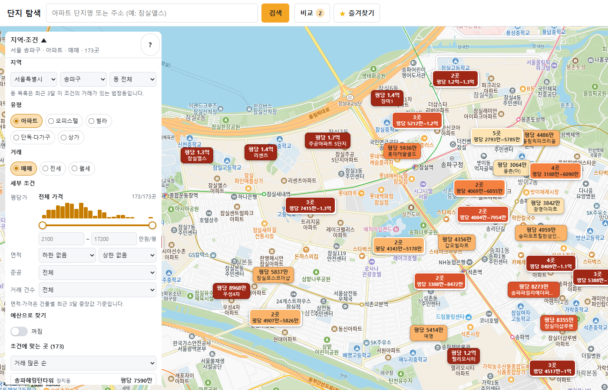
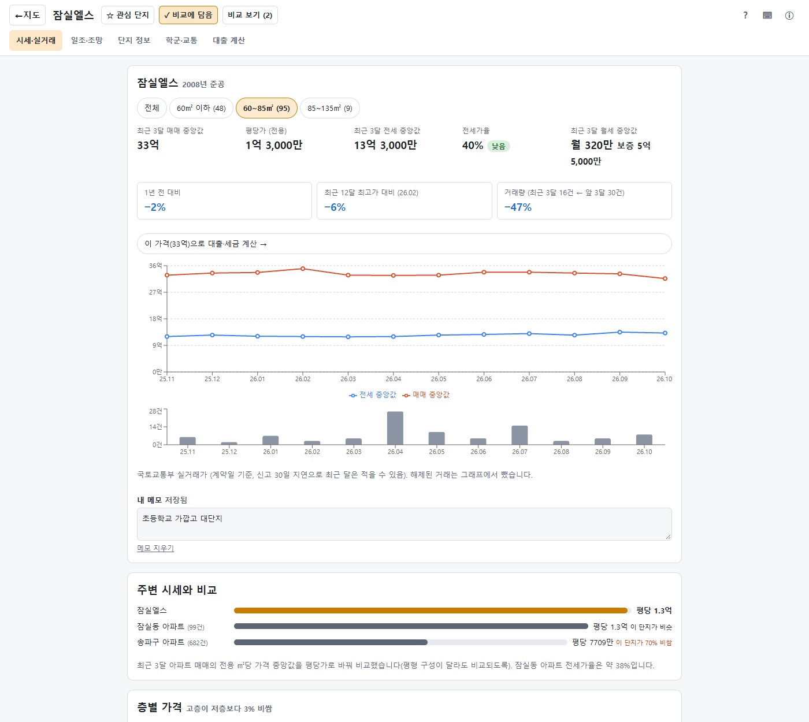
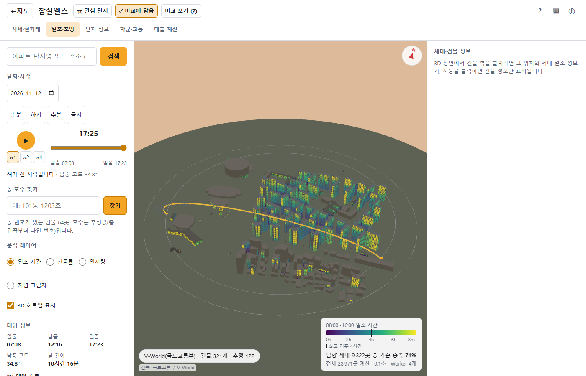
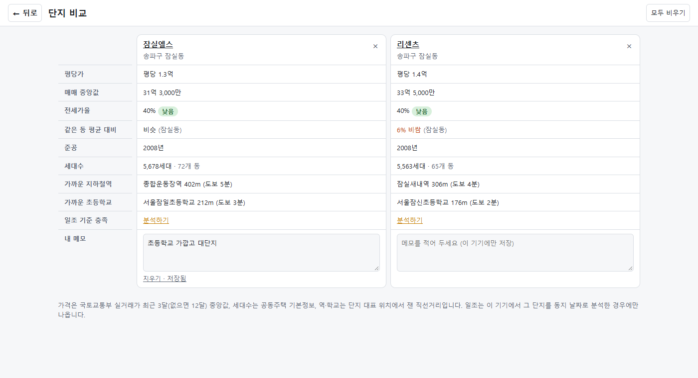
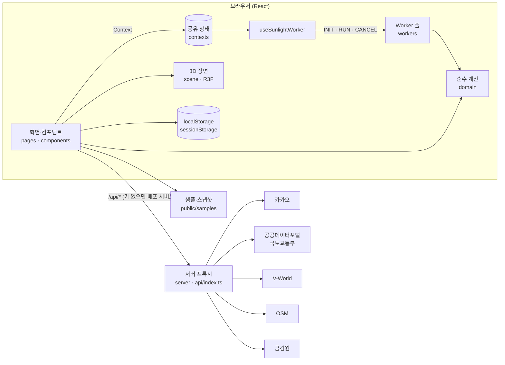

# 전국 부동산 분석

전국 아파트·오피스텔·빌라·단독·상가의 **실거래 시세를 지도에서 찾고**, 단지마다 **시세 해석·단지 정보·학군·대출 계산·세대별 일조 3D 시뮬레이션**까지 한곳에서 분석하는 웹 앱입니다.

- **배포 주소**: https://sunlight-simulator-alpha.vercel.app
- **소스 코드**: https://github.com/LEEmoonyong/real-estate-analysis
- **기술**: React 18 · TypeScript(strict) · Vite · React Router · three.js(@react-three/fiber) · recharts · Web Worker · Vercel 서버리스 함수
- **상태 관리**: React 기본 기능(useState · useReducer · Context)만 씁니다. 외부 상태 라이브러리(redux·zustand 등)는 쓰지 않습니다.
- **규모**: TypeScript 약 2만 2천 줄(테스트 제외), 단위 테스트 551개(63개 파일)

| 지도 탐색                                                             | 시세·실거래 탭                                                                  |
| --------------------------------------------------------------------- | ------------------------------------------------------------------------------- |
|          |  |
| **일조·조망 탭 (3D)**                                                 | **단지 비교**                                                                   |
|  |                   |

---

## 목차

1. [주요 기능](#1-주요-기능)
2. [화면 구성과 사용 방법](#2-화면-구성과-사용-방법)
3. [과제 필수 요구사항 충족표](#3-과제-필수-요구사항-충족표)
4. [실행 방법](#4-실행-방법)
5. [아키텍처](#5-아키텍처)
6. [폴더 구조](#6-폴더-구조)
7. [핵심 알고리즘](#7-핵심-알고리즘)
8. [검증과 테스트](#8-검증과-테스트)
9. [한계와 주의 사항](#9-한계와-주의-사항)
10. [데이터 출처](#10-데이터-출처)
11. [명령어 모음](#11-명령어-모음)
12. [개발 기록](#12-개발-기록)

---

## 1. 주요 기능

### 지도 탐색 (첫 화면 `/`)

| 기능                  | 설명                                                                                                                                                                                                                      |
| --------------------- | ------------------------------------------------------------------------------------------------------------------------------------------------------------------------------------------------------------------------- |
| 실거래 시세 표시      | 카카오 지도를 확대하면 화면 가운데 시·군·구의 **최근 3달 실거래**를 건물마다 표시합니다. 매매는 전용면적 기준 평당가, 전세는 보증금, 월세는 월세·보증금 중앙값이고, 지역 안 5분위로 색을 칠합니다.                        |
| 주택 유형 · 거래 종류 | 아파트 · 오피스텔 · 빌라(연립·다세대) · 단독·다가구 · 상가 중 하나, 매매 · 전세 · 월세 중 하나. 오피스텔·빌라·단독은 원룸·투룸(면적으로 추정)도 고릅니다.                                                                 |
| 지역 선택             | 시·도 → 시·군·구 → 동. 고르면 지도가 그 지역으로 옮겨 가고 행정구역 **테두리**를 그립니다. 지도를 누르면 확대 수준에 맞는 구역(동·구·시·도) 테두리가 나옵니다.                                                            |
| 세부 조건             | 가격 범위(지역 가격 분포 막대 + 양쪽 손잡이 슬라이더 + 직접 입력), 월세 보증금 상한, 면적(평), 준공 연도, 최근 3달 거래 건수. 켜 둔 조건은 칩으로 보이고 ×로 하나씩 끕니다. **조건 초기화** 버튼으로 한 번에 처음 상태로. |
| 조건에 맞는 곳 목록   | 결과 수와 목록(거래 많은 순 · 가격 낮은/높은 순 · 최신 준공 순). 누르면 지도에서 그곳 카드가 열립니다.                                                                                                                    |
| 예산으로 찾기         | 자기 자금·연소득을 넣으면 그 지역 대출 규제로 **살 수 있는 최대 가격**을 계산하고, 켜 두면 그 이하인 곳만 지도에 남깁니다(기본 꺼짐).                                                                                     |
| 겹친 표시 묶기        | 화면에서 겹치는 가격 표시를 `12곳 · 평당 6440만~9840만` 한 묶음으로 보여 주고, 누르면 확대합니다.                                                                                                                         |
| 전세가율              | 매매를 볼 때 같은 건물의 전세 시세를 함께 받아 건물마다 전세가율을 붙입니다.                                                                                                                                              |
| 검색                  | 단지명·주소 검색, 0.3초 멈추면 연관 검색어, 검색창을 누르면 최근 검색 기록.                                                                                                                                               |
| 비교 · 즐겨찾기 버튼  | 검색 옆 **비교**(담은 단지 비교 화면으로), **★ 즐겨찾기**(관심 단지 목록 + 새 거래 알림). 관심 단지는 지도에 ★로도 표시됩니다.                                                                                            |
| 최근 본 단지          | 연 단지 10곳을 자동으로 기억해 패널 아래에 보여 줍니다.                                                                                                                                                                   |

### 단지 상세 (`/complex/:key/:tab`)

모든 탭이 같은 머리글을 씁니다. 윗줄은 **← 지도 · 단지 이름 · ☆ 관심 단지 · + 비교에 담기 · 비교 보기 · 도움말(?, ⌨, ⓘ)**, 아랫줄은 탭입니다.

| 탭                     | 내용                                                                                                                                                                                                                                                                                                                                                                                                                   |
| ---------------------- | ---------------------------------------------------------------------------------------------------------------------------------------------------------------------------------------------------------------------------------------------------------------------------------------------------------------------------------------------------------------------------------------------------------------------- |
| **시세·실거래** (기본) | 최근 12달 매매·전세 중앙값 추이(평형대별)와 달별 거래 건수 막대, 최근 3달 매매·전세·월세 중앙값, 평당가, **전세가율 위험 단계**(낮음·보통·주의·위험), **가격 변화 요약**(1년 전 대비 · 최고가 대비 · 거래량 변화), **주변 시세와 비교**(같은 동·시군구 평균 대비 %), **층별 가격**(저·중·고층 평당가), 매매·전세·월세 거래 목록, **비슷한 단지** 3곳(1km 안 평당가·평수·연식이 비슷한 곳), 주변 거래 단지, **내 메모** |
| **일조·조망**          | 주변 건물을 3D로 세우고 세대마다 창문에 해가 드는 시간을 직접 계산. 세대 일조 히트맵, 날짜·시각 재생, 동·호수 찾기, 층별 비교, 3D 태양 경로, 천공률·일사량·지면 그림자, 계절 타임랩스(12개월), 창문 시점, 옥상 태양광, 층수 보정, **가상 건물 영향 분석**, **세대 리포트**(인쇄·PDF)                                                                                                                                   |
| **단지 정보**          | 세대수·동 수·최고층·사용승인일·난방·복도 형식·시공사·전용면적별 세대수 (공동주택 기본정보, 실거래 단지와 이름·지번으로 연결)                                                                                                                                                                                                                                                                                           |
| **학군·교통**          | 1.5km 안 초·중·고, 2km 안 지하철역(노선 묶음), 대형마트·병원·어린이집 — 직선거리와 도보 시간                                                                                                                                                                                                                                                                                                                           |
| **대출 계산**          | 이 단지 최근 매매 중앙값으로 시작하는 주택담보대출 한도(LTV · 10·15 대책 주택가격별 한도 · DSR 스트레스 금리), 월 상환액, 취득세·보유세, 은행 주담대 금리                                                                                                                                                                                                                                                              |

### 단지 비교 (`/compare`)

머리글의 **+ 비교에 담기**로 최대 3곳을 담아 평당가 · 매매 중앙값 · 전세가율 · 같은 동 평균 대비 · 준공 · 세대수 · 가까운 지하철역 · 초등학교 · 일조 기준 충족 비율 · **내 메모**(이 화면에서 바로 편집)를 나란히 봅니다. PC에서는 줄 높이를 맞춘 표, 휴대폰에서는 단지별 카드입니다. **← 뒤로**는 들어오기 전 화면으로 돌아갑니다.

### 그 밖

- **대출·세금 계산기** (`/calc`): 시세 탭의 "이 가격으로 대출·세금 계산"에서 엽니다.
- **샘플 모드**: 인터넷이나 서버가 없어도 샘플 3곳(서울 잠실, 부산 마린시티, 세종 한솔동)은 일조·시세·단지 정보·학군·금리까지 저장된 자료로 열립니다.
- **반응형**: PC(3단) · 태블릿(2단) · 휴대폰(하단 시트) 레이아웃, 다크 모드, 키보드 단축키.

---

## 2. 화면 구성과 사용 방법

```mermaid
flowchart LR
  M["지도 /<br/>검색 · 지역·조건 · 시세 표시"] -->|표시 → 단지 분석 열기| P["단지 상세<br/>/complex/:key/price"]
  M -->|검색 옆 비교| C["단지 비교<br/>/compare"]
  M -->|★ 즐겨찾기 · 최근 본 단지| P
  P <-->|탭| S["일조·조망 · 단지 정보<br/>학군·교통 · 대출 계산"]
  P -->|+ 비교에 담기 → 비교 보기| C
  C -->|← 뒤로| P
  P -->|← 지도 (보던 위치 그대로)| M
```

1. **지도에서 지역 고르기** — 지역·조건 패널에서 시·도 → 시·군·구를 고르거나 지도를 끌어 확대합니다. 유형·거래 종류·세부 조건으로 좁히고, 결과 목록이나 지도 표시를 누릅니다.
2. **단지 분석 열기** — 카드의 **단지 분석 열기**로 단지 상세의 **시세·실거래** 탭이 열립니다. 주소(URL)에 단지가 들어 있어 새로 고침·뒤로 가기·링크 공유가 그대로 됩니다.
3. **단지 살펴보기** — 탭을 옮기며 시세 해석, 일조(3D), 단지 정보, 학군·교통, 대출을 봅니다. 마음에 들면 **☆ 관심 단지**(새 거래 알림)나 **+ 비교에 담기**를 누르고 메모를 남깁니다.
4. **비교하기** — **비교 보기**로 담은 단지를 나란히 보고, **← 뒤로**로 돌아갑니다.
5. **지도로 돌아가기** — **← 지도**를 누르면 보던 위치·확대 수준 그대로 열립니다.

일조·조망 탭 사용법

- 날짜·시각(기본: 오늘·지금)을 고르고 ▶로 재생하면 그림자가 실제 태양 방향을 따라 움직입니다.
- 건물 **벽**을 누르면 그 세대의 일조 정보(하루 총 일조, 08~16시 총 일조, 최대 연속 일조, 참고 기준 충족 여부, 시간대 막대)가, **지붕**을 누르면 건물 정보(동 번호 지정, 층수 보정, 옥상 태양광)가 나옵니다.
- 분석 레이어에서 천공률 · 일사량 · 지면 그림자로 바꾸고, 계절 타임랩스로 12개월 변화를 봅니다.
- **가상 건물 놓기**로 빈 땅에 건물을 세우면 세대마다 일조가 얼마나 줄어드는지 비교합니다.

키보드 단축키

| 키                        | 동작                                         |
| ------------------------- | -------------------------------------------- |
| `Space`                   | 시각 재생 / 정지                             |
| `←` `→` / `Shift`+`←` `→` | 10분 / 1시간 이동                            |
| `1` `2` `3` `4`           | 레이어: 일조 / 천공률 / 일사량 / 지면 그림자 |
| `H`                       | 3D 히트맵 켜기·끄기                          |
| `F`                       | 선택한 세대·건물로 카메라 이동               |
| `Esc`                     | 선택 해제 (창문 시점이면 궤도 보기로)        |
| `/`                       | 검색창                                       |
| `?`                       | 단축키 도움말                                |

---

## 3. 과제 필수 요구사항 충족표

소스 파일 맨 위에 `// [요구사항: …]` 주석을 달아 두었습니다. 아래 명령으로 위치를 모두 찾을 수 있습니다.

```bash
grep -rn "\[요구사항:" src server api
```

| #   | 요구사항                          | 어디서                                                                                                           | 구체적 사용 예                                                                                                                                                                                                                                                                                                                                                                                                                                                                                                                                                                |
| --- | --------------------------------- | ---------------------------------------------------------------------------------------------------------------- | ----------------------------------------------------------------------------------------------------------------------------------------------------------------------------------------------------------------------------------------------------------------------------------------------------------------------------------------------------------------------------------------------------------------------------------------------------------------------------------------------------------------------------------------------------------------------------- |
| 1   | **React**                         | `src/main.tsx`, `src/App.tsx`                                                                                    | React 18 `createRoot` + StrictMode, `React.lazy` + `Suspense` 코드 분할(3D 엔진·그래프·비교·계산기 화면을 필요할 때 받음), `ErrorBoundary`                                                                                                                                                                                                                                                                                                                                                                                                                                    |
| 2   | **TypeScript**                    | `tsconfig*.json`(`strict`, `noUncheckedIndexedAccess`), 모든 `*.ts(x)`                                           | 도메인 모델·서버 응답·Worker 메시지를 판별 유니온 타입으로 정의, 저장소 값은 타입 가드로 검증                                                                                                                                                                                                                                                                                                                                                                                                                                                                                 |
| 3   | **컴포넌트 (기능별 분리)**        | `src/pages/`, `src/components/<기능>/`, `src/scene/`                                                             | 화면 5개(`MapPage`, `ComplexPage`, `SunlightWorkspace`, `ComparePage`, `CalculatorPage`), 기능 폴더 18개(`map`, `complex`, `search`, `report`, `virtual`, `watchlist`, `layout` …), 컴포넌트 파일 76개(3D 장면 포함). 예: `MarketPanel`, `PriceRange`, `HeaderMenus`, `ComplexHeader`, `PricePanel`, `TrendCards`, `InsightCards`, `NearbyPanel`, `UnitReport`, `VirtualBuildingPanel`, `SceneCanvas`                                                                                                                                                                         |
| 4   | **상태 관리 (useState 중심)**     | 모든 화면, `src/contexts/*`, `src/reducers/*`                                                                    | 지역 상태: 검색어·목록 열림(`SearchBar`), 지도 조건·결과·확대 수준(`MapPage`), 슬라이더 임시 값(`PriceRange`), 메모 입력(`MemoEditor`). 공유 상태: Context 12개 — `Favorites`·`Watchlist`·`Compare`(관심 단지·비교 목록, localStorage 동기화), `SceneData`·`Time`·`Settings`·`Season`·`VirtualUi`·`Heatmap`·`Toast`(useState), `Simulation`·`Playback`(useReducer), 계산기 입력 폼(useReducer). **외부 상태 라이브러리 0개**                                                                                                                                                  |
| 5   | **이벤트 처리**                   | `SearchBar`, `MarketPanel`, `PriceRange`, `HeaderMenus`, `MemoEditor`, `BuildingMesh`, `useKeyboardShortcuts` 등 | `onChange`(조건 선택·슬라이더·입력), `onSubmit`(검색·동호수), `onKeyDown`(콤보박스 ↑↓·Enter·Esc), `onBlur`(메모 저장), `onClick`(지도 표시·묶음 확대·칩 해제·비교 담기), 지도 SDK `click`·`idle`·`dragstart`, R3F `onClick`·`onPointerMove`(건물·세대·지면), 바깥 클릭·Esc로 목록 닫기, window `keydown`(단축키), `matchMedia`(반응형), `storage`(다른 탭 동기화)                                                                                                                                                                                                             |
| 6   | **Hooks**                         | `src/hooks/*`, `src/components/*/use*.ts`                                                                        | 기본 훅: `useState`, `useReducer`, `useEffect`, `useLayoutEffect`, `useMemo`, `useCallback`, `useRef`, `useContext`, `useId`, `useSyncExternalStore`. **커스텀 훅 40개**: `useComplexMarket`(단지 확정 → 12달 실거래, AbortController), `useComplexInfo`, `useLocalStorage`(버전·검증·탭 동기화), `useMemos`, `useComplexTitle`, `useNewDeals`, `useApiHealth`(로컬 키 → 배포 서버 → 샘플 경로 결정), `useBuildings`, `useGeocode`, `useSunlightWorker`(Worker 풀·취소), `useTimePlayback`(rAF), `useCameraFlyTo`, `useKeyboardShortcuts`, `useBreakpoint`, `useMediaQuery` … |
| 7   | **데이터 처리 (외부 API + 로컬)** | `server/handlers/*`, `api/index.ts`, `src/data/**`, `public/samples/*`                                           | **외부 API 8곳**: 카카오맵 JS SDK, 카카오 로컬(검색·좌표→법정동·주변 시설), 국토교통부 실거래가(아파트·오피스텔·빌라·단독·상가 × 매매·전월세), 공동주택 단지 목록·기본정보, V-World(건물·행정구역 경계), OSM Overpass(건물), 금감원 금융상품한눈에(금리). 키는 서버 프록시에만 둡니다. **로컬 데이터**: localStorage 13종(아래 표), sessionStorage(지도 위치), 샘플 JSON·시세 스냅샷, 전국 시·군·구 목록(`regions.json`)                                                                                                                                                      |
| 8   | **UI (반응형)**                   | `src/components/layout/*`, `*.module.css`, `src/styles/tokens.css`, `useBreakpoint`                              | 3단계 브레이크포인트(< 768 / 768~1199 / ≥ 1200px), 휴대폰 하단 시트·탭, 패널 접기(휴대폰은 접힌 채 시작), 비교 표 ↔ 카드 전환, 터치 회전·핀치 줌, 기기별 그림자 해상도·Worker 수 자동 조정, 다크 모드, CSS Modules + 디자인 토큰                                                                                                                                                                                                                                                                                                                                              |

**React Router는 화면 이동에만** 씁니다(상태 관리는 위의 React 기본 기능만).

| 주소                 | 화면                                                                                                                                        |
| -------------------- | ------------------------------------------------------------------------------------------------------------------------------------------- |
| `/`                  | 지도 탐색                                                                                                                                   |
| `/complex/:key/:tab` | 단지 상세 — `price`(기본) · `sun` · `info` · `area` · `loan`. `:key`는 `geo-위도,경도`(검색어·실거래 단지 번호는 쿼리) 또는 `sample-샘플id` |
| `/compare`           | 단지 비교                                                                                                                                   |
| `/calc`              | 대출·세금 계산기                                                                                                                            |
| 그 밖                | `/`로 이동                                                                                                                                  |

**브라우저 저장소** (`src/data/storage/schema.ts` — 키마다 버전을 두고 `{ v, data }`로 저장, 읽을 때 타입 가드로 검증, 손상되면 기본값)

| 저장소         | 키                                                      | 내용                                                                          |
| -------------- | ------------------------------------------------------- | ----------------------------------------------------------------------------- |
| localStorage   | `favorites` · `recentSearches`                          | 저장한 위치 · 최근 검색                                                       |
|                | `watchlist` · `compare` · `recentComplexes` · `memos`   | 관심 단지(새 거래 확인 날짜 포함) · 비교 담은 단지 · 최근 본 단지 · 단지 메모 |
|                | `budget` · `settings` · `onboarding` · `mapGuideHidden` | 예산 입력 · 설정(테마 등) · 가이드 완료 · 지도 안내 닫힘                      |
|                | `corrections` · `dongAssignments` · `sunSummaries`      | 층수 보정 · 동 번호 지정 · 단지 일조 요약                                     |
| sessionStorage | `sunlight:mapView`                                      | 지도 위치·확대 수준 (단지에서 돌아올 때 그대로)                               |

---

## 4. 실행 방법

### 4.1 빠른 실행 (API 키 없이)

```bash
npm install
npm run dev
```

- 브라우저에서 http://localhost:5173 을 엽니다. **Node.js 22.12 이상**이 필요합니다(`.nvmrc`).
- **키를 설정하지 않아도 전국 데이터를 볼 수 있습니다.** 이 컴퓨터에 키가 없으면 앱이 요청을 배포 서버(`https://sunlight-simulator-alpha.vercel.app/api`)로 보내고, 화면 위에 **"배포 서버 경유"** 배지를 띄웁니다. 키는 배포 서버에만 있고 소스·제출물에는 없습니다.
- 인터넷이나 배포 서버가 없으면 **샘플 모드**로 시작합니다. 샘플 3곳은 일조·시세·단지 정보·학군·금리까지 저장된 스냅샷(`public/samples/market-snapshot.json`)으로 열립니다(지도는 카카오 SDK가 인터넷을 써야 해서 안내 문구로 대신).

| 실행 방법                         | 볼 수 있는 범위 | 데이터 경로             |
| --------------------------------- | --------------- | ----------------------- |
| 배포 주소에서 열기                | 전국            | 배포 서버 `/api`        |
| 로컬 실행, 키 없음 (기본)         | 전국            | 배포 서버 `/api` 경유   |
| 로컬 실행, `.env.local`에 키 있음 | 전국            | 로컬 개발 서버 `/api`   |
| 오프라인 또는 배포 서버 응답 없음 | 샘플 3곳        | 샘플 JSON + 시세 스냅샷 |

배포 서버는 내 컴퓨터 주소(`localhost`·`127.0.0.1`·`[::1]`)에서 오는 요청만 CORS로 허용하므로, 다른 웹사이트가 이 프록시를 빌려 쓸 수는 없습니다. 배포 서버를 쓰지 않으려면 `.env.local`에 `VITE_REMOTE_API_BASE=`(빈 값)을 넣습니다.

### 4.2 내 키로 실행 (선택)

1. `.env.example`을 `.env.local`로 복사하고 아래 값을 채웁니다.

| 변수                               | 발급처                                                                                  | 용도                                                                                                                                                    |
| ---------------------------------- | --------------------------------------------------------------------------------------- | ------------------------------------------------------------------------------------------------------------------------------------------------------- |
| `KAKAO_REST_API_KEY`               | [카카오 developers](https://developers.kakao.com) › 앱 키 › REST API 키                 | 주소·단지명 검색, 좌표 → 법정동, 주변 시설                                                                                                              |
| `VITE_KAKAO_JS_KEY`                | 같은 앱의 JavaScript 키 (플랫폼 › JavaScript SDK 도메인에 `http://localhost:5173` 등록) | 지도 표시. 지도 SDK 구조상 브라우저에 노출되는 **공개 키**이며 등록한 도메인에서만 동작                                                                 |
| `VWORLD_API_KEY` / `VWORLD_DOMAIN` | [V-World 오픈API](https://www.vworld.kr)                                                | 건물 외곽선·층수, 행정구역 경계. `VWORLD_DOMAIN`은 키에 등록한 서비스 URL과 정확히 같아야 함                                                            |
| `DATA_GO_KR_SERVICE_KEY`           | [공공데이터포털](https://www.data.go.kr) 일반 인증키(Decoding)                          | 국토교통부 실거래가(아파트 매매 상세·전월세, 오피스텔·연립다세대·단독/다가구 매매·전월세, 상업업무용 매매), 공동주택 단지 목록·기본정보 — 각각 활용신청 |
| `FSS_FINLIFE_API_KEY`              | [금감원 금융상품한눈에](https://finlife.fss.or.kr)                                      | 주택담보대출 금리                                                                                                                                       |

2. `npm run dev`를 다시 실행합니다.

> **보안**: 서버 키는 `VITE_` 접두사를 붙이지 않아 브라우저 번들에 들어가지 않고 서버 프록시(`server/`, 배포 시 `api/index.ts`)에서만 읽습니다. 빌드할 때마다 결과물에 키 값이 없는지 검사했습니다. `.env.local`은 git에서 제외되어 있습니다.
>
> **배포 시**: V-World는 해외 IP 요청을 막아 Vercel 함수 리전을 서울(`icn1`)로 고정했습니다(`vercel.json`).

---

## 5. 아키텍처



- **화면 → 도메인 분리**: 시세 집계·전세가율·평균 비교·비슷한 단지·층별 가격·지도 묶기·대출 한도·세금·태양 위치·광선 판정은 모두 React와 무관한 순수 함수(`src/domain/`)라 단위 테스트로 검증합니다. 컴포넌트는 그 결과를 그리기만 합니다.
- **서버 프록시**: 외부 API 키를 숨기고, XML 응답을 JSON으로 정규화하고, 같은 요청을 캐시합니다(지난 달 7일, 최근 두 달 6시간). 개발 중에는 Vite 미들웨어, 배포에서는 Vercel 함수 하나(`api/index.ts`)가 같은 라우터(`server/router.ts`)를 씁니다.
- **요청 최소화**: 단지 상세는 시군구 12달 실거래를 한 번 받아 이 단지 거래·동 평균·비슷한 단지·층별 가격을 모두 계산합니다. 같은 주소 요청은 브라우저 메모리에서도 한 번만 보냅니다. 지도 조건은 이미 받은 표시를 거를 뿐 서버를 다시 부르지 않습니다.
- **병렬 계산**: 일조·천공률·지면 그림자는 Web Worker 풀(코어 − 1, 최대 4개)이 나눠 계산하고, 새 요청이 오면 이전 작업을 취소합니다.

---

## 6. 폴더 구조

```
src/
├─ App.tsx, main.tsx    라우팅(React Router) · Context 계층 조립
├─ pages/               화면 — MapPage(지도), ComplexPage(단지 상세), SunlightWorkspace(일조·조망 탭),
│                       ComparePage(단지 비교), CalculatorPage(대출·세금)
├─ components/
│  ├─ map/              지역·조건 패널(MarketPanel), 가격 슬라이더(PriceRange), 예산·최근 본 단지(PanelExtras),
│  │                    비교·즐겨찾기 버튼(HeaderMenus), 장소 카드(PlaceCard)
│  ├─ complex/          공통 머리글(ComplexHeader·ComplexActions·ComplexTabs), 시세 탭(PricePanel·TrendCards·InsightCards),
│  │                    단지 정보(InfoPanel), 학군·교통(NearbyPanel), 대출(LoanTab), 데이터 훅(useComplexMarket·useComplexInfo)
│  ├─ search/           검색창(연관 검색어·최근 검색)
│  ├─ watchlist/        관심 단지 목록·새 거래
│  ├─ report/ virtual/  세대 리포트, 가상 건물 영향
│  ├─ controls/ detail/ dongHo/ floorCompare/ season/ solar/ sunPath/ heightCorrection/ analysis/
│  │                    일조·조망 탭의 조작·정보 패널
│  └─ layout/ common/ onboarding/   반응형 레이아웃, 공용 UI, 사용 가이드
├─ contexts/            공유 상태 12개 (Favorites, Watchlist, Compare, SceneData, Time, Settings, Season,
│                       Simulation, Playback, VirtualUi, Heatmap, Toast)
├─ hooks/               커스텀 훅 (useLocalStorage, useMemos, useComplexTitle, useNewDeals, useApiHealth, …)
├─ domain/              순수 계산 (React 무관, 단위 테스트)
│  ├─ realestate/       시세 집계·지도 조건·결과 정렬·전세가율·평균 비교·비슷한 단지·지도 묶기·가격 변화·층별 가격·단지 이름 매칭
│  ├─ finance/          대출 한도·예산 역산·취득세·보유세
│  └─ solar/ geo/ geometry/ spatial/ sunlight/ units/ ground/ heatmap/ time/   태양·광선·일조 계산
├─ data/                API 클라이언트, 데이터 경로 결정, 샘플·스냅샷, 저장소 스키마, 시·군·구 목록
├─ routes/              단지 주소(URL) ↔ 대상 변환
├─ scene/               3D 장면 (건물, 히트맵, 태양 경로, 지면 그림자, 카메라)
├─ workers/             Worker 프로토콜·풀·작업 큐·캐시
└─ config/              상수, 기능 플래그, 품질 프리셋, 대출·세금 규칙(regulations.ts — 기준일·출처)
server/                 /api/* 라우터와 핸들러 — region, realestate(trades·rents·deal-places·complexes·complex),
                        boundary, nearby, finance, buildings(V-World·OSM), geocode / XML 정규화 / CORS / 캐시
api/index.ts            Vercel 서버리스 함수 진입점
scripts/                시·군·구 목록 생성, 시세 스냅샷, 단지 매칭 점검, API 실측 검증
public/samples/         샘플 3곳 건물 JSON + 시세·단지 정보·학군·금리 스냅샷
docs/                   스크린샷, API 실측 기록
```

---

## 7. 핵심 알고리즘

자세한 식과 근거는 [PLAN.md 9장](PLAN.md)에 있습니다.

### 부동산

| 항목           | 방법 (파일)                                                                                                                                                                                                                                        |
| -------------- | -------------------------------------------------------------------------------------------------------------------------------------------------------------------------------------------------------------------------------------------------- |
| 시세 집계      | 단지 실거래를 달·평형대(60·85·135㎡ 경계)로 묶어 중앙값. 전세는 월세 0인 계약만, 해제 거래 제외 (`aggregate.ts`)                                                                                                                                   |
| 지도 표시      | 국토교통부 실거래를 건물(지번)마다 묶어 최근 3달 중앙값, 좌표는 카카오 주소 검색(동시 4개 · 429 재시도 · 캐시). 지번이 비공개인 단독·상가는 법정동 위치에 묶음 (`server/handlers/deals.ts`)                                                        |
| 색 구분        | 지역 안 평당가 5분위 경계 (`format.ts`)                                                                                                                                                                                                            |
| 전세가율       | 같은 기간 ㎡당 전세 중앙값 ÷ ㎡당 매매 중앙값. 70 / 80 / 90% 경계로 낮음·보통·주의·위험 (`insight.ts`)                                                                                                                                             |
| 주변 평균 비교 | 같은 법정동·시군구 아파트 매매의 ㎡당 중앙값과 비교 (평형 구성이 달라도 비교되게). 이 단지 최근 3달 거래가 없으면 12달 (`insight.ts`)                                                                                                              |
| 비슷한 단지    | 1km 안 후보마다 차이 점수 = 가격 차이 비율 + 평수 차이 비율 + 연식 차이/20 + 거리 가중. 가격·평수가 35% 넘게 다르면 제외 (`insight.ts`)                                                                                                            |
| 가격 변화      | 최근 3달 vs 12달 중 첫 3달(1년 전), 달별 최고 ㎡당 중앙값 대비, 거래량(최근 3달 vs 그 앞 3달) (`trend.ts`)                                                                                                                                         |
| 층별 가격      | 거래에 나온 최고층 기준 3등분(저·중·고층) ㎡당 중앙값 (`trend.ts`)                                                                                                                                                                                 |
| 지도 묶기      | 위경도 → 화면 좌표 변환 후, 거래 많은 곳부터 기준으로 가로 96px·세로 44px 안의 표시를 모음 (`insight.ts`)                                                                                                                                          |
| 단지 이름 매칭 | 실거래 단지와 공동주택 단지 목록은 식별 체계가 달라 법정동·지번이 같으면 확정, 아니면 이름 정리(지역명·"아파트"·차/단지 표기, 영문 표기 통일, "주공"·"시영") 후 2-gram 다이스 계수. `npm run audit:match`로 9개 시·군·구 2,033곳 점검 (`match.ts`) |
| 대출 한도      | min(LTV × 가격, 10·15 대책 주택가격별 한도, DSR 40% 여유를 스트레스 금리로 갚을 수 있는 원금), 100만원 단위 내림 (`finance/loan.ts`)                                                                                                               |
| 예산 역산      | "필요 자기 자금 ≤ 가진 돈"인 가장 비싼 가격을 대출 한도 함수 위에서 이분 탐색 (`finance/budget.ts`)                                                                                                                                                |
| 세금           | 취득세 6~9억 구간 (가액 × 2/3억 − 3)/100, 재산세·종부세 누진 구간표 (`finance/tax.ts`)                                                                                                                                                             |

### 일조 시뮬레이션

| 단계            | 방법                                                                                              |
| --------------- | ------------------------------------------------------------------------------------------------- |
| 태양 위치       | NOAA Solar Calculator 식(Meeus) 직접 구현 — 적위·균시차 → 시간각 → 고도·방위                      |
| 건물            | 외곽선 정리 → 돌출 프리즘. 높이 = 실측, 없으면 층수 × 2.9m                                        |
| 세대            | 외벽을 6m 라인 × 층으로 나눈 창문 점, 바깥에서 볼 때 왼쪽부터 라인 번호 → 추정 호수               |
| 가림 판정       | 창문 점에서 태양 쪽 반직선과 벽의 교차를 2D로 판정, 균일 격자 + DDA(Amanatides–Woo)로 후보만 검사 |
| 일조 집계       | 10분 칸 가시성 → 총 일조, 08~16시 총, 09~15시 최대 연속 → 참고 기준(연속 2시간 또는 총 4시간)     |
| 천공률 · 일사량 | 코사인 가중 피보나치 반구 샘플링 / 청천 모델(Meinel DNI + Kasten–Young 대기 질량)                 |
| 병렬화          | Worker 풀이 세대 범위를 나눠 계산, 512개마다 취소 확인, 결과는 transferable로 전달                |

---

## 8. 검증과 테스트

- **단위 테스트 551개** (Vitest, 63개 파일) — 도메인 계산, 저장소 검증, 주소 변환, 매칭, 서버 정규화. `npm test`
- **다른 시간대 테스트** — 뉴욕 시간대에서도 같은 결과인지 `npm run test:tz`
- **타입·린트** — `tsc -b`(strict), ESLint 오류 0

**계산 정확도**

| 항목           | 결과                                                                                                      |
| -------------- | --------------------------------------------------------------------------------------------------------- |
| 태양 위치      | NASA/JPL Horizons 대비 고도·방위 오차 < 0.02°(실측 최대 0.007°), 일출·일몰 30초 이내, suncalc 대비 < 0.2° |
| 천공률         | 가림 없는 수직 벽 이론값 0.5 대비 0.0001, 협곡(W = H) 이론값 0.447 대비 0.0015 (N = 256)                  |
| 일사량         | 서울 춘분 남중 수평면 700~900 W/m²(청천 문헌값 범위)                                                      |
| 대출 예산 역산 | 구한 가격에서는 자기 자금이 충분하고 100만원 더 비싸면 모자람을 테스트로 확인                             |

**성능** (브라우저, Worker 4개, 동지, 10분 간격)

| 장면               | 규모                     | 시간                                         |
| ------------------ | ------------------------ | -------------------------------------------- |
| 세종 한솔동 일조   | 세대 16,231 · 광선 46만  | 36ms                                         |
| 잠실 일조          | 세대 52,361 · 광선 148만 | 154ms                                        |
| 계절 12개월 (세종) | 일조 × 12                | 약 1초                                       |
| 첫 화면 JS         | 코드 분할 후             | 약 270KB (gzip 약 90KB), 3D 엔진은 지연 로딩 |

**전체 흐름 점검 (배포 사이트, 송파구)** — 지도에서 지역 선택(아파트 매매 173곳) → 단지 분석 열기(시세 탭) → 관심 단지·비교에 담기 → 비교 화면(메모 편집) → 뒤로 → 지도(보던 위치). 빌라 매매 671건 표시, 조건 초기화, 예산 스위치까지 확인했습니다.

**접근성** — 이름 없는 버튼 0, 라벨 없는 입력 0, 화면마다 `h1`·`main` 1개, `lang="ko"`, 위험 단계는 색과 글자를 함께 표시, 키보드만으로 가상 건물 배치 가능.

---

## 9. 한계와 주의 사항

**부동산 데이터**

- 실거래가는 **신고 기준**(계약 후 30일 안 신고)이라 최근 한 달은 적을 수 있어 지난달까지를 기준으로 봅니다. 해제된 거래는 뺍니다. 매물(호가) 정보는 공개 API가 없어 다루지 않습니다.
- 원룸·투룸은 실거래 자료에 방 수가 없어 **전용면적으로 추정**합니다(원룸 33㎡ 이하, 투룸 33~60㎡).
- 단독·다가구와 일반 상가는 지번이 비공개라 건물이 아니라 **법정동 위치**에 묶어 표시합니다. 한 시군구에 표시는 거래 많은 순으로 최대 300곳입니다.
- 실거래 단지 좌표는 대표 지번 주소라 큰 단지는 실제 위치와 수백 m 다를 수 있습니다. 단지 정보는 공동주택 단지 목록에 있는 단지만 연결됩니다(소규모·임대 단지 일부 제외).
- 관심 단지 새 거래는 지도 화면을 열 때 확인합니다(푸시 알림 없음).
- 공공데이터포털 개발 계정은 API별 하루 호출 한도가 있어 서버에서 캐시합니다.
- 빌라 매매 API는 2026-10 개편으로 주소가 `RTMSDataSvcRHTrade2`로 바뀌어 새 주소를 씁니다(예전 주소는 새로 받은 키를 거절).

**계산**

- **대출·세금은 참고용 추정**입니다. 실제 한도는 금융기관 심사, 세액은 세무 당국 고지로 정해집니다. 정책대출·세액공제·세부담 상한은 넣지 않았습니다. 예산 역산은 무주택·금리 4.5%·30년 가정이고 부대비용을 뺐습니다.
- 대출 규칙은 2026-11 기준(10·15 대책)이며 `src/config/regulations.ts` 한곳에 기준일·출처와 함께 둡니다.

**일조 시뮬레이션**

- 지형 고저차, 발코니·나무·담장은 반영하지 않습니다. 건물 높이는 데이터 또는 층수 × 2.9m 추정입니다(층수 보정 가능).
- 세대 위치·호수는 외벽을 6m 간격으로 나눈 **추정값**입니다.
- 일조 기준 표시는 판례에서 자주 쓰는 기준을 참고로 보여 줄 뿐 **법적 판단이 아닙니다**. 일사량·태양광은 맑은 날 상한 추정치입니다.
- 가상 건물은 직사각형 상자로 단순화한 가정입니다.

---

## 10. 데이터 출처

- 실거래가 · 공동주택 단지 목록·기본정보: 국토교통부, [공공데이터포털](https://www.data.go.kr) (공공누리)
- 지도 · 주소·장소 검색 · 주변 시설: [카카오맵 API](https://apis.map.kakao.com/web/), [카카오 로컬 API](https://developers.kakao.com/docs/latest/ko/local/dev-guide)
- 건물 · 행정구역 경계: 국토교통부 [V-World](https://www.vworld.kr)
- 건물(대체): © [OpenStreetMap](https://www.openstreetmap.org/copyright) contributors, ODbL
- 주택담보대출 금리: [금융감독원 금융상품한눈에](https://finlife.fss.or.kr)
- 대출 규제: 금융위원회 10·15 대책(2025-10-15) / 세율: 지방세법·종합부동산세법
- 태양 위치 식: NOAA Global Monitoring Laboratory, _Solar Calculation Details_ (Meeus, _Astronomical Algorithms_)
- 일사 모델: Meinel & Meinel(1976), Kasten & Young(1989), Liu & Jordan(1960)

---

## 11. 명령어 모음

| 명령                                 | 설명                                                                      |
| ------------------------------------ | ------------------------------------------------------------------------- |
| `npm run dev`                        | 개발 서버 (`/api/*` 프록시 포함)                                          |
| `npm run build`                      | 타입 검사 + 프로덕션 빌드                                                 |
| `npm run preview`                    | 빌드 결과 미리 보기                                                       |
| `npm test`                           | 단위 테스트 (Vitest, 551개)                                               |
| `npm run test:tz`                    | 다른 시간대(뉴욕)에서 단위 테스트                                         |
| `npm run coverage`                   | 커버리지                                                                  |
| `npm run lint` / `npm run typecheck` | ESLint / TypeScript 검사                                                  |
| `npm run bench`                      | 광선 판정 성능 측정                                                       |
| `npm run build:regions`              | 전국 시·군·구 목록 다시 만들기 (카카오 주소 검색으로 확인)                |
| `npm run audit:match`                | 실거래 단지 ↔ 공동주택 단지 목록 연결 점검                                |
| `npm run snapshot:market`            | 샘플 모드용 시세·단지 정보·학군·금리 스냅샷 다시 받기                     |
| `npm run verify:api`                 | 외부 API 실측 검증 ([docs/api-verification.md](docs/api-verification.md)) |

---

## 12. 개발 기록

- [PLAN.md](PLAN.md) — 처음 설계: 일조 시뮬레이터 요구사항·알고리즘·검증 계획
- [PLAN_EXPANSION.md](PLAN_EXPANSION.md) — 부동산 앱으로 확장한 단계별 계획과 진행 기록(지도·라우팅 → 시세·단지 정보 → 학군·계산기 → 관심 단지·가상 건물 → 유형·전월세)
- 커밋 기록은 [GitHub](https://github.com/LEEmoonyong/real-estate-analysis/commits/main)에 있습니다(Conventional Commits).
