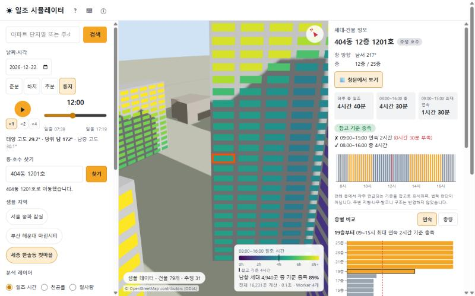
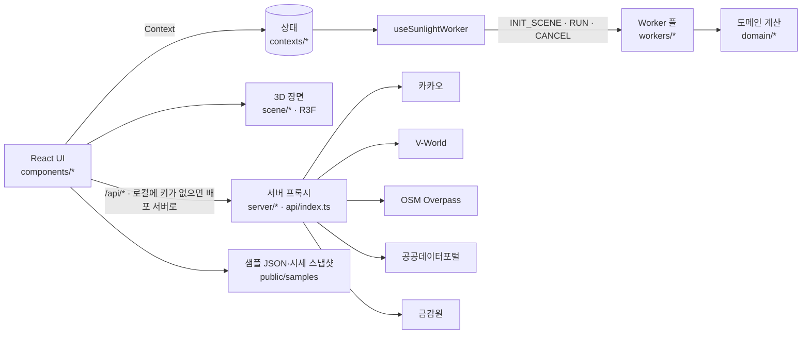

# ☀ 전국 단위 3D 아파트 단지 일조량 시뮬레이터 + 단지 탐색

아파트 단지를 검색하면 주변 건물을 3D로 세우고, **세대마다 창문에 해가 드는 시간**을 직접 계산해 보여 주는 웹 앱입니다.
동지 기준 일조 참고 기준 충족 여부, 층별 비교, 천공률·일사량, 계절 변화까지 한 화면에서 볼 수 있습니다.
여기에 지도 홈(아파트·오피스텔·빌라·단독/다가구·상가 × 매매·전세·월세 시세 표시, 원룸·투룸, 필터), 실거래 시세, 단지 정보, 학군·교통, 대출·세금 계산기, 세대 리포트, 가상 건물 영향 분석, 관심 단지 새 거래 알림을 더한 **단지 탐색형 부동산 앱**입니다(매물 정보는 공개 API가 없어 제외).

- **배포 주소**: https://sunlight-simulator-alpha.vercel.app
- **기술**: Vite + React 18 + TypeScript(strict), three.js(@react-three/fiber), recharts, Web Worker
- 상태 관리는 React 기본 기능(useState·useReducer·Context)만 사용합니다. 외부 상태 라이브러리는 쓰지 않습니다.
- 태양 위치·광선 교차·일조·천공률·일사량 계산은 모두 직접 구현했습니다. suncalc는 테스트에서 비교용으로만 씁니다.
- **확장 계획과 진행 기록**: [PLAN_EXPANSION.md](PLAN_EXPANSION.md) — X1(라우팅·지도) ~ X7(샘플 스냅샷·점검·재배포), X8(주택 유형·전월세 선택, 2026-11-08 배포) 완료.



---

## 1. 빠른 실행 (API 키 없이)

```bash
npm install
npm run dev
```

- 브라우저에서 http://localhost:5173 을 엽니다. **Node.js 22.12 이상**이 필요합니다(`.nvmrc` 참고).
- **키를 설정하지 않아도 전국 아파트를 검색할 수 있습니다.** 이 컴퓨터에 키가 없으면 앱이 검색·건물 요청을 배포 서버(`https://sunlight-simulator-alpha.vercel.app/api`)로 보냅니다. 키는 그 서버에만 있고 소스·제출물에는 들어 있지 않습니다. 이때 화면 위쪽에 **"배포 서버 경유"** 배지가 표시됩니다.
- 인터넷이 없거나 배포 서버에 연결할 수 없으면 **샘플 모드**로 자동 시작합니다. 샘플 3곳(서울 잠실, 부산 마린시티, 세종 한솔동)은 일조뿐 아니라 시세·단지 정보·학군·세대 리포트·계산기 금리까지 **저장해 둔 스냅샷**(`public/samples/market-snapshot.json`, 2026-11-06 기준)으로 그대로 열립니다. 단지 상세 위쪽에 "샘플 자료 · 날짜 기준" 표시가 붙습니다(지도는 카카오 SDK가 인터넷을 써야 해서 안내 문구로 대신).

| 실행 방법                         | 검색 가능 범위 | 데이터 경로                                   |
| --------------------------------- | -------------- | --------------------------------------------- |
| 배포 주소에서 열기                | 전국           | 배포 서버 `/api`                              |
| 로컬 실행, 키 없음 (기본)         | 전국           | 배포 서버 `/api` 경유 ("배포 서버 경유" 배지) |
| 로컬 실행, `.env.local`에 키 있음 | 전국           | 로컬 개발 서버 `/api`                         |
| 오프라인 또는 배포 서버 응답 없음 | 샘플 3곳       | 정적 샘플 JSON + 시세 스냅샷                  |

배포 서버를 빌려 쓰지 않으려면 `.env.local`에 `VITE_REMOTE_API_BASE=`(빈 값)을 넣습니다. 그러면 키가 없을 때 바로 샘플 모드로 시작합니다.
배포 서버는 내 컴퓨터 주소(`localhost`·`127.0.0.1`·`[::1]`)에서 오는 요청만 CORS로 허용하므로, 다른 웹사이트가 브라우저에서 이 프록시를 쓸 수는 없습니다.

## 2. 실데이터 실행 — 내 키 사용 (선택)

1. `.env.example`을 `.env.local`로 복사합니다.
2. 아래 키를 채웁니다.
   - `KAKAO_REST_API_KEY` — [카카오 developers](https://developers.kakao.com) › 내 애플리케이션 › 앱 키 › REST API 키 (주소·단지명 검색)
   - `VWORLD_API_KEY` — [V-World 오픈API](https://www.vworld.kr/dev/v4dv_2ddataguide2_s001.do) 인증키 (건물 외곽선·층수)
   - `VWORLD_DOMAIN` — V-World 키를 발급할 때 등록한 서비스 URL과 **정확히 같아야** 합니다(로컬은 `http://localhost:5173`). V-World 키 하나에는 서비스 URL 하나만 등록되므로, 배포용 키와 로컬용 키를 따로 발급하는 것이 편합니다.
   - `VITE_KAKAO_JS_KEY` — 같은 카카오 앱의 **JavaScript 키**(지도 표시). 카카오 콘솔 › 앱 › 플랫폼 키 › JavaScript SDK 도메인에 `http://localhost:5173`(과 배포 주소)을 등록해야 지도가 뜹니다. 이 키는 지도 SDK 구조상 브라우저에 노출되는 **공개 키**이고, 등록한 도메인에서만 동작해 보호됩니다. 없으면 지도 대신 안내 문구가 나오고 검색으로 단지를 열 수 있습니다.
   - `DATA_GO_KR_SERVICE_KEY` — [공공데이터포털](https://www.data.go.kr) 일반 인증키(Decoding). 키 하나로 "국토교통부_아파트 매매 실거래가 상세 자료", "아파트 전월세 실거래가 자료", "공동주택 단지 목록제공 서비스", 그리고 지도 유형 선택용 "오피스텔 매매·전월세", "연립다세대 매매·전월세", "단독/다가구 매매·전월세", "상업업무용 부동산 매매" 실거래가 자료, "공동주택 기본 정보제공 서비스", "건축HUB 건축물대장정보 서비스"를 각각 활용신청합니다(서버 전용).
   - `FSS_FINLIFE_API_KEY` — [금감원 금융상품한눈에](https://finlife.fss.or.kr) 오픈API 인증키(주택담보대출 금리, 서버 전용).
3. `npm run dev`를 다시 실행합니다.

서버 키(카카오 REST, V-World, 이후 공공데이터포털·금감원)는 서버 프록시(`server/`, 배포 시 `api/index.ts`)에서만 읽습니다. `VITE_` 접두사를 붙이지 않으므로 클라이언트 번들에 들어가지 않습니다(빌드 결과 검사로 매번 확인). `VITE_`가 붙은 것은 공개 값(카카오 JavaScript 키, 설정 플래그)뿐입니다.
건물 데이터는 V-World → OpenStreetMap → 샘플 순서로 대체합니다. 하나가 실패해도 화면이 비지 않습니다.

> **배포 시 주의**: V-World는 해외 IP 요청을 막습니다. 그래서 Vercel 함수 리전을 서울(`icn1`)로 고정했습니다(`vercel.json`). 배포 도메인도 V-World 키의 서비스 URL에 등록해야 합니다.

## 3. 과제 필수 요구사항 충족 매핑표

각 파일 상단에 `// [요구사항: …]` 주석 태그를 달아 두었습니다. 아래 명령 한 번으로 위치를 찾을 수 있습니다.

```bash
grep -rn "\[요구사항:" src server api
```

| #   | 항목                         | 충족 파일                                                                                                                                                                                                                                         | 컴포넌트 / 훅                                                                                                                                                                                                                                                                                                                                                                                                                                                                                                              | 구체적 사용 예                                                                                                                                                                                                                                                                                                                                                                                                                                                                                       |
| --- | ---------------------------- | ------------------------------------------------------------------------------------------------------------------------------------------------------------------------------------------------------------------------------------------------- | -------------------------------------------------------------------------------------------------------------------------------------------------------------------------------------------------------------------------------------------------------------------------------------------------------------------------------------------------------------------------------------------------------------------------------------------------------------------------------------------------------------------------- | ---------------------------------------------------------------------------------------------------------------------------------------------------------------------------------------------------------------------------------------------------------------------------------------------------------------------------------------------------------------------------------------------------------------------------------------------------------------------------------------------------- |
| 1   | 개발 프레임워크: React       | `src/main.tsx`, `src/App.tsx`, `vite.config.ts`                                                                                                                                                                                                   | `App`, `AppProviders`                                                                                                                                                                                                                                                                                                                                                                                                                                                                                                      | Vite + React 18 `createRoot`, StrictMode, `React.lazy` 코드 분할                                                                                                                                                                                                                                                                                                                                                                                                                                     |
| 2   | 개발 언어: TypeScript        | `tsconfig*.json`(`strict`, `noUncheckedIndexedAccess`), 전체 `*.ts(x)`                                                                                                                                                                            | `src/domain/types.ts`, `src/workers/protocol.ts`                                                                                                                                                                                                                                                                                                                                                                                                                                                                           | 모든 도메인 모델과 Worker 메시지를 판별 유니온 타입으로 정의                                                                                                                                                                                                                                                                                                                                                                                                                                         |
| 3   | 컴포넌트: 기능별 분리        | `src/pages/`, `src/components/<기능>/`, `src/scene/`                                                                                                                                                                                              | `MapPage`, `ComplexPage`, `SunlightWorkspace`, `NearbyPanel`, `UnitReport`, `VirtualBuildingPanel`, `VirtualBuildings`, `WatchlistCard`, `WatchButton`, `SearchBar`, `DongHoSearch`, `TimeControls`, `SceneCanvas`, `Buildings`, `UnitHeatmap`, `SunPathDome`, `GroundShadowLayer`, `UnitDetailPanel`, `FloorCompareChart`, `MonthlySummaryChart`, `FavoritesPanel`, `OnboardingTour`, `AppLayout` 등 약 50개                                                                                                              | 폴더: `complex`, `report`, `virtual`, `watchlist`, `search`, `dongHo`, `controls`, `detail`, `floorCompare`, `heightCorrection`, `favorites`, `season`, `solar`, `sunPath`, `onboarding`, `layout`, `analysis`, `common`                                                                                                                                                                                                                                                                             |
| 4   | 상태관리: useState           | 모든 UI 컴포넌트, `src/contexts/*`, `src/reducers/*`                                                                                                                                                                                              | 지역: `SearchBar`(`query`, `isOpen`), `DongHoSearch`(`input`, `feedback`), `HeightCorrectionForm`(`floorsInput`, `formError`), `FavoritesPanel`(`editingId`, `draftName`), `MobileLayout`(`activeTab`), `MapPage`(지도 필터), `UnitReport`(주변 시설·시세), `VirtualBuildings`(배치 미리보기) / 공유: `SceneData`·`Settings`·`Time`·`Favorites`·`Toast`·`Season`·`VirtualUi`(가상 건물 배치·전후 비교)·`Watchlist`(관심 단지) Context(useState), `Simulation`·`Playback`(useReducer), `CalculatorPage` 입력 폼(useReducer) | **zustand·redux 등 외부 상태 라이브러리 0개**                                                                                                                                                                                                                                                                                                                                                                                                                                                        |
| 5   | 이벤트 처리                  | `SearchBar.tsx`, `TimeSlider.tsx`, `PlaybackButton.tsx`, `BuildingMesh.tsx`, `GroundShadowLayer.tsx`, `DongHoSearch.tsx`, `HeightCorrectionForm.tsx`, `FavoritesPanel.tsx`, `WindowViewCamera.tsx`, `useKeyboardShortcuts.ts`, `useBreakpoint.ts` | —                                                                                                                                                                                                                                                                                                                                                                                                                                                                                                                          | `onChange`/`onSubmit`(검색·동호수·층수 보정), 지도 위 표시 클릭·"단지 분석 열기"(주소 이동), 지도 필터 `onChange`, 3D 지면 클릭으로 가상 건물 놓기·크기 슬라이더, 세대 리포트 인쇄(`window.print`), `onKeyDown`(콤보박스 ↑↓·Enter·Esc, 이름 편집), R3F `onClick`/`onPointerMove`(건물·세대·지면 셀), 포인터 드래그(창문 시점 둘러보기), window `keydown`(단축키), `matchMedia change`(반응형), `storage`(다른 탭 동기화)                                                                             |
| 6   | Hooks                        | `src/hooks/*`, `src/components/*/use*.ts`, `src/contexts/*`                                                                                                                                                                                       | 기본: `useState`, `useReducer`, `useEffect`, `useLayoutEffect`, `useMemo`, `useCallback`, `useRef`, `useContext`, `useId`, `useSyncExternalStore` / **커스텀 훅 20개 이상**                                                                                                                                                                                                                                                                                                                                                | `useApiHealth`(로컬 키 → 배포 서버 → 샘플 경로 결정), `useNewDeals`(관심 단지 새 거래, AbortController), `useGeocode`(AbortController 정리), `useSunlightWorker`(Worker 풀 생성·terminate, 작업 취소), `useTimePlayback`(rAF 정리), `useLocalStorage`(storage 이벤트 동기화), `useCameraFlyTo`(useFrame 보간), `useKeyboardShortcuts`, `useUnitLookup`, `useFloorStats`, `useOnboarding`, `useBreakpoint`, `useQuality`                                                                              |
| 7   | 데이터 처리: 외부 API + 로컬 | `server/handlers/*`, `api/index.ts`, `src/data/**`, `public/samples/*.json`                                                                                                                                                                       | `useApiHealth`, `useGeocode`, `useBuildings`, `useLocalStorage`                                                                                                                                                                                                                                                                                                                                                                                                                                                            | **외부 API**: 카카오맵 JavaScript SDK(지도), 카카오 로컬(주소·키워드 검색·좌표→법정동·주변 학교·역·편의시설), 국토교통부 실거래가(매매·전월세)·공동주택 단지 목록·기본정보(공공데이터포털), V-World 2D 데이터(건물), OSM Overpass(건물) — 키는 서버 프록시에만, 로컬에 키가 없으면 배포 서버 프록시를 경유 / **로컬**: 샘플 JSON 3종(건물) + 시세·단지 정보·학군·금리 스냅샷(샘플 모드), localStorage(즐겨찾기·최근 검색·층수 보정·동 번호·설정·온보딩 완료·지도 안내 닫힘·단지 일조 요약·관심 단지) |
| 8   | UI: 반응형                   | `src/components/layout/*`, `src/styles/tokens.css`, `*.module.css`, `useBreakpoint.ts`, `src/config/quality.ts`                                                                                                                                   | `AppLayout` → `DesktopLayout` / `TabletLayout` / `MobileLayout`, `BottomSheet`                                                                                                                                                                                                                                                                                                                                                                                                                                             | 3단계 브레이크포인트(<768 / 768~1199 / ≥1200), 모바일 하단 시트·탭, 터치 회전·핀치 줌, 기기별 그림자 해상도·Worker 수·천공률 샘플 수 자동 조정, 다크 모드                                                                                                                                                                                                                                                                                                                                            |

## 4. 주요 기능

**부동산 탐색 (확장)**

- **지도 홈**: 카카오 지도에서 확대하면 화면 중심 시·군·구의 최근 3달 거래 단지를 **전용면적 기준 평당가**로 표시합니다(5등급 색, 범례). 표시를 누르면 최근 거래·건수·준공 연도 카드가 뜹니다.
- **지역·조건 패널 (확장 X8)**: 검색창 바로 아래 **지역·조건**을 눌러 접고 엽니다(휴대폰은 접힌 채로 시작, 접혀 있어도 "서울 송파구 · 아파트·빌라 · 월세 · 세부 2"처럼 요약이 보임).
  - **지역**: 시·도 → 시·군·구를 고르면 지도가 그 지역으로 옮겨 가고 바로 불러옵니다. 목록은 전국 256곳(로컬 데이터 `src/data/regions/regions.json`, `npm run build:regions`로 카카오 주소 검색 확인 후 생성 — 2026-07 인천 개편·부천/화성 일반구 반영). 지도를 직접 끌면 다시 화면 중심 지역을 따라갑니다.
  - **유형 (여러 개 체크)**: **아파트 · 오피스텔 · 빌라(연립·다세대) · 단독·다가구 · 상가(상업업무용)**. 여러 개를 고르면 유형마다 불러와 한 지도에 합치고, 표시 이름 앞에 유형(아파트·오피·빌라·단독·상가)이 붙습니다. 한 유형이 실패해도(예: API 승인 대기) 나머지는 보여 주고 빠진 유형을 안내합니다.
  - **거래**: **매매 · 전세 · 월세** 중 하나. 상가는 매매 자료만 있어 전세·월세에서는 빠집니다. 오피스텔·빌라·단독이 하나라도 있으면 **원룸·투룸**도 고릅니다(실거래 자료에 방 수가 없어 전용면적으로 추정: 원룸 33㎡ 이하, 투룸 33~60㎡).
  - 표시: 매매는 평당가 중앙값, 전세는 보증금 중앙값, 월세는 월세 중앙값과 보증금 중앙값. 누르면 최근 3달 건수·중앙값과 최근 거래 8건 표가 나옵니다.
  - 단독·다가구(매매는 지번이 3*처럼 가려지고 전월세는 지번 항목 자체가 없음)와 상가 중 일반 건물은 **법정동 위치에 묶어**(점선 테두리) 보여 줍니다. 집합 상가(호실)는 지번이 공개돼 건물 위치에 나옵니다. 상가는 국토교통부 공개 자료에 매매만 있습니다.
  - 좌표는 카카오 주소 검색으로 붙이고 서버에 캐시합니다(빌라 전월세는 시군구 하나에 건물 수백 곳 → 동시 요청을 4개로 제한, 429면 잠깐 쉬고 재시도).
  - 아파트는 표시에서 바로 단지 상세로, 오피스텔·빌라 건물은 그 자리 일조 분석으로 들어갑니다.
  - 빌라 **매매**는 공공데이터포털의 "연립다세대 매매 실거래가 자료" 키 반영을 기다리는 중입니다(2026-11-08 기준 403). 반영되면 다시 배포하지 않아도 표시됩니다.
  - **세부 조건**: 가격 하한·상한(매매 평당가 / 전세 보증금 / 월세), 월세 **보증금 상한**, **면적**(평) 범위, **준공 연도**(○○년 이후), 아파트를 고르면 **일조 기준 충족 세대 비율**(50·70·90% 이상). 모두 건물별 최근 3달 중앙값 기준이고 이미 불러온 표시를 거르므로 서버를 다시 부르지 않습니다. 거래 종류를 바꾸면 가격 조건만 비웁니다. 일조는 이 기기에서 한 번 분석한 곳만 알 수 있어(계산 결과 요약을 localStorage에 저장), 그 주변 400m 단지에 ☀ 비율이 붙고 일조 조건을 켜면 나머지는 숨깁니다.
- **지도 안내 카드**: 오른쪽 위(휴대폰은 아래) 안내 카드는 × 버튼으로 닫을 수 있고, 닫은 상태는 이 기기에 기억됩니다(localStorage). 다시 보려면 지역·조건 패널 머리의 **?** 버튼을 누릅니다.
- **관심 단지·새 거래 알림**: 시세 탭의 **☆ 관심 단지**로 등록하면 지도 홈에 목록이 생기고, 이번 달·지난달 매매 신고 중 마지막으로 본 뒤 올라온 거래가 있으면 "새 거래 N건"과 헤더 🔔가 뜹니다. 단지를 열어 시세 탭을 보면 확인한 것으로 처리합니다(localStorage, 최대 30곳).
- **단지 상세 탭**: `일조·조망`(기존 시뮬레이터) · `시세·실거래` · `단지 정보` · `학군·교통`
  - 시세·실거래: 최근 12달 매매·전세 중앙값 추이(평형대 필터), 최근 3달 매매·전세·월세(보증금 함께) 중앙값·평당가·전세가율, 매매/전세/월세 거래 목록(해제 거래 표시), 주변 거래 단지
  - 단지 정보: 세대수·동 수·최고층·사용승인일·난방·복도 형식·시공사·전용면적별 세대수 (공동주택 기본정보, 실거래 단지와 이름·지번으로 연결)
  - 학군·교통: 1.5km 안 초·중·고(가까운 순), 2km 안 지하철역(노선 묶음), 대형마트·병원·어린이집 — 직선거리와 도보 시간(분속 75m). 카카오 로컬 카테고리 검색, 서버 7일 캐시
- **세대 리포트** (세대 상세의 "📄 세대 리포트"): 생활 환경 점수(100점·A~D — 일조 35·기준 10·향 15·개방감 15·층 10·입지 15, 값이 없는 항목은 빼고 환산), 일조 요약, 400m 안 거래 단지의 최근 거래·평당가와 대출 한도·취득세 추정, 가까운 학교·역을 한 장에 담습니다. **인쇄 / PDF 저장**은 브라우저 인쇄를 쓰고 인쇄용 CSS가 리포트만 남깁니다.
- **대출·세금 계산기** (`/calc`, 시세 탭의 "이 가격으로 대출·세금 계산"에서 가격·면적·지역이 채워진 채 열림)
  - 주택담보대출 한도: LTV · 수도권·규제지역 주택가격별 총액 한도(15억 이하 6억 / 25억 이하 4억 / 초과 2억) · DSR 40%(스트레스 금리 수도권·규제지역 +3.0%p, 지방 +0.75%p) 중 최솟값, 한도를 정한 요인 막대, 월 상환액, 필요한 자기 자금
  - 취득세(1주택 1~3%, 다주택 중과 8·12%, 지방교육세·농특세, 생애최초 감면), 보유세(재산세·도시지역분·지방교육세, 종부세·농특세) 개략
  - 은행 주택담보대출 금리(금감원 금융상품한눈에, 아파트·분할상환, 전월 평균 낮은 순) — "이 금리로" 누르면 계산에 반영
  - 규칙은 `src/config/regulations.ts` 한곳에 기준일(2026-11, 10·15 대책 반영)·출처와 함께 둔다

**가상 건물 영향 분석 (확장 X6)** — 일조·조망 탭의 분석 영역 "가상 건물 영향"

- **＋ 가상 건물 놓기** → 3D 지면을 누르면 그 자리에 상자 건물(기본 40×18m, 25층)이 생깁니다. 층수·가로·세로·회전·위치를 슬라이더로 바꾸면 바로 다시 계산합니다. 여러 동을 놓을 수 있습니다.
- 놓기 전 결과와 세대마다 비교해 **30분 이상 줄어든 세대 수, 기준 충족 → 미충족이 된 세대, 최대·평균 감소, 충족 비율 전후**를 보여 주고, 히트맵을 "줄어든 일조"(−3h+ ~ 변화 없음)로 칠합니다. 세대를 고르면 그 세대의 감소량도 나옵니다.
- 가상 건물은 세대를 만들지 않고 실제 건물 뒤에 붙여, 세대 번호가 그대로라 같은 세대끼리 비교됩니다. 날짜를 바꾸면 "놓기 전 결과 계산하기"로 원래 장면을 한 번 계산합니다(결과 캐시로 이미 계산한 날짜는 즉시).

**기본 (MVP)**

- 주소·단지명 검색(카카오) → 주변 건물 3D 생성(V-World / OSM / 샘플)
- 날짜·절기 프리셋, 시각 슬라이더, 재생(×1·×2·×4). 그림자가 실제 태양 방향을 따라 움직입니다.
- **세대 일조 히트맵**: 08~16시 총 일조 시간을 창문 패치 수만 개에 색으로 표시합니다(InstancedMesh, Web Worker 병렬 계산).
- 세대 상세: 동·층·추정 호수·창 방향, 하루 총 일조, 08~16시 총 일조, 09~15시 최대 연속 일조, 참고 기준 배지, 하루 타임라인(막대를 누르면 그 시각으로 이동)

**1차 추가 기능 (B)**

- **동·호수 찾기**: "101동 1203호" → 카메라가 그 세대로 이동합니다. 같은 동 번호가 여러 곳이면 후보를 고릅니다. 동 번호 직접 지정도 됩니다.
- **층별 비교 그래프**: "N층부터 기준 충족" 표시. 막대를 누르면 그 층 세대가 선택됩니다.
- **3D 태양 경로**: 선택한 날짜·동지·하지·춘분 궤적과 현재 태양 위치
- **층수 보정**: 보정하면 다시 계산되고, 새로 고침 후에도 유지되며, 되돌리면 저장된 결과로 즉시 복원됩니다.
- **즐겨찾기·최근 검색**: 이름 변경, 삭제 실행 취소(5초), 다른 탭과 동기화
- **온보딩 가이드** 4단계, 키보드 단축키, 시뮬레이션 한계 안내

**2차 추가 기능 (C)**

- **창문 시점**: 세대 창문 앞에서 바깥을 둘러봅니다. 해가 옆 동 뒤로 넘어가는 순간을 직접 볼 수 있습니다.
- **지면 그림자 누적**: 놀이터·주차장이 하루에 얼마나 그늘지는지 셀 단위로 보여 줍니다.
- **천공률**(하늘 개방도), **일사량**(맑은 날 추정 kWh/m²), **옥상 태양광** 하루·연간 발전량
- **계절 타임랩스**: 매월 21일 12개월을 미리 계산해 재생합니다. 월별 요약 차트(이 세대, 단지 평균, 하위 10%)를 함께 보여 줍니다.

**키보드 단축키**

| 키                        | 동작                                                                     |
| ------------------------- | ------------------------------------------------------------------------ |
| `Space`                   | 시각 재생 / 정지                                                         |
| `←` `→` / `Shift`+`←` `→` | 10분 / 1시간 이동                                                        |
| `1` `2` `3` `4`           | 레이어: 일조 / 천공률 / 일사량 / 지면 그림자                             |
| `H`                       | 3D 히트맵 켜기·끄기                                                      |
| `F`                       | 선택한 세대·건물로 카메라 이동                                           |
| `Esc`                     | 선택 해제(창문 시점이면 궤도 보기로, 리포트가 열려 있으면 리포트만 닫기) |
| `/`                       | 검색창                                                                   |
| `?`                       | 단축키 도움말                                                            |

## 5. 사용 방법

1. 첫 화면은 **지도**입니다. 단지명·주소를 검색하면 카드가 뜨고(지도에는 샘플 표시를 두지 않습니다. 샘플 3곳은 검색이나 단지 상세의 샘플 버튼, 샘플 모드에서 엽니다), **단지 분석 열기**로 단지 상세에 들어갑니다. 지도를 확대하면 단지마다 평당가가 표시되고, 누르면 그 단지의 시세를 바로 열 수 있습니다. 단지 상세 위쪽 탭으로 일조·조망 / 시세·실거래 / 단지 정보 / 학군·교통을 오갑니다. 왼쪽 위 **← 지도**로 돌아옵니다. 주소(URL)에 단지가 들어 있어 새로 고침·뒤로 가기·링크 공유가 그대로 동작합니다.
2. 단지 상세에서는 처음에 사용 가이드가 나옵니다(헤더 `?`로 다시 보기). 검색창·**샘플 지역** 버튼으로 다른 단지로 바로 옮길 수도 있습니다.
3. 날짜(기본: 동지)와 시각을 고르고 ▶ 로 재생해 그림자를 봅니다.
4. 건물 **벽**을 클릭하면 그 위치 세대의 일조 정보가, **지붕**을 클릭하면 건물 정보(동 번호 지정, 층수 보정, 옥상 태양광)가 나옵니다.
5. 분석 레이어에서 천공률·일사량·지면 그림자로 바꾸고, 계절 타임랩스를 켜 12개월 변화를 봅니다.

| 샘플                                  | 특징                                                           |
| ------------------------------------- | -------------------------------------------------------------- |
| 서울 송파 잠실 (엘스·리센츠·트리지움) | 대단지 3곳, 건물 625개·세대 5만여 곳 — 성능 상한 확인용        |
| 부산 해운대 마린시티                  | 초고층(최대 75층) — 긴 그림자, 같은 동 번호가 여러 단지에 있음 |
| 세종 한솔동 첫마을                    | 판상형·탑상형 혼합, 동 번호 대부분 있음 — 동·호수 검색 시연용  |

## 6. 알고리즘 요약

자세한 수식과 근거는 [PLAN.md 9장](PLAN.md)에 있습니다.

| 단계        | 방법                                                                                                                                                                                                                                                  |
| ----------- | ----------------------------------------------------------------------------------------------------------------------------------------------------------------------------------------------------------------------------------------------------- |
| 태양 위치   | NOAA Solar Calculator 식(Meeus) 직접 구현 — 적위·균시차 → 시간각 → 고도·방위. 일출·일몰은 −0.833° 기준                                                                                                                                                |
| 좌표 변환   | 위경도 → 장면 중심 기준 로컬 평면(m), x = 동, z = 남                                                                                                                                                                                                  |
| 건물        | 외곽선 정리(중복점·자기교차 복구) → 돌출 프리즘. 높이 = 실측 높이, 없으면 층수 × 2.9m, 없으면 추정                                                                                                                                                    |
| 세대        | 외벽을 6m 라인 × 층으로 나눈 창문 점. 주향 면을 정하고, 바깥에서 볼 때 왼쪽부터 라인 번호 → 추정 호수                                                                                                                                                 |
| 가림 판정   | 창문 점에서 태양 쪽 반직선이 프리즘 벽과 교차하는지 2D 반직선–선분 교차로 판정. 균일 격자 + DDA(Amanatides–Woo)로 후보만 검사                                                                                                                         |
| 일조 집계   | 10분 칸 중점의 가시성 마스크 → 총 일조, 08~16시 총, 09~15시 최대 연속 → 참고 기준(연속 2시간 또는 총 4시간)                                                                                                                                           |
| 천공률      | 코사인 가중 피보나치 반구 샘플링(N = 256 등) → 하늘이 보이는 비율                                                                                                                                                                                     |
| 일사량      | 청천 모델: Meinel DNI + Kasten–Young 대기 질량, 산란 = 0.1 DNI, F_sky = 천공률, 지면 반사 0.2                                                                                                                                                         |
| 지면 그림자 | 장면을 4m 셀로 나눠 셀 중심에서 같은 가림 판정 → 그늘 시간                                                                                                                                                                                            |
| 대출 한도   | 원리금 균등 상환 역산: DSR 여유(연소득 × 40% − 다른 대출 상환액)를 (금리 + 스트레스 금리)로 갚을 수 있는 원금. LTV·주택가격별 한도와 비교해 최솟값, 100만원 단위 내림 (`src/domain/finance/loan.ts`)                                                  |
| 세금        | 취득세 6~9억 구간 (가액 × 2/3억 − 3)/100, 재산세·종부세 누진 구간표(과표 × 세율 − 누진공제) (`src/domain/finance/tax.ts`)                                                                                                                             |
| 시세 집계   | 단지 하나의 실거래를 달·평형대(60·85·135㎡ 경계, 경계값은 아래 구간)별로 묶어 중앙값, 전세는 월세 0인 계약만, 전세가율 = 전세 중앙값 ÷ 매매 중앙값. 지도 색은 시·군·구 안 평당가 5분위 (`src/domain/realestate/aggregate.ts`, `format.ts`)            |
| 단지 매칭   | 실거래 단지(`aptSeq`)와 공동주택 단지 목록(`kaptCode`)은 식별 체계가 달라, 같은 법정동·지번이면 확정하고 아니면 이름 유사도(지역명 접두어·"아파트"·차/단지 표기 정리, 숫자가 같을 때만, 2-gram 다이스 계수)로 연결 (`src/domain/realestate/match.ts`) |
| 병렬화      | Worker 풀(코어 − 1, 최대 4개)이 세대·셀 범위를 나눠 계산, 512개 청크마다 취소 확인, 결과는 transferable로 전달. 작업 큐는 우선순위·최신 요청 유지·협조적 양보                                                                                         |

## 7. 검증 결과

**태양 위치** (`src/domain/solar/solarPosition.test.ts`)

- suncalc 대비 고도 2° 이상 구간에서 차이 0.2° 미만(굴절 보정을 맞춰 비교)
- NASA/JPL Horizons(DE441) 고정밀 천체력 기준값과 비교 시 고도·방위 오차 0.02° 미만(실측 최대 0.007°), 일출·일몰 30초 이내
- 서울 하지 남중 고도 76.9°(이론 77.0°)

**천공률 수렴** — N = 16,384 기준값 대비 절대 오차 (`src/domain/sunlight/skyView.test.ts`)

| 장면                                             | 기준 SVF | N = 64 | 128    | 256    | 1,024  |
| ------------------------------------------------ | -------- | ------ | ------ | ------ | ------ |
| 가림 없는 수직 벽 (이론 0.5)                     | 0.4999   | 0.0001 | 0.0078 | 0.0001 | 0.0001 |
| 앞 20m에 높이 60m 탑                             | 0.2066   | 0.0121 | 0.0113 | 0.0035 | 0.0005 |
| 협곡 바닥 W = H = 20m (이론 cos(atan 2) = 0.447) | 0.4478   | 0.0054 | 0.0054 | 0.0015 | 0.0015 |

**일사량**: 서울 춘분 남중 수평면 GHI 700~900 W/m²(청천 문헌값 범위), 동지 남향 벽 > 북향 벽 × 3, 하지 지붕 > 동지 지붕 × 2

**지면 그림자**: 정오 그림자 길이 = H / tan h, 셀 크기 2m ↔ 4m의 그림자 면적 차이 < 5%

**전체 흐름 점검 (X7, localhost)**

- 지도 홈 → "헬리오시티" 검색 → 단지 분석 열기 → 시세(최근 3달 중앙값 30억) → 단지 정보(9,510세대) → "이 가격으로 대출·세금 계산"(한도 2억, 가격별 한도) → 뒤로 → ← 지도.
- 샘플 모드(`VITE_FORCE_SAMPLE_MODE=true`): /api 요청 0건으로 잠실 시세(리센츠 34.1억)·단지 정보(5,563세대)·학군, 세종 세대 리포트(83점), 계산기 금리 표시.
- 접근성 자동 점검(지도·시세·학군·계산기·일조 탭 3개): 이름 없는 버튼 0, 라벨 없는 입력 0, `alt` 없는 이미지 0, 화면마다 `h1`·`main` 1개, `lang="ko"`. 새 거래 배지는 흰 글자 대비 5.6:1로 조정, 가상 건물은 "가운데에 놓기" + 슬라이더로 키보드만으로도 배치.

**성능** (브라우저, Worker 4개, 동지, 10분 간격)

| 장면                   | 규모                     | 시간                                              |
| ---------------------- | ------------------------ | ------------------------------------------------- |
| 세종 한솔동 일조       | 세대 16,231 · 광선 46만  | 36ms                                              |
| 잠실 일조              | 세대 52,361 · 광선 148만 | 154ms (배포 사이트 182ms)                         |
| 지면 그림자 (세종, 4m) | 59,049셀                 | 0.29초                                            |
| 계절 12개월 (세종)     | 일조 × 12                | 약 1초                                            |
| 첫 화면 JS             | 코드 분할 후             | 약 270KB (gzip 약 90KB), 3D 엔진은 따로 지연 로딩 |

## 8. 시뮬레이션 한계

- **원룸·투룸은 면적 추정**입니다. 국토교통부 실거래 자료에 방 수가 없어 전용(단독은 계약·연면적)면적으로 나눴습니다. 단독·다가구·상가는 지번 비공개라 건물 위치가 아니라 법정동 위치입니다. 한 시군구에 표시는 거래 많은 순으로 최대 300곳입니다.

- **가상 건물**은 직사각형 상자(층고 2.9m)로 단순화한 가정입니다. 실제 건축 계획·인허가·일조권 사선 제한과 다를 수 있습니다. 비교는 08~16시 총 일조 기준입니다.
- **관심 단지 새 거래**는 이번 달·지난달 매매 신고 중 "마지막으로 본 거래 날짜"보다 새 것을 셉니다. 늦게 신고된 예전 날짜의 거래는 놓칠 수 있고, 알림은 지도 홈을 열 때 확인합니다(푸시 알림 없음).
- **지도 일조 필터**는 이 기기에서 한 번 분석한 곳(동지 결과)만 압니다. 일조 장면은 주변 건물을 함께 계산하므로 그 주변 400m 단지에 같은 요약을 붙입니다.
- **샘플 스냅샷**은 2026-11-06에 받은 자료라 그 뒤 거래는 없습니다(`npm run snapshot:market`으로 다시 받기).
- 단지 연결: 실거래 단지 좌표는 대표 지번을 주소 검색한 값이라, 큰 단지는 검색 좌표와 수백 m 다를 수 있습니다. 주소에 단지 코드가 없으면 600m 안에서 이름이 맞는 단지 → 250m 안 가장 가까운 단지 순으로 찾습니다.

- **대출·세금 계산은 참고용 추정**입니다. 실제 한도는 금융기관 심사, 세액은 세무 당국 고지로 정해집니다. 정책대출(디딤돌·보금자리론), 종부세 재산세 중복분 공제·고령자·장기보유 세액공제, 세부담 상한은 넣지 않았고, 2026-08 종부세 개편안은 국회 확정 전이라 반영하지 않았습니다. 공시가격을 모르면 시세 × 69%(현실화율)로 추정합니다.
- 금감원 금융상품한눈에 오픈API는 https 연결이 끊겨 서버에서 http로 부릅니다(서버 간 구간에서 키가 암호화되지 않는 한계).
- 실거래가는 신고 기준(계약 후 30일 이내 신고)이라 최근 한 달은 비어 있을 수 있어, 지난달까지를 기준으로 봅니다. 해제(취소)된 거래는 집계에서 뺍니다.
- 공공데이터포털 개발 계정은 API별 하루 호출 한도가 있습니다. 그래서 응답을 서버에서 캐시(지난 달 7일, 최근 두 달 6시간)하고, 단지 기본정보는 단지 상세를 열 때 한 곳씩만 부릅니다(한꺼번에 178곳을 부르자 429로 막힌 실측 결과).

- 지형 고저차는 반영하지 않습니다. 모든 건물이 같은 평지에 있다고 가정합니다.
- 건물 높이는 데이터의 높이 또는 층수 × 층고(2.9m)로 추정하며, 일부는 기본값입니다. 건물을 선택해 층수를 보정할 수 있습니다.
- 발코니·돌출부·옥탑·나무·담장은 반영하지 않습니다. 건물은 바닥 모양을 그대로 세운 형태로 근사합니다.
- 일조 판정에는 대기 굴절을 반영하지 않은 기하학적 태양 고도를 씁니다(보수적). 일출·일몰 시각만 표준 보정합니다.
- 세대 위치와 호수는 외벽을 6m 간격으로 나눈 **추정값**이며 실제 평면·호수 체계와 다를 수 있습니다.
- 일조 기준 판정은 판례 등에서 자주 언급되는 기준을 참고로 표시한 것이며 **법적 판단이 아닙니다**.
- 일사량·태양광은 구름·미세먼지가 없는 **맑은 날 상한 추정치**입니다.
- 데이터 출처(V-World / OpenStreetMap / 샘플)에 따라 건물 모양·높이 정확도가 다릅니다.

## 9. 아키텍처·폴더 구조



```
src/
├─ pages/        화면 (MapPage 지도 홈, ComplexPage 단지 상세, SunlightWorkspace 일조·조망 탭)
├─ components/complex/  단지 상세 탭(ComplexTabs, MarketTabs, PricePanel, InfoPanel, NearbyPanel, WatchButton, useComplexMarket)
├─ components/report/   세대 리포트(인쇄/PDF)
├─ components/virtual/  가상 건물 영향 패널
├─ components/watchlist/ 관심 단지·새 거래 목록
├─ config/regulations.ts  대출·세금 규칙(기준일·출처)
├─ domain/finance/       대출 한도·취득세·보유세 계산
├─ routes/       단지 주소(URL) ↔ 대상 변환
├─ domain/       순수 계산 (React·three.js 무관, 단위 테스트) — solar, geo, geometry, spatial, sunlight, units, ground, heatmap, time
├─ workers/      Worker 프로토콜·런타임·풀·작업 큐·캐시
├─ contexts/     SceneData, Settings, Time, Playback, Season, Simulation, VirtualUi, Heatmap, Favorites, Watchlist, Toast
├─ hooks/        커스텀 훅 (useSunlightWorker, useGeocode, useLocalStorage, useCameraFlyTo, …)
├─ components/   기능별 UI (search, dongHo, controls, detail, floorCompare, season, solar, favorites, onboarding, layout, …)
├─ scene/        R3F 3D 구성요소 (건물, 히트맵, 태양광, 태양 경로, 지면 그림자, 카메라)
├─ data/         API 클라이언트·데이터 경로 결정(apiHealth), 응답 정규화, 샘플 로더·시세 스냅샷, localStorage 스키마(즐겨찾기·일조 요약·관심 단지)
└─ config/       상수, 기능 플래그, 품질 프리셋
server/          /api/* 라우터·핸들러·CORS (개발: Vite 미들웨어, 배포: Vercel 함수)
                 realestate/ 실거래·단지 응답 정규화(XML → JSON) — /api/region, /api/realestate/{trades,rents,trade-complexes,complexes,complex}
                 realestate/property.ts·handlers/deals.ts 유형별(아파트·오피스텔·빌라·단독·상가) 매매·전월세 → /api/realestate/deal-places
                 handlers/ finance(/api/finance/mortgage-rates), nearby(/api/nearby)
scripts/         샘플 데이터 생성, 시세 스냅샷 받기, API 실측 검증
```

## 10. 데이터 출처·라이선스

- 지도: [카카오맵 JavaScript API](https://apis.map.kakao.com/web/)
- 실거래가·공동주택 정보: 국토교통부, [공공데이터포털](https://www.data.go.kr) (공공누리)
- 주택담보대출 금리: [금융감독원 금융상품한눈에](https://finlife.fss.or.kr)
- 대출 규제: 금융위원회 10·15 대책(2025-10-15), 세율: 지방세법·종합부동산세법
- 주소·장소 검색: [카카오 로컬 API](https://developers.kakao.com/docs/latest/ko/local/dev-guide)
- 건물: 국토교통부 [V-World](https://www.vworld.kr) 2D 데이터(LT_C_BLDGINFO)
- 건물·샘플: © [OpenStreetMap](https://www.openstreetmap.org/copyright) contributors, ODbL
- 태양 위치 식: NOAA Global Monitoring Laboratory, _Solar Calculation Details_ (Meeus, _Astronomical Algorithms_ 기반)
- 일사 모델: Meinel & Meinel(1976), Kasten & Young(1989), Liu & Jordan(1960)

## 11. 테스트·스크립트

| 명령                                 | 설명                                                                           |
| ------------------------------------ | ------------------------------------------------------------------------------ |
| `npm run dev`                        | 개발 서버 (`/api/*` 프록시 포함)                                               |
| `npm run build`                      | 타입 검사 + 프로덕션 빌드                                                      |
| `npm test`                           | 단위 테스트 (Vitest, 500개)                                                    |
| `npm run test:tz`                    | 다른 시간대(뉴욕)에서 단위 테스트 — 계산이 실행 PC 시간대와 무관한지 확인      |
| `npm run coverage`                   | 커버리지                                                                       |
| `npm run lint` / `npm run typecheck` | ESLint / TypeScript 검사                                                       |
| `npm run bench`                      | 광선 판정 성능 측정                                                            |
| `npm run snapshot:market`            | 샘플 모드용 시세·단지 정보·학군·금리 스냅샷 다시 받기 (키 있는 개발 서버 필요) |
| `npm run verify:api`                 | 외부 API 실측 검증 ([docs/api-verification.md](docs/api-verification.md))      |
